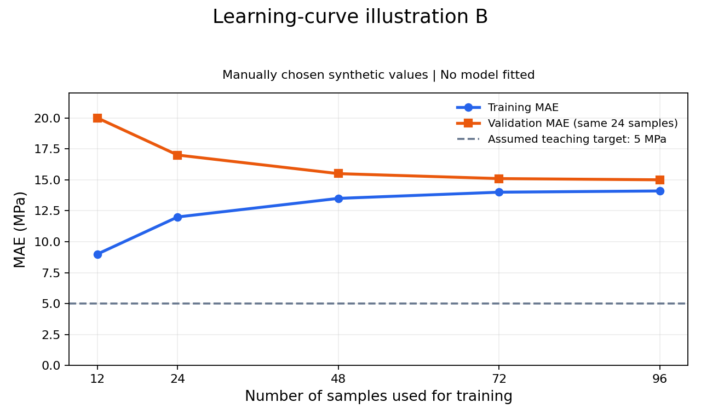

# 单元09：学习曲线与K折交叉验证——练习与运行记录

状态：学习中；2026-10-29启动。本文件保存实验预设、新synthetic CSV及学生实际代码。[6]首稿真实返回值数量错误已保留，[7]提示后修正并输出120/30分组shape；[12]已提示后修正ID导出并保存，两个ID文件核验通过；尚无模型评价分数。

## 工作簿与运行环境

Notebook：`unit09-learning-curves-kfold-cross-validation.ipynb`。本地工作簿位于D:/CodexProject/ML_learning/learning/exercises/，继续使用已安装的Unit 07 (.venv)内核；名称只表示复用环境。

教师侧仅查询了Python与安装包版本：Python3.10.11、scikit-learn1.7.2、NumPy2.2.6、pandas2.3.3、Matplotlib3.10.7、JupyterLab4.6.4、nbformat5.11.1。这是环境元数据，不是模型执行或干净环境复现证据。

## 实验预设（在数据生成和查看结果前固定）

本单元只使用全新的 **synthetic data（人工模拟数据）**，不复用单元08的CSV、训练/验证/测试分组或已知分数。以下数量和设置为生成前固定的实验设计。2026-10-30已完成CSV准备与学生120/30划分；96/24、K折和模型评价仍未执行，不能把计划当实际评价结果。

- 教学问题：单一输入 ZrB2_wt_pct → 模拟目标 UTS_MPa。wt.%数值1表示1 wt.%，UTS单位MPa；关系为数学教学设定，不是7085Al强化机制或实验标定。
- 新数据配方：NumPy default_rng(20261029)；先生成150个Uniform(0,2)输入，再生成150个Normal(0,6)噪声；模拟目标为465 + 60*x - 24*x**2 + noise。不按预期图形重抽样或更换种子。
- 以sample_id固定追溯行身份。原始输入X预期shape=(150,1)，目标y沿用二维列约定(150,1)；这些是计划shape，运行后另核验。
- 在任何拟合、选模、目标散点图或指标分析之前，用train_test_split(test_size=0.2, random_state=20261030)分离120条开发数据、30条独立保留测试数据。记录索引；保留测试不预览目标、作图、参与曲线或交叉验证。
- 先在开发数据内部按test_size=0.2、random_state=20261031建立固定96训练/24验证的入门学习曲线。训练子集顺序按固定划分返回顺序保留；样本量预设为12、24、48、72、96。每点重新训练完整Pipeline，训练误差仅在对应训练子集上计算，验证组固定。有限曲线无需严格单调。
- 然后在全部120条开发数据内部用KFold(n_splits=5, shuffle=True, random_state=20261032)，两个候选共用同一组折索引。每折计划96训练/24验证；只用开发数据，不把保留测试混入K-fold。
- 仅比较两个预设候选：StandardScaler → LinearRegression（一次线性回归）；PolynomialFeatures(degree=4, include_bias=False) → StandardScaler → Ridge(alpha=1.0)。次数和强度是在查看结果前给定的教学方案，不由单元08最优值迁移，不开展网格搜索或新模型。
- 每个训练子集和每个训练折都拟合自己的完整Pipeline。PolynomialFeatures没有学习均值/方差，但仍封装在折内；StandardScaler只学习本训练部分的均值/方差，验证只transform/predict。
- 评价使用不含正则化惩罚项的MAE（MPa）。使用cross_validate时明确scoring='neg_mean_absolute_error'并将负分转换成正MAE；实际键名、输入/输出与shape在代码教学时逐段解释。
- 报告5个验证折的MAE、算术平均值、描述性标准差（本单元预定np.std(ddof=0)），并声明标准差反映该固定划分下的折间波动，不是置信区间或所有未知材料的误差保证。训练折高度重叠，不把5折当成5次独立材料实验。
- 若依据开发CV选定一个方案，先冻结选择、流水线与最终评价步骤，才可用全部开发数据重拟合并一次评价本单元保留测试；不凭测试结果改次数、alpha、划分或种子。本阶段没有开放测试执行。
- learning_curve函数放在理解K折后再实现CV学习曲线；输入为完整Pipeline和原始开发数据，训练量指每折训练部分使用的样本量。函数输出的二维分数数组与fold维度由学生先判断。
- GroupKFold仅讲分组独立性原理；本轮不生成虚构炉次、不完成分组实践。真实炉次或文献来源需有实际元数据并匹配预测目标。

## 证据记录规则

每次代码教学先解释输入、输出、shape和来源。学生先写，教师先审查并提示，再由学生运行保存；没有真实输出就标“未运行”。教师辅助检查与学生运行分开记录；所有图像先由学生独立判断趋势、原因与限制，不预填诊断或候选排名。


## 当前练习与证据

启动阶段概念入口（历史题面）：模型的多项式次数和Ridge的alpha都保持固定。要画训练样本数分别为12、24、48时的误差点：你会分别用对应数量的训练样本重新fit，还是先用全部训练样本fit一次，再换不同数量的样本计算误差？请说明理由。

首次学生代码：尚无。  
实际数据生成/划分：尚未执行。  
实际拟合、预测、评分、图像：尚无。  
教师参考模型运行：未进行。  
学生Notebook顺序运行验收：未进行。

不得将实验预设数量、计划shape、示意曲线、纸上计算或教师解释当作模型实测输出。待学生逐段写代码并运行后，保留真实源码、首次错误、提示、修正及实际输出。

## Q0首次概念回答与提示（2026-10-29）

学生原答：“第二种吧，原因不会”。选择的是“全部训练样本fit一次，再改变评分样本量”，本题选择错误，理由未说明。没有提交代码，也没有实际执行。

教师只给概念提示：如果先用96条synthetic训练样本fit，再取其中12条计算误差，模型的系数仍是从96条数据学来的；只减少评分样本没有减少训练时的信息。横轴写“训练样本数12”时，应代表模型实际用多少条学习？请据此重新选一次并说明理由。

当时状态（历史）：尚未收到提示后复答，不记纠正/通过，不开启下一知识点或运行。本次不修改Notebook，不生成或评分任何synthetic模型；实验预设全部不变。

## Q0提示后纠正与Q1入口（2026-10-29）

学生提示后完整原答：“横轴标为“12条训练样本”的那个点，模型实际应该用12条数据来 fit，选第一种，第二种的模型系数是从96条数据学来的，不会因为只对训练样本数为12、24、48时的误差点评分，就忘记其他点”。

核心选择和理由正确：知道12条点应以12条拟合，全部96条fit后只减评分数不能代表只训练12条。记为提示后纠正，原首次错误和教师提示保留；尚无不同情境独立复查或实际程序运行。

下一教学检查Q1：仍是synthetic data的计划情境，尚未运行：训练池共96条，当前模型只取其中12条fit，另有固定24条验证数据。这个横坐标为12的点，它的训练MAE应该在参与fit的12条样本上计算，还是在整个96条训练池上计算？为什么？

当时状态（历史）：学生Q1原答待收，先作概念解释，暂不写代码。未读取/改写/执行Notebook，未生成或划分新数据、拟合、预测或评分；实验预设不变。

## Q1首次正确与Q2入口（2026-10-29）

Q1学生首次原答：“在参与拟合的这12条上计算，其他的训练样本未参与fit”。计算应限参与拟合的12条及未参与fit的其余训练池样本区别均正确，记本题首次作答正确。不是Q0的不同情境独立复查，也不计正式8题。

教师下一点讲解：同一个已用12条样本fit的模型，还会对固定24条验证样本作预测，再比较这些预测与对应的synthetic目标，得到该点的验证MAE；这个评分过程不在验证数据上重新fit。这里是固定划分版学习曲线，之后K折各折的验证组按另一规则轮换。

Q2题面：在固定划分版学习曲线中，训练样本量依次为12、24、48，每次都重新fit。为什么我们用同一组24条验证样本比较这些模型的验证MAE，而不是每次重新抽一组验证样本？

当时状态（历史）：Q2尚无学生答案；没有学生代码、数据生成/划分、fit、predict、MAE或图像实际执行。本轮Notebook与实验预设均未改。

## Q2求助与教学节奏调整（2026-10-29）

学生原文：“不会，感觉这章节有点跳跃，不太理解”。未提交错误理由或代码，记求助及教学反馈，不记新增错误，不按原抽象题反复催答。

教师暂停后续操作，先补比较逻辑：先用材料实验的控制变量作类比：假设同时改变颗粒含量和时效制度，就不能把UTS变化只归因于颗粒含量。学习曲线想比较训练样本量变化；若同时更换验证样本，误差变化还掺入评价样本变化。固定同一批验证样本，让各训练量的模型接受同样的评价；这不保证误差一定下降，也不等于对全部未知材料的保证。这里只补比较逻辑，不推进代码或K折。

Q2a（讲解后理解检查）：如果训练样本增加的同时，也换了一批验证样本，验证MAE下降了：除了训练数据更多，还有哪一种变化也可能让误差下降？

当时状态（历史）：尚无Q2a答案或新运行证据。既有Q0首错与提示后纠正、Q1首次正确均保留；没有Notebook/数据/代码操作，也不更换任何预设。

## Q2a讲解后确认与Q3安排表（2026-10-29）

学生原答：“了一批更容易或更难预测的样本”。已识别评价样本变化，不记新的错误，归为讲解后辅助确认；原求助及教师讲解保留，不写成Q2首次独立理由。学生识别了验证样本本身变化这一额外因素。针对题设的MAE下降，教师补充一种可能是换到更容易预测的样本；更难样本可能导致误差上升。这一方向说明是教师补充，不将学生的概括答复另记错误，也不冒称其已独立完整解释。

教师将已有概念连接为表格：

以下为synthetic data教学安排，尚未执行；表中数字是样本数量，不是MAE值。每行都重新fit一个模型，次数/alpha等设置固定；同一行的两个MAE来自该行同一个模型。

| 实际用于fit的样本数 | 训练MAE在哪些样本上算 | 验证MAE在哪些样本上算 |
| ---: | --- | --- |
| 12 | 这12条训练样本 | 固定的24条验证样本 |
| 24 | 这24条训练样本 | 同一组24条验证样本 |
| 48 | 这48条训练样本 | 同一组24条验证样本 |

每行产生两个待计算误差值。真正画图时纵轴放MAE（MPa），训练MAE与验证MAE分别连接成两条线；现在没有实际误差值或图像，不预先判断趋势。

下一检查Q3：验证样本始终是24条，那么验证误差曲线的横轴，为什么仍然是12、24、48，而不是一直为24？

当时状态（历史）：Q3尚无答案。本轮无学生代码、Notebook修改、数据生成/划分或模型fit/predict/评分；表格是计划，不是运行日志。所有预设和原有资产保持不变。

## Q3首次正确与Q4教师示意图（2026-10-29）

学生Q3首次原答：“横轴数字是训练样本数量”。指出验证曲线也以训练样本数量作横轴，核心正确，记本题首次回答正确；此前求助/教师补讲和原首错均保留，不升级为延迟独立复查。

教师手工指定读图练习数列：训练样本数[12,24,48,72,96]；训练MAE[1.0,2.0,3.0,3.5,4.0]；验证MAE[14.0,10.0,7.0,6.0,5.5]（MPa）。全部是人为设定的synthetic教学示意值，不来自真实材料、单元09预设数据或任何模型拟合/评分。教师仅用Matplotlib将这些数列渲染为1280×768 PNG，不代表实际学习曲线必然如此，也不提供Ridge/线性方案的性能证据。

教师生成图像：[unit09-learning-curve-illustration.png](figures/unit09-learning-curve-illustration.png)。本地原图SHA256：420CAF7A026E0F9C9B84E925246506E39ED15E4A65779CC45854B1E73DD8143F；Git blob：582c654b833087f042c6f86b796f63ec4f522bbd。教师目视确认标题、两坐标轴、两条线、图例与合成来源标注清晰。


Q4只问：随着训练样本从12条增加到96条，蓝色训练MAE曲线与橙色验证MAE曲线之间的差距怎样变化？ 当时状态（历史）：尚无学生原答，不给诊断答案。

本次仅绘制教师示意PNG，不公开完整Python解法代替后续学生学习曲线练习。没有运行学生Notebook、生成预设150条材料CSV、划分训练测试、fit模型、predict或计算模型评分。正式8题尚未开始，原预设和Notebook不变。

## Q4首次读图正确与Q5概念类比（2026-10-29）

学生Q4首次原答：“差距越来越小”。读图观察正确，记本题首次正确，但不是实际模型评价或独立绘图；没有给原因、Bias/Variance标签或真实性能证据。

教师将注意力转到示意图蓝线：本图的训练MAE随训练样本数增加而上升。这个趋势由教师指出，不能冒充学生已独立描述。接着用同一一次线性模型的少点/多点类比让学生先解释可能原因，不直接给原因或Bias/Variance结论，不声称真实MAE必然单调上升。

Q5：先用一次线性回归作概念类比（synthetic示意情境，不是图中MAE数值的计算来源）：同样用一条直线，拟合两个横坐标不同的点，和拟合许多不完全共线的点，哪一种更容易让每个训练点的误差都很小？

当时状态（历史）：Q5尚无答案；继续慢节奏、一次一个原因。未生成新图、执行学生Notebook、生成材料CSV、划分或拟合/预测/评分；此前PNG与手工数列保持不变，正式8题仍未开始。

## Q5首次选B与几何提示（2026-10-29）

学生首次原答：“情况B”。本题选择错误，理由未说明；仅记录观察到的选择，不替学生编造错误原理。

教师提示：这里先只看训练点上的误差。请先看情况A的两个横坐标不同的点：能不能画出一条直线，同时穿过这两个点？如果能，这两个点的预测值与目标值之间的差是多少？先回答这一步，再回到原来的A/B比较。

当时状态（历史）：只等待这一几何小步的真实答案，再回到原A/B比较和训练MAE；尚未给完整纠正版或记录通过。没有学生代码、Notebook修改、新图或模型执行，原synthetic示意PNG和实验设计不变。

## Q5局部求助补档、几何子步正确与Q6入口（2026-10-29）

学生对几何提示的原答：“能，差不知道”。其中“能”正确；“差不知道”是求助，未给错误数值，不新增计算错误。该次局部记录此前仅在本地交接，现补齐。

教师解释：直线穿过训练点，代表在该输入处预测值等于目标纵坐标，预测值减目标值为0。synthetic手算例的目标UTS500MPa、预测500MPa，差为0MPa；两训练点都被穿过时两误差均0、训练MAE也0。这是教师说明，不是学生自主算出的数值，也不是模型运行或原PNG的计算来源。

教师随后题面：加入第三个点，而且三个点不共线；允许重新调整直线的斜率和截距，还能用一条直线同时穿过这三个点吗？

学生原答：“不能，两点确定一条直线”。在此前几何提示及零误差讲解之后，正确判断不共线三点不能被同一直线同时穿过，理由正确，记提示/讲解后的几何子步正确，不计原A/B首次独立正确或延迟独立复查。

教师归纳：原A/B比较中，A的两个不同横坐标点可由一条直线同时穿过，训练误差可为0；B许多不完全共线点无法全部同时穿过，直线需要折中。因此同一模型形式在样本很少时可能把训练点拟合得非常好，加入更多有散布的样本后训练MAE可能上升。这里只说明一种可能原因，不保证实际MAE严格单调，也不由训练误差上升直接判定未知样本预测变差。原A/B的选A和这段曲线解释由教师总结，不冒充学生已独立改选或说出完整原因。

当前Q6：回到原来的教师示意图：橙色验证MAE随着训练样本数从12条增加到96条，是上升、下降，还是基本不变？ 当时状态（历史）：尚无学生答案。继续看原PNG，未重画或换手工数列。图像SHA256复核仍420CAF7A026E0F9C9B84E925246506E39ED15E4A65779CC45854B1E73DD8143F。

本轮只是概念讲解与读图衔接，没有执行学生Notebook或新代码，也没有生成材料CSV、划分、fit、predict或计算模型评分。正式8题尚未开始，实验预设不变。

## Q6读图补档、Q7判断正确与Q8入口（2026-10-29）

Q6首次原答：“下降”。对橙色验证MAE下降的观察正确，记本题首次正确；前一轮只记本地交接的记录现已补齐，不伪造程序运行。

Q7题面：在这张示意图表达的情境中，虽然训练MAE上升，模型在固定的24条验证样本上的预测表现是变好还是变差？你依据哪条曲线判断？

学生首次原答：“变好，依据橙色验证曲线判断”。判断及依据均正确，记本题首次回答正确；题面已限定这24条固定验证样本，不能因学生未额外主动列全部泛化边界而降级或追加门槛。教师补充的准确范围：仅在教师synthetic示意图设定和这组验证样本上误差更小，不能替代实际运行、真实材料实验或全部未知材料保证。

当前Q8：模型形式和验证集都没变，为什么增加训练样本，可能让模型对验证样本预测得更准？请先提出一种可能解释，不需要公式。 当时状态（历史）：尚无学生解释，不预填正确原因或分类。

继续使用同一张人为设定synthetic MAE PNG，没有新数值/图片、学生代码或Notebook运行，没有材料数据生成、划分、fit、predict、评分或测试集使用；原实验预设和正式8题未开始状态不变。

## Q8合理可能原因与Q9入口（2026-10-29）

学生Q8首次原答：“增加的训练样本中可能有偶然的样本对预测验证样本更加有利”。

这是合理的可能解释：新增训练样本的具体组成可能恰好让拟合关系更适合当前固定验证组。本题只要求提出一种可能原因，学生已满足，不因未说出教师预设的噪声/Variance机制而判错或追加通过门槛。不能把‘可能’写成已证实的实际原因，也不能据此推断学生主动用验证集筛选训练点或发生数据泄漏；原答没有这样的操作。 记本题首次提出合理可能解释，不当作实际模型证据。

教师再补充一种常见可能机制：训练样本很少时，个别偏高/偏低的样本可能较明显地影响拟合关系；新增有代表性、质量相近的数据后，模型可能更受共同趋势约束，对个别偶然波动不那么敏感，从而改善验证误差。该机制有前提，不保证数据越多验证MAE必降，也不是从手工示意图证实的因果结论；这是教师解释，不冒充学生自述。

当前Q9：在一个新的synthetic概念情境中，数据总体趋势明显弯曲，模型却始终只用一条直线。只增加同类训练样本、不改模型形式，能让这条直线自动获得描述弯曲趋势的能力吗？ 当时状态（历史）：尚无学生答案，不预填结论。

本轮没有代码/Notebook/图像/CSV操作，没有实际数据生成、划分、拟合、预测、模型评分或测试集使用；原固定候选、配方和随机种子保持。教学问答Q8/Q9不是结课正式题号，正式8题仍未开始。

## Q9首次正确与教师示意图B（2026-10-29）

学生Q9首次原答：“不能，线性弯曲趋势的能力和模型形式有关”。学生正确判断不能，并将描述弯曲趋势的能力关联模型形式，核心解释正确，记本题首次回答正确；不为‘线性弯曲趋势’的表达另立错误或要求机械重答。题设限定原始单一特征的一次直线模型，不将结论扩大成所有对参数线性的模型都不能拟合曲线；多项式回归仍可对参数线性。该限定是教师精确说明，不冒充学生本轮主动说过。

教师手工指定图B数列：训练样本数[12,24,48,72,96]；训练MAE[9.0,12.0,13.5,14.0,14.1]；验证MAE[20.0,17.0,15.5,15.1,15.0]（MPa）。虚线5MPa表示人为假设的教学目标MAE≤5MPa，不是7085Al工程标准、实验要求或已知不可约噪声基准。全部为synthetic教学示意值，教师只用Matplotlib渲染，没有拟合模型或生成预设150条材料数据，也不把图B归属为本单元线性/Ridge候选的真实分数。

图像：[unit09-learning-curve-illustration-b.png](figures/unit09-learning-curve-illustration-b.png)，1280×768；SHA256 B192524CAC3046D68387A7E3611296095BDB4FB16FA7222BD9CD73746CC461F1；Git blob 223b0818946670bf334a12334b2ead9ce57748a1。教师已目视核验坐标、图例、synthetic/No model fitted与5MPa教学目标标注清晰。



当前Q10：看示意图B右侧（训练样本较多时）：两条MAE虽然接近，但相对虚线标出的教学目标，它们的误差水平如何？ 尚无学生回答，不提前给诊断结论或读图答案。

本轮仅教师渲染PNG，无学生代码、Notebook运行、材料CSV生成、划分、fit/predict/评分或测试集使用。图A不变，两个实际候选及种子/数据配方不变。正式结课8题未开始。

## Q10/Q11首次读图正确与Q12入口（2026-10-30）

Q10题面：“看示意图B右侧（训练样本较多时）：两条MAE虽然接近，但相对虚线标出的教学目标，它们的误差水平如何？” 学生首次原答：“误差没有达到目标要求”，观察正确。此前仅本地记录现补齐。

Q11题面：“当训练样本从48条增加到96条时，橙色验证误差还在明显下降，还是已经趋于平缓？” 学生首次原答：“趋于平缓”，观察正确。均为教师手工synthetic图B的读图证据，不是实际拟合或评价分数。

教师连接（非学生自述）：结合前面“用直线描述弯曲趋势”的模型限制设定，图B可用来示意高Bias（欠拟合）的一种表现：模型连训练数据的主要规律也未描述充分，继续增加同类样本的改善可能有限。这是有背景条件的synthetic概念说明，不是已运行模型的诊断；不能仅凭两线接近、任意5 MPa教学目标或曲线趋平就排除噪声等其他原因。

下一题Q12回看既有图A：“只看图A最左侧12条训练样本的那个位置：这更像高Bias（欠拟合）还是高Variance（过拟合）的常见表现？请依据训练误差和验证误差说明。” 尚无学生回答。没有新图像、Notebook、CSV或代码修改，没有数据生成/划分、fit/predict/评分；正式8题未开始，固定数据配方、候选和封存测试设计不变。

## Q12首次正确，进入数据读取与封存（2026-10-30）

学生首次原答：“左侧12条，模型训练误差显著低于验证误差，为过拟合”。本题问常见表现，学生正确判断过拟合并给出训练误差显著低于验证误差的依据，记首次回答正确；不因未主动补充题外限制而降为提示后。教师将其联系到高Variance（方差大）常见信号，但不把单点差距当成真实模型原因的确定证明。

### 教师实际完成的数据准备

2026-10-30教师按生成前冻结的NumPy default_rng(20261029)配方生成150条新synthetic data：先Uniform(0,2)输入，再Normal(0,6)噪声，目标465+60*x-24*x**2+noise。CSV三列sample_id、ZrB2_wt_pct、UTS_MPa；ID为U09-001至U09-150，仅追溯行身份，不作模型特征。以17位有效数字保存浮点数并核验往返数值一致，SHA256为1486c2ffd5758f68fdd79b4d1cd3743e6e7aa6363d5e2dfcc43fbb67a468f165，Git blob为3b5d51dce533d7fcfd25f4e4db1630a96d7c45e4。不是实验结果，不含材料机制或真实UTS性能依据。

文件：[data/unit09-learning-curves-synthetic.csv](data/unit09-learning-curves-synthetic.csv)。教师只生成一次并检查150×3结构、ID唯一与CSV精度，没有筛种子、划分样本、拟合/预测/评分或查看目标分布/散点图。原Unit08测试集完全未用。

Notebook仅更新教师Markdown，保留8格结构和唯一纯注释代码格。代码格整体（含source、execution_count、outputs、metadata）规范化JSON摘要SHA256前后相同：e98788da2025539910a5b9c4789885ba7d56213c69e62fd2975022ae6dcd7eb0；执行计数null、outputs=[]。nbformat静态校验通过，不是Notebook执行。更新后Notebook SHA256：d3f1f50ff05daccb6d1c15ff032c8b3a43b9fcd5b821ecb2e123cb11514c15f2，Git blob：5f2be24b1dc999e000d6d0aefde8a21fdfb686d3。

### 实践第1步原任务（历史，现已提示后完成）

在单元09 Notebook的已有代码格中，导入pandas和train_test_split；读取data/unit09-learning-curves-synthetic.csv为df09；保持原CSV行顺序，用test_size=0.2、random_state=20261030一次划分为df09_dev和df09_holdout；只打印两者shape，先发代码检查，不运行或展示目标。

输入df09预期(150,3)，输出开发df09_dev预期(120,3)、封存df09_holdout预期(30,3)，均含ID/输入/目标三列；sample_id不作为feature。输出对象与shape是预期，不是实际运行证据。先查代码再由学生执行；保持CSV原行序、不按目标排序/筛样本，不预览封存测试目标、统计量或图。之后保存分组ID，并仅在开发数据内构建曲线与K折。除数据生成阶段已完成外，全部候选/随机种子和既定协议不变。

## 实践第1步：真实首错、提示与修正运行（2026-10-30）

### 学生首次提交的完整源码

```python
import pandas as pd
df09 = pd.read_csv("data/unit09-learning-curves-synthetic.csv")

X09 = df09[["ZrB2_wt_pct"]]
y09 = df09[["UTS_MPa"]]

from sklearn.model_selection import train_test_split
df09_dev, df09_holdout = train_test_split(X09,y09,test_size = 0.2,random_state = 20261030)
print(df09_dev.shape, df09_holdout.shape)
```

本地Notebook首稿代码格[6]真实错误：

```text
ValueError: too many values to unpack (expected 2)
```

该次print未执行，无shape输出。读取和双中括号取列正确；错误在四返回对象仅赋给两变量，不是CSV/随机种子/泄漏问题。

### 提示与纠正层级

学生首稿已实际运行并保存为代码格[6]，报ValueError: too many values to unpack (expected 2)，没有shape输出。教师解释train_test_split对每个输入返回两份，两输入X/y会返回四份，提示本步整表划分以保留sample_id。学生随后原答“df09”，属提示后的对象识别；教师再明确提示以df09替换X09,y09，尚未给完整修正代码。学生修正版已运行为[7]，截图与本地保存版一致，stdout为(120, 3) (30, 3)。记提示后修正并成功运行，不记首次独立完成或延迟独立复查；不能由执行计数6/7推断未见的其他尝试。

修正后的实际划分行：

```python
df09_dev, df09_holdout = train_test_split(df09,test_size = 0.2,random_state = 20261030)
```

学生[7]保存的真实stdout：

```text
(120, 3) (30, 3)
```

教师未执行学生代码或补算分组，以上取自学生截图和已保存Notebook。初稿中的split函数已被调用但赋值解包失败，不能写成从未调用，也不能由其错误假定保留测试已被用于选模。当前无error不抹去此前真实异常。

### 当前证据与文件

这是150条新synthetic教学数据的实际读取/划分证据，不是模型评价或材料实验性能。test_size=0.2、random_state=20261030与原CSV行序保持；df09_dev为120×3，df09_holdout为30×3，三列sample_id/ZrB2_wt_pct/UTS_MPa同行保留。保留测试目前仅展示shape，未见目标预览、统计或模型使用。分组ID尚未导出，不宣称身份清单已经封存到文件；后续曲线/CV仅用开发数据。无模型fit/predict/评分、96/24内部划分或K折运行，正式8题未开始。

当前教师仅更新Notebook Markdown，唯一学生代码格的source、execution_count=7、完整stdout及metadata保持原样。代码格整体规范化JSON摘要前后均为2128e38eb8a5e8f4eead420fb661c94121304bdebc2b77fc4276e8752a724ac6；静态nbformat校验通过，不是教师执行Notebook。更新前学生保存版SHA256为83d99ef03d626833446ad465d8b98f0571ff03ddc1f8c0cebe366593d921f27b；更新后Notebook 12131字节，SHA256 8c25caa95e5354d2af9f41d7d43bbd3f80c5b527aa16673504f26fbd7d5da044，Git blob 4ee2221721370c0a3727e9dc13756dfc8ce8f7fb。原CSV SHA256仍1486c2ffd5758f68fdd79b4d1cd3743e6e7aa6363d5e2dfcc43fbb67a468f165。

### 当时下一小步：保存分组身份（历史，当前结果见后）

新建代码格，从df09_dev和df09_holdout各选sample_id一列，分别保存为data/unit09-dev-ids.csv和data/unit09-holdout-ids.csv。使用.to_csv(..., index=False)；index=False是不额外写入pandas行索引，sample_id列仍保留。输入为120×3和30×3，选列后为120×1和30×1，输出是对应数量的一列CSV。先发两行代码检查，暂不运行；不重新划分、不打印/保存UTS目标到这两个ID文件。

参考：[pandas CSV写入说明](https://pandas.pydata.org/docs/user_guide/io.html#writing-out-data)。当时两个ID文件尚未生成，未提前验收；现已由下方实践2记录补齐全部首稿、提示、真实修正与文件核验。

## 实践第2步：CSV导出的两稿错误与修正（2026-10-30）

### 第一稿：路径赋值与对象引用

```python
data/unit09-dev-ids.csv = df09[["sample_id"]].to_csv(df09.dev, index=False)
data/unit09-holdout-ids.csv = df[["sample_id"]].to_csv(df09.holdout, index=False)
```

学生实际代码格[9]：SyntaxError: cannot assign to expression here. Maybe you meant '==' instead of '='? (18608364.py, line 13)，无stdout。语法分析阶段整格停止；其他潜在变量/属性问题仅为静态检查，不编造额外实际异常。教师给通用模板`table.to_csv("data/example.csv", index=False)`，解释表格/引号路径的调用位置、无需路径=，及下划线变量不同于点号属性访问；原本先请学生只改开发行、在聊天发送。

### 第二稿：组别和选列已对，路径引号与逗号仍缺

```python
df09_dev[["sample_id"]].to_csv(data/unit09-dev-ids.csv index=False)
df09_holdout[["sample_id"]].to_csv(data/unit09-holdout-ids.csv, index=False)
```

学生实际代码格[11]：SyntaxError: invalid syntax. Perhaps you forgot a comma? (4058408734.py, line 13)，无stdout，整格未执行。教师提示两行路径都加双引号，给第一条路径的字符串片段，并指出第一行路径与index=False之间补逗号；未代写完整实际两行。index=False始终正确。执行计数不证明其他未见尝试。

### 第三稿、保存及真实文件证据

```python
df09_dev[["sample_id"]].to_csv("data/unit09-dev-ids.csv", index=False)
df09_holdout[["sample_id"]].to_csv("data/unit09-holdout-ids.csv", index=False)
```

学生在两轮语法提示后提交正确保存代码截图，两个ID文件已实际生成。第一次只读时磁盘Notebook仍为[11]错误版；教师请求Ctrl+S，学生明确回复“已保存”，随后只读核验为[12]正确源码、stdout为(120, 3) (30, 3)、无error输出。记提示后修正并成功运行，不记首次独立完成、独立复查或教师批准后才运行；教师未提供本任务完整两行代写答案。

两个CSV均只含sample_id列：开发120行、保留测试30行，组内唯一、组间互斥，并集与原CSV150个ID完全一致。教师仅在原始ID序列上用预设RandomState(20261030)重建排列以核对文件顺序，两组顺序均精确匹配；未使用UTS目标列分析、拟合模型或评分，不把元数据核验冒充学生模型实验。

| 文件 | 实际数据shape | SHA256 |
| --- | --- | --- |
| [unit09-dev-ids.csv](data/unit09-dev-ids.csv) | (120, 1) | 3f522e8f90a26000a1fa0fd4c46efeacad5cfd5a0b91b2e227bff991be2e8ae6 |
| [unit09-holdout-ids.csv](data/unit09-holdout-ids.csv) | (30, 1) | 04221b8d952d5f35e62255214998fbe3499917c361a81675bd1ba23017b3789a |


上表shape为CSV数据行数×列数，不含表头。开发ID文件1091字节、Git blob 8c39ae8a0c144a7af091066f0e1a3af57685c573；保留ID文件281字节、Git blob 3e96fdc163b19b9d100d76e3edc9c49e96b92acc。源CSV SHA256仍1486c2ffd5758f68fdd79b4d1cd3743e6e7aa6363d5e2dfcc43fbb67a468f165。全部为新synthetic教学数据的身份清单，不是实验目标或模型性能。

### Notebook归档与当前下一步

本轮原样归档学生确认保存的Notebook，教师没有编辑任何Markdown、代码、输出或metadata，也没有执行Notebook。文件12490字节，SHA256 ee4f7edb310945d36ef1a94b635449fd2327b68b890412aceb11d45872ed3002，Git blob 8610788c52f718e176c61a108f6134994a4b9945；唯一学生代码格[12]、stdout与metadata整体规范化摘要为13269a0cf0065ca31463eb078da3fd4d1558442f8c4a273b17f94ecc2832cb72。仅做nbformat静态校验，未声称重启/Run All或独立复现。原Notebook早期任务说明仍作为已有教学记录，当前进度以本节及progress为准。

当前下一步：新建代码格，用train_test_split只划分df09_dev，依次接收为df09_train_pool和df09_val；test_size=0.2、random_state=20261031；打印两表shape，先发代码检查，暂不运行。

输入是已封存测试后留下的120×3开发表，预期得到96×3训练样本池和24×3固定验证表。训练池供后续12/24/48/72/96各训练量取样，每个点重新拟合完整Pipeline；同一24条验证样本评价所有这些点。此处test_size参数名只表示分给第二组的比例，第二组在本步骤的角色是验证集。30条holdout继续封存，不参与曲线、CV或模型选择。96/24尚未实际执行，不能提前记作运行输出。
