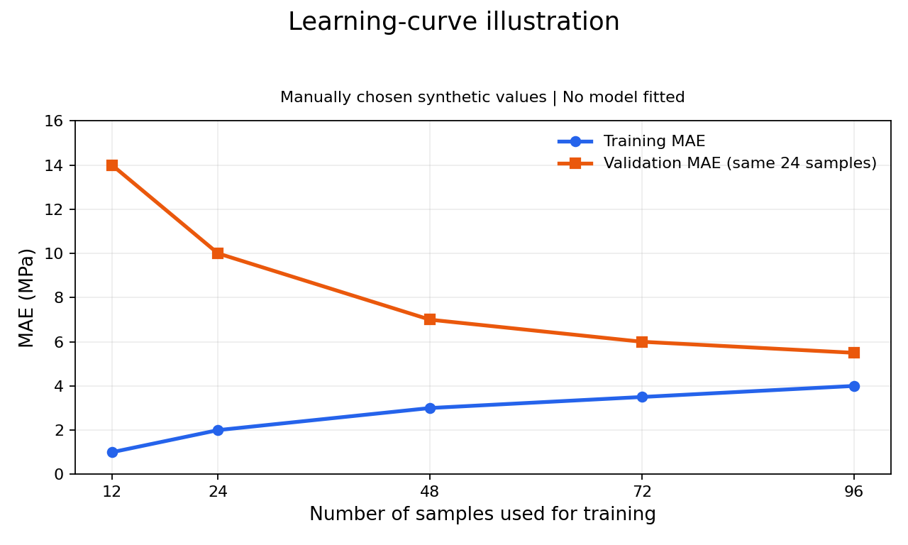
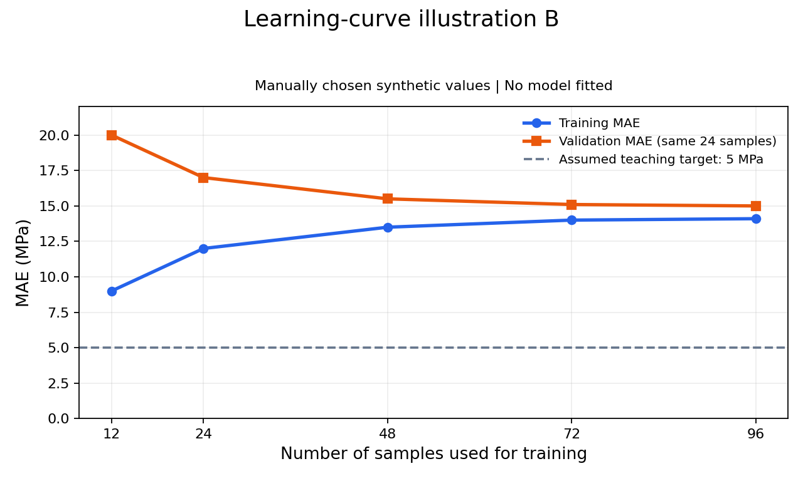
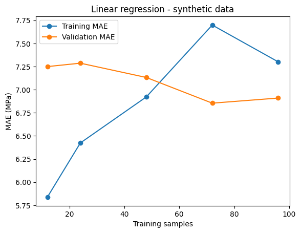
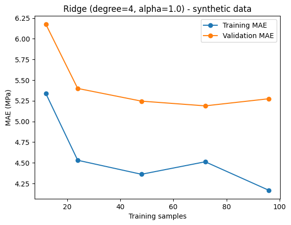

# 单元09：学习曲线与K折交叉验证——练习与运行记录

状态：学习中。实践23首次代码正确并保存std 0.599 MPa，实践22均值MPa标签已核验修复；尚无Ridge CV。

## 最新检查点：标准差已运行，进入报告解释（2026-11-07）

实践23：教师此前讲解“偏差→平方→求平均→开方”，只给通用API 数组.std(ddof=0)，没有代写具体赋值/打印或代算真实标准差。学生首次具体代码与实际输出正确：

```python
std_mae09_linear = mae09_linear_folds.std(ddof=0)
print(f"标准差：{std_mae09_linear:.3f} MPa")
```

保存stdout：`标准差：0.599 MPa`。输入为本单元synthetic开发数据实际CV产生的五折MAE数组mae09_linear_folds，shape (5,)；输出是一个标准差标量，单位MPa。本次ddof=0，分母为5，描述这五折MAE的散布，不作为置信区间、单条误差上限或未知材料性能保证。不是教师重新运行模型得到的参考分数。

实践22格式提醒已修复并核验：均值格[9]保存stdout为`五折平均MAE:  7.391  MPa`。当前可报告一次线性方案五折平均MAE 7.391 MPa、折间标准差0.599 MPa（ddof=0）；仅保留三位显示，不伪造更高精度。

只读核对并原样归档Notebook：150904字节，SHA256 c79bfdfad09e154963bc60735220b6cb9f6e6fb7e01621d406f311a57e31891b，Git blob 7c797acbbad588f3703ce0d02b6267c258dc9319；9个代码格，计数[1,2,3,4,5,6,7,9,13]，nbformat静态有效，无保存error。前7格源码及stdout与上次归档一致，第6/7格计数改变，不能据此确认重启/Run All，也不宣称学生未重跑CV。均值格补单位，新增标准差格。教师未执行Notebook、模型、评分或.std()，未编辑Notebook/原始课程目录。

Q32首次原答：“乙的五折MAE更分散，其数字分布不均”。首次核心判断正确，日常解释方向正确；教师补充甲全为7、乙范围3—11，不冒称学生独立说出了补充细节，也不把“分布不均”按正式均匀分布术语追罚。这两组是手工构造、未运行模型的synthetic教学数列，不能与实际CV结果混写。

下一教学检查Q33（待首次回答，不计正式8题）：当前报告为五折平均MAE 7.391 MPa、折间标准差0.599 MPa（ddof=0）。这能否保证每一个未知材料样本的预测误差都不超过“平均MAE＋标准差”？为什么？

正式8题未开始；Ridge CV、最终选模、GroupKFold原理认识仍待推进。保持120条synthetic开发数据、30条封存测试、四个随机种子和两个预设方案，不重筛种子/大规模调参，测试集未用于选择。

以下为历史检查点，待答/待补等状态以本节为准。

## 上一检查点：Q31求助讲解与实践22均值输出（2026-11-03）

Q31学生原答“不知道”，记求助、没有独立理由，不新增错误。教师没有继续拆诱导小问或追问整题，而用真实synthetic第2折6.422/第3折8.280 MPa（三位显示）解释只报最小值未反映其他折，再讲五折平均MAE=五个MAE之和/5及通用数组.mean()。这是教师讲解，不能记学生已独立解释Q31；对汇总意义的自主理解稍后检查。

教师只给通用.mean()含义、输入/输出说明和标量赋值/三位MPa打印任务，没有代写这两行或代算均值。

实践22截图与保存索引12[9]一致：mean_mae09_linear = mae09_linear_folds.mean()，以f-string的:.3f打印，实际显示“五折平均MAE:  7.391”。基于原始五折数组求均值及三位小数格式首次代码正确，已运行；输入(5,)来自本单元synthetic开发集实际CV，输出是一个平均值标量，物理单位仍MPa，未重新训练。

实际源码：

```python
# 计算五折平均MAE：数组.mean() 可以求平均值
mean_mae09_linear = mae09_linear_folds.mean()
print(f"五折平均MAE:  {mean_mae09_linear:.3f} ")
```

保存stdout原文（此处保留单位标签尚未补上的事实）：

```text
五折平均MAE:  7.391 
```

原print字符串末尾没有MPa。教师提示在输出文字末尾补单位，计算本身正确，不将标签遗漏判算法错误/新增第9项，也不推断学生认为它无量纲；单位补注尚未收到新保存核验，无需为小标签修改单独多轮确认，不阻塞下一概念。只获得三位显示值7.391，不补造更长均值精度；后续计算继续用原数组/变量。

Notebook原样150265字节，SHA256 51560e3011beb9839d8f0a8d73942cc52f5b2df2c793ac29e3f5569e017edee5，Git blob 7ef65d5a249f94c4a3a882e7a3ea096b13a7cfe4，8格原始规范化摘要36eadbb0aa13b31025f015759a873747c2c99ce7e9e8c93b952a39972fc40549。前7格完整摘要仍bf2b9084a019c98d9fbea8cf3a1c3c77e5f7eef8d32ae3af617ea0e9d013f66f，与上一归档一致；只新增均值格，未重跑CV。计数[1,2,3,4,5,7,8,9]，全文件无error、nbformat静态有效，不凭编号追认重启/Run All。内嵌/独立两PNG与四CSV/ID/manifest hash保持，教师只读/原字节归档，未运行.mean或模型、未计算参考均值/std或改Notebook。

30条独立测试继续封存，120条synthetic开发数据、两个预设完整方案/参数及四seed保持。当前已得一次线性五折平均MAE的实际显示结果，还没有折间std/Ridge CV/最终选模，正式8题未开始；toy数列与真实输出分开，不称材料实验性能或所有未知材料保证。

### 当前教学检查Q32：相同均值、不同散布（待答，不计正式8题）

以下是人为构造、未运行模型的synthetic五折MAE教学数列，不是实际一次线性/Ridge分数，也不是材料实验结果：

| 教学数列 | 五折MAE（MPa） | 平均MAE（MPa） |
| --- | --- | ---: |
| 甲 | 7、7、7、7、7 | 7 |
| 乙 | 3、5、7、9、11 | 7 |

题面：两组平均MAE相同，哪组五折MAE更分散？请用这些数字说明。先由学生比较，尚无回答，不预填组别或原因，不要求标准差公式/精确数值。此步只建立折间波动直觉，随后再定义/计算描述性std，不同时加入Ridge或独立测试评价。

## 上一检查点：实践21首次代码正确并运行保存（2026-11-03）

实践21截图与本地保存格[8]一致：mae09_linear_folds = -neg_mae09_linear，随后正确打印数组与shape。在教师给通用逐元素取反提示后，学生首次具体赋值/打印代码正确并实际运行，无本步错误或纠错；不扩大为整套CV完全独立实现或旧错误独立复查通过。

学生实际代码：

```python
# 在数组名前加 -，会逐元素取相反数
mae09_linear_folds = -neg_mae09_linear
print(mae09_linear_folds, mae09_linear_folds.shape)
```

保存stdout：

```text
[7.25421522 6.42174577 8.2799882  7.61102202 7.38939505] (5,)
```

输入来源为实践20真实CV返回的neg_mae09_linear数组(5,)，每个元素为相应折-MAE；输出mae09_linear_folds(5,)逐元素取相反数，对应五折非负MAE，单位MPa。打印行由学生正确写出，没有新增shape/标量错误，也没有新fit或CV调用。

Notebook原样149791字节，SHA256 f7e3f55b091a7ec49bfe30c1a6653c36d9b2f3bc842aedb8c154f36a01ba186a，Git blob 6dc86e2c3da8993e528e77761625b04132ae16cf；7格原始规范化摘要bf2b9084a019c98d9fbea8cf3a1c3c77e5f7eef8d32ae3af617ea0e9d013f66f。前6格完整摘要仍b1cff197e7bcf979c9eeae9f09c5821a563de7d05eaf45f10914258132304bea，与上一归档一致；只新增本步数组转换格，未重新运行CV。计数[1,2,3,4,5,7,8]，无error、nbformat静态有效，不据编号声称重启/Run All。两内嵌PNG、四CSV/ID/manifest及两独立PNG hash保持；教师只读核验保存输出并原字节归档，未计算参考模型/均值/std、未执行学生代码或改Notebook。

五个MAE来自同一120条synthetic开发数据的五折验证，各折24条验证、96条训练，顺序对应folds09第1—5折，单位MPa。保存输出是NumPy显示精度，不补造更长浮点；仍未有平均MAE/标准差的代码运行结果。30条独立测试继续封存，两候选/参数/四seed不变，尚无Ridge CV或最终模型冻结，不把这些数字当真实材料实验或未知材料保证；正式8题未开始。

### 当时教学检查Q31（历史题面，求助后已讲解）

题面：如果只报告这五折中最小的MAE，能否充分概括这次交叉验证的整体表现？为什么？先让学生解释汇总动机，暂不写代码。

学生后来答“不知道”，已由教师讲解，见最新入口；未记独立回答通过，不要求提前掌握统计术语。随后再逐点介绍五折平均MAE与折间描述性标准差的含义/代码，先不代算汇总，也不执行Ridge/独立测试。

## 上一检查点：实践20真实五折评分与帮助层级（2026-11-03）

实践20一次线性完整Pipeline交叉验证已由学生实际运行成功，保存格[7]正确采用StandardScaler→LinearRegression、原始X09_dev/y09_dev和同一folds09，scoring="neg_mean_absolute_error"。多余的提前fit已删除；每折完整管道重新拟合，没有独立全开发数据预标准化。cv09_linear["test_score"]按键取值和打印均成功，实际shape(5,)，全文件无error。这里test_score是五个验证折，未使用30条封存独立测试。

### 讲解与代码帮助（补齐此前本地记录）

过程帮助层级补齐：Q30学生原答“4.2”在明确MPa的synthetic手算题下首次换算正确，教师补单位不降级；该4.2不是实际CV分数。实践20学生先答“不会”，属于求助而非错误；教师给完整旧两步管道和填X/y/cv的函数骨架，学生后三个映射首次代码正确。首稿额外提前fit仅多余，因为cross_validate会按折克隆未训练的完整管道并重新fit，不将其判CV泄漏或新增第9项；尚无该多余fit实际执行证据。后续字典取值行由教师示范，学生自行写的打印数组/shape首次正确。本步记教师支架后成功运行，不升级完整独立CV编程或旧错独立复查。

原支架前任务曾要求构造/调用/打印一起完成，学生求助后实际缩为填X/y/cv；所以随后未打印不判漏项。最初聊天稿带提前pipe09_linear_cv.fit(X09_dev,y09_dev)，教师建议删掉作为流程简化，未判算法错误。已只读核对本机sklearn1.7.2的cross_validate源码在每折_fit_and_score使用clone(estimator)，新副本不带已fit参数；没有执行该函数验证参考分数。

### 当前实际CV代码部分（同保存格内，首折分组检查保留）

```python
    # 用 cross_validate 自动执行五折：每折的标准化和模型拟合都只使用该折的96条训练数据。
scaler09_cv = StandardScaler()#创建标准化器
reg09_cv = LinearRegression()
        
pipe09_linear_cv = Pipeline([
    ("scale", scaler09_cv),
    ("reg", reg09_cv),
])

# cross_validate 会为每折创建未训练副本，再用该折的96条训练数据重新拟合，不沿用提前学到的参数。
from sklearn.model_selection import cross_validate

# cv09_linear 是字典，即按名称保存结果的容器：
cv09_linear = cross_validate(
    estimator=pipe09_linear_cv,
    X=X09_dev,
    y=y09_dev,
    cv=folds09,
    scoring="neg_mean_absolute_error",
)#X：120条开发样本的输入表。y：对应的UTS目标表。cv：刚生成的五折安排列表。

# 这行取出五个验证折的 负MAE评分。这里的 test_score 指验证折评分
neg_mae09_linear = cv09_linear["test_score"]

print(neg_mae09_linear, neg_mae09_linear.shape)
```

实际CV输出（原文显示精度；不是Q30手算或教师重算）：

```text
[-7.25421522 -6.42174577 -8.2799882  -7.61102202 -7.38939505] (5,)
```

输入数据源为既有synthetic开发样本120条，X09_dev/y09_dev各(120,1)，原始ZrB2输入与模拟UTS目标，sample_id未作特征。cv=folds09给出相同五折，每折96训练/24验证。输出字典按test_score键取五个验证折评分，数组(5,)，顺序对应folds09的第1—5折。未得到正MAE数组/均值/std的新运行证据，不把打印的舍入值当完整底层精度，也不填模拟的“真实材料分数”。

本次Notebook原样149299字节，SHA256 ec33cd9b0282ee6cbcb439c8f4e890c7a1aab4b6d9ddd9cdd49913a9107f8733，Git blob 1e2173b9c79b22162f646e62f12fbef74816f752；6格原始规范化摘要b1cff197e7bcf979c9eeae9f09c5821a563de7d05eaf45f10914258132304bea。前5格完整摘要仍41743c183bd618cbf7e527abc4731c587655d377812ef2830ce1620e167cc52d，与上一归档一致，旧源代码/完整输出/metadata保留。计数[1,2,3,4,5,7]，nbformat静态有效；不据此声称观察重启/Run All。两内嵌PNG、四CSV/ID/manifest及两独立PNG hash保持，教师没有运行学生或参考模型，只读核验保存输出并原字节归档。

原30条独立测试保持封存，其他候选/参数/四seed不变；本次是既定一次线性方案开发集CV的程序结果，尚无Ridge CV或最终方案冻结，正式8题未开始。

### 当时实践21：将负评分转换成MAE（历史任务，现已完成）

不再重复Q30标量换算。请在新代码格对现有neg_mae09_linear整体取相反数，保存为mae09_linear_folds，打印数组及shape。给通用提示：负号放在数组名前，会逐个元素取相反数；不代写实际赋值和print两行。

输入是本次synthetic开发数据真实CV运行产生的五值负评分数组(5,)，输出预期是五折非负MAE数组(5,)，单位MPa。只转换已有评分，不需要重新训练；写好后允许直接运行该格、Ctrl+S保存并提交输出，不为这一步另加代码审批。该任务现已完成，源码/实际输出见最新入口；此处保留当时任务，均值/std和Ridge仍待后续。

## 上一检查点：实践19提示后完成与真实折分输出（2026-11-03）

实践19已提示后补齐并运行成功：在正确kf09构造后、读取folds09[0]前加入folds09 = list(kf09.split(X09_dev))。实际输出列表长度5，第一折训练位置96个、验证位置24个，shape分别(96,)和(24,)；保留初始解包/shape正确、len漏输出提示后补齐及随后第8项实际NameError的完整阶段，不改为整步首次独立完成。

当前实际保存的代码格：

```python
# k折交叉验证
X09_dev = df09_dev[["ZrB2_wt_pct"]]
y09_dev = df09_dev[["UTS_MPa"]]
print(X09_dev.shape, y09_dev.shape)

    # 创建KFold分组规则对象
from sklearn.model_selection import KFold
kf09 = KFold(n_splits = 5, shuffle = True, random_state = 20261032) #分组规则
folds09 = list(kf09.split(X09_dev)) #用 list(...) 收集 kf09.split(X09_dev) 的结果，并赋给 folds09

train_idx09, val_idx09 = folds09[0]  # folds09[0]:取第一折，其中包含两组编号，可以用两个变量接收; len(folds09)：查看列表里有几份安排
print(len(folds09),train_idx09, val_idx09, train_idx09.shape, val_idx09.shape)
```

实际stdout原文：

```text
(120, 1) (120, 1)
5 [  1   2   3   4   7   9  11  12  13  14  15  16  17  18  19  21  22  23
  25  26  27  28  29  30  32  33  35  36  37  39  40  41  43  44  45  46
  47  49  50  51  52  54  55  56  57  58  59  60  61  63  64  65  66  67
  69  70  71  72  73  74  77  78  79  80  82  83  84  86  87  88  90  92
  93  94  96  97  98  99 100 101 102 103 104 106 107 108 110 111 112 113
 114 115 116 117 118 119] [  0   5   6   8  10  20  24  31  34  38  42  48  53  62  68  75  76  81
  85  89  91  95 105 109] (96,) (24,)
```

输入是现有120条synthetic开发样本X09_dev(120,1)与固定kf09规则；folds09输出五份分组安排，第一折接收为两条一维位置数组，shape不等于实际特征表的(96,1)/(24,1)。尚未按这些编号取实际样本或调用模型训练/评分。

教师只解析学生已保存stdout，确认第一折两组位置各自唯一、不重叠，合并覆盖当前开发表0—119全部120个位置；不是独立运行KFold生成参考分组，没有拟合模型。位置编号代表当前开发表行位置，不是ZrB2特征值、sample_id或原DataFrame索引标签。只有第一折行号被打印；五折列表长度已实际输出，不冒称其他四折全部逐一展示。

最终归档Notebook原始148000字节，SHA256 c9f856b962f02176a4cb3af22ef44b6496f49f2f579dec395852e49caaca0a82，Git blob dc9022a5fb6eb4bc4c07ee3521898c7a74ba9b15；6格原始规范化摘要17c03257a0e90553e47b53d29983792da5793401e79a2411dc7f217c2951a6ca，前5格完整摘要41743c183bd618cbf7e527abc4731c587655d377812ef2830ce1620e167cc52d。读取过程中先见[27]，随后保存版更新为计数[1,2,3,4,5,6]，源码和首折输出一致，最终格[6]无error、nbformat静态有效；学生没有明确报告重启/Run All，不仅凭连续编号声称观察到了该操作。

前5格源码、全部stdout与上一归档逐项一致，两内嵌PNG以及源CSV、开发/holdout ID、split manifest和两独立PNG的hash均保持。计数/显示等随重跑变化，不称旧整格完整规范化JSON未变。教师仅只读核验/解析保存输出并原样归档，未执行学生Notebook、split、模型fit/预测/评分或重绘。120条synthetic开发数据、30条封存独立测试、两预设方案/参数/四seed保持；没有新的CV模型性能或材料实验结果，正式8题未开始。

### 当时教学检查Q30：负MAE换算（历史题面，现已答）

准备进入cross_validate前，只讲评分约定：scikit-learn的scorer按“返回值越大越好”比较；MAE本身按“越小越好”，所以scoring="neg_mean_absolute_error"返回-MAE。负号属于评分接口，实际MAE仍非负。对应[scikit-learn 1.7.2官方评分说明](https://scikit-learn.org/1.7/modules/model_evaluation.html#scoring-string-names)。

单一口头题：某折返回-4.2，这是明确的synthetic手算教学示例，不是当前Notebook运行分数。若换回MAE并用MPa报告，应写多少？当时尚未回答；现已首次答对，见最新入口。该题未同时加入均值、标准差或完整CV代码。讲解后的首次应用不当作旧错独立复查或正式8题。

后续直接进入完整Pipeline配合现有folds09的cross_validate，不重复已学的手动切片/单折训练整套流程；独立测试集区别稍后单独确认。原30条holdout继续封存，本单元尚无任何真实CV模型评分。

## 上一检查点：实践19两阶段首稿与真实NameError（2026-11-02）

实践19首份聊天代码的双变量接收和两数组shape查询正确，额外打印两组行号可接受；但总折数len(folds09)只在注释中出现，尚未打印。教师只提示把len(folds09)加入现有print，允许补后直接运行保存，不代写整行。该漏输出当时不登记算法错误，也没有当时的运行异常证据。

第一份聊天源码：

```python
train_idx09, val_idx09 = folds09[0]  # folds09[0]:取第一折，其中包含两组编号，可以用两个变量接收; len(folds09)：查看列表里有几份安排
print(train_idx09, val_idx09, train_idx09.shape, val_idx09.shape)
```

学生随后“已保存，报错”。只读保存Notebook索引10[25]，实际源码已把len(folds09)加入print，但在上一行train_idx09, val_idx09 = folds09[0]抛出NameError: name 'folds09' is not defined。此前只打印开发输入(120, 1) (120, 1)，末尾含len/数组/shape的print尚未执行，没有实际五折列表长度、首折行号或shape结果。

当前实际保存的失败代码格原文：

```python
# k折交叉验证
X09_dev = df09_dev[["ZrB2_wt_pct"]]
y09_dev = df09_dev[["UTS_MPa"]]
print(X09_dev.shape, y09_dev.shape)

    # 创建KFold分组规则对象
from sklearn.model_selection import KFold
kf09 = KFold(n_splits = 5, shuffle = True, random_state = 20261032)

train_idx09, val_idx09 = folds09[0]  # folds09[0]:取第一折，其中包含两组编号，可以用两个变量接收; len(folds09)：查看列表里有几份安排
print(len(folds09),train_idx09, val_idx09, train_idx09.shape, val_idx09.shape)
```

真实输出：

```text
(120, 1) (120, 1)
NameError: name 'folds09' is not defined
```

异常发生于本格第10行，创建正确kf09之后、末尾print之前；完整原始traceback/outputs保留在原样Notebook中，未代算任何折分。

保存源码已正确创建kf09规则，却没有生成并赋值folds09。规则对象不会自动创建名为folds09的结果列表；本次缺列表生成步骤与实际NameError登记为第8项。不能倒写为此前已经观察报错，不能把它解释成KFold参数错误或把已正确的解包/len/shape判错，也不猜测学生遗漏的动机。

当前最小提示：回看前一条“用split产生、list收集五折安排并赋给folds09”的示范句，把它放在创建kf09之后、读取folds09[0]之前。只补这一步，补后可直接运行当前格、Ctrl+S保存并提交实际输出；未重贴完整修正版/整套CV代码，没有新修正答案或成功折分证据。

Notebook原始字节148855，SHA256 3afdbb2b765853b64ad5648f0fb64dea412e7b4f945938c2f92629471ebc2a43，Git blob 563504f885e14d6a836648ab165a6e93b814c2d0；全部6个原始代码格规范化摘要c4c241a0499f8ac50acfc8422cf9efa8b889f8031bb6fa2f08cb2c8c79fca297，前5格当前完整摘要25f5eecbf96f2901c45653fe47cf1f866aded894c50b13696a4cbde1947909c1。计数[19,20,21,22,23,25]，nbformat静态有效，含这一次实际NameError。旧5格源码、全部stdout及两内嵌PNG与上一归档逐项一致；执行计数等发生更新，不能说整格outputs/metadata规范化摘要未变，也不推断重启/Run All或未见的中间执行。

源CSV、开发/holdout ID、split manifest及两独立PNG的hash仍保持。只有120条synthetic开发数据参与本单元流程，30条独立测试继续封存；两预设完整方案、参数和四seed保持。教师只读核验/原字节归档，没有执行Notebook、split、模型拟合/预测/评分或重绘。本次报错不产生新的CV性能证据，正式8题尚未开始。

## 上一检查点：实践18提示后修正与实际保存（2026-11-02）

实践18已在教师局部提示后修正，并保存实际执行证据。截图中True和无中文分号均正确；复读本地Notebook索引10[17]，源码为kf09 = KFold(n_splits = 5, shuffle = True, random_state = 20261032)，stdout仍为开发输入两个(120,1)，全文件无error。KFold赋值本来不额外打印对象，结合该格正确源码/执行输出确认构造成功，不把旧shape输出当作五折训练结果。

当前实际保存代码格（包含先前开发输入准备）：

```python
# k折交叉验证
X09_dev = df09_dev[["ZrB2_wt_pct"]]
y09_dev = df09_dev[["UTS_MPa"]]
print(X09_dev.shape, y09_dev.shape)

    # 创建KFold分组规则对象
from sklearn.model_selection import KFold
kf09 = KFold(n_splits = 5, shuffle = True, random_state = 20261032)
```

stdout为(120, 1) (120, 1)。输入准备部分的来源仍df09_dev，输出X/y各(120,1)；构造部分的输入是三个配置值，输出KFold规则对象，无数据表shape或新MAE。缩进的单独注释行不构成代码缩进错误，不因此另立问题。

第一遍只读曾遇到尚未同步的旧ture源码，短暂复读后正确版本已写入；这是保存时点差异，不新增错误，也不冒称曾观察到旧稿SyntaxError/NameError。原聊天首稿、中文分号是否在Notebook中的条件说明、种子非日期的释疑与提示层级保留。此步记“提示后修正并实际构造成功”，不是首次完整构造正确或独立复查通过。

Notebook原始字节147014，SHA256 820b489635dd8042e83f3b9d9eb6a4580fda7618702e9ea9998aaa29a9700c42，Git blob ca4ad5c4655b75852da6a206ad1132e9c9c14497；全部6个原始代码格规范化摘要2f90111567a6be95e323afc2730626598048baab0b626b89c7f6bf0091b13518。计数[1,2,3,9,12,17]，无error，nbformat静态有效；不据编号推断重启/Run All或未见的第16次执行内容。

前五个代码格的规范化摘要仍2620e1272b9acd0ed8073b5793a5d5c2fda399721f90638c505c6379b178fb9a，源CSV、开发/holdout ID、split manifest及线性/Ridge两PNG的hash均不变。教师没有执行Notebook、KFold分组、拟合、预测、评分或重绘，只读核验并原样归档学生文件。

### 当时实践19：观察折分内容（历史任务，首稿及报错已收到）

新API用法示范：

```python
folds09 = list(kf09.split(X09_dev))
```

输入是既定kf09规则和现有X09_dev(120,1)，来源为同一份synthetic开发数据；split按规则给出每折两组行位置编号，list将五份安排收集成列表。位置从0开始，针对当前开发表的行顺序，不是sample_id或原DataFrame索引标签。这里只生成分组信息，不拟合模型或计算MAE；30条holdout不参与。

folds09[0]取列表第一份安排，其中先训练行号、后验证行号。说明可以用两个变量接收这两个结果，沿用此前多变量接收写法，不引入next/enumerate或双层索引。请学生补代码：用train_idx09、val_idx09接收第一折，然后打印列表长度及两数组shape；len(列表)返回元素个数。预期长度5、首折行号数组shape为(96,)和(24,)，这些只是待核验的预期，不是当前已运行输出。暂不取实际样本或写模型训练循环。

先在聊天提交补充代码检查，不代写完整KFold/Pipeline/cross_validate全流程；首次新API示范属于教师提供，不计整套独立实现。参考：[scikit-learn 1.7.2 KFold.split官方文档](https://scikit-learn.org/1.7/modules/generated/sklearn.model_selection.KFold.html#sklearn.model_selection.KFold.split)。

## 上一检查点：实践18首稿与静态检查（2026-11-02）

学生首次聊天源码原样保存：

```python
# 创建KFold分组规则对象
from sklearn.model_selection import KFold
kf09 = KFold(n_splits = 5, shuffle = ture, random_state = 20261032)；#2026年10月没有32号哦
```

静态检查：导入、对象赋值结构、n_splits=5与random_state=20261032均正确；shuffle=ture没有写成题目要求的布尔常量True，ture会按变量名解释；按聊天原样作为Python代码时，行末中文全角分号“；”不符合语法；如果它也写入Notebook，请删除，若只是聊天标点则不据此判Notebook有错。本轮只有聊天源码，尚无实际运行输出或新保存确认；未核验磁盘，也不编造实际SyntaxError/NameError。

随机种子释疑：20261032是实验前固定的整数设置，不是日期，不要求存在“2026年10月32日”。它用于控制随机过程复现；继续保留该预设，不因为外观像日期而更换。学生的注释是提问/疑问，不登记为实际换seed、筛选分数或模型划分错误。

教师提示：对照上一步参数表中的True，检查ture的字母顺序和大小写；如果行末中文全角分号“；”也在Notebook源码中，将其删除；这一行赋值不需要它，注释直接用#。只让学生修改这两处并提交修正后的kf09构造行，未提供整行完整修正版，也未继续split/cross_validate。

本步输入是五折、是否打乱及固定随机种子等配置，预期输出KFold规则对象，没有数据数组shape；尚无该对象实际构造证据。数据来源仍为随后计划使用的120条synthetic开发样本，30条独立测试封存。本轮没有新Notebook/数据/图像写入，也没有模型执行；Notebook最近已核验/归档版本仍为前一检查点146831字节、SHA256 8f48fa7c08e88f676e5bdad4dbaacb651bdca330a599b44b862a1b9c47430418，本轮未重新读取磁盘。

当前仅等待修正后的kf09那一行，不预填提示后完成或实际构造成功。正式8题仍未开始，无新的K折索引、fit、预测或MAE。

## 上一检查点：实践17首次正确并已运行保存（2026-11-02）

学生首次提交以下三行代码，来源、列名、二维单列与打印对象均正确；是在给定变量映射和已有pool/val选列模式下完成，不扩大为完整KFold独立实现。

```python
# k折交叉验证
X09_dev = df09_dev[["ZrB2_wt_pct"]]
y09_dev = df09_dev[["UTS_MPa"]]
print(X09_dev.shape, y09_dev.shape)
```

学生“已保存”后，教师只读Notebook索引10代码格[15]，源码与聊天一致，实际stdout：

```text
(120, 1) (120, 1)
```

输入来源是既有120条synthetic开发数据df09_dev(120,3)；X09_dev为单列原始ZrB2含量，y09_dev为配对模拟UTS，各(120,1)。sample_id不作特征，原30条holdout未读取评分。旧96/24都属于开发数据，后续CV用全部120；没有新的fit、预测、MAE或真实K折索引输出。

### 本次保存证据

Notebook原始字节146831，SHA256 8f48fa7c08e88f676e5bdad4dbaacb651bdca330a599b44b862a1b9c47430418，Git blob 32f86b6cce1a3cc5c191cbef9534c7059052017c。全部6个原始代码单元规范化JSON摘要SHA256为0f252c4a1d7b559695dd392e41d8298819783825e0ae791f84ea6942f1ad8606；前5个仍为2620e1272b9acd0ed8073b5793a5d5c2fda399721f90638c505c6379b178fb9a，与上一归档一致。保留源码、完整输出及metadata，未编辑Notebook。计数[1,2,3,9,12,15]，无error；静态nbformat校验通过，不据计数推断重启/Run All。

源CSV、开发/holdout ID、split manifest及线性/Ridge两张独立PNG的SHA256均与上一检查点一致，原先五量分数和图未重算。本轮教师只读/校验/原样上传，不执行学生或参考模型。

Q27角色计数、Q28训练折统计量来源、Q29验证transform已有首次核心正确答复，完整原文/评价见测验档；没有新增错误、独立编程复查或正式8题。

### 当时实践18：创建KFold对象（历史任务，首稿现已提交）

先示范新API的导入：

```python
from sklearn.model_selection import KFold
```

本步只用配置参数创建名为kf09的对象。三个参数：n_splits=5表示五折；shuffle=True表示打乱样本行号后确定折分组；random_state=20261032是实验前固定的复现种子，不为追求分数更换。请学生按“变量名 = 类名(参数名=值, ...)”的通用构造格式，自己写创建kf09的一行并先提交检查。未提供完整cross_validate代码，也未执行新对象/折分。

输入是三个设置值，输出是KFold规则对象，不是数据数组，因此没有样本表的shape或性能分数。后续将用于现有120条synthetic开发数据；30条holdout保持封存。实际折索引、Pipeline逐折训练与评分留到后续小步，不在此时预填。

参考：[scikit-learn 1.7.2 KFold官方文档](https://scikit-learn.org/1.7/modules/generated/sklearn.model_selection.KFold.html)。

## 上一检查点：完成固定验证比较，K折仍处于原理教学（2026-11-02）

Q21读Ridge曲线、Q22固定验证完整方案比较、Q23单次划分波动、Q24第一折构成、Q25跨折角色转换和Q26不能直接复用旧模型评分均已有首次核心正确的口头答复，原文及评价见测验档。Q25当时的概括理由未冒称包含全部拟合细节；Q26明确指出B已参与第一折训练。没有新增代码、Notebook执行或CV分数。

固定96条训练/24条验证的既有synthetic运行证据：一次线性完整方案验证MAE6.909 MPa；四次特征→StandardScaler→Ridge(alpha=1.0)验证MAE5.275 MPa（三位显示，原始精度仍保留在既有列表）。仅说明这次固定验证组，不单独归因于Ridge，不作材料实验结论或最终冻结选模。

下一实验仍按原预设：全部120条开发数据实施KFold(n_splits=5, shuffle=True, random_state=20261032)，两个完整Pipeline使用相同折分，每折96训练/24验证。每折完整Pipeline只在本折训练部分fit；30条holdout继续封存。这里只记录既定方案，尚未让学生实现/运行KFold、cross_validate、neg_mean_absolute_error或折间标准差；不得填入预测的折分数。

当前仅展示A—E各24条的五轮角色示意，详见理解笔记。当时Q27题面为五折角色次数；现已首次答对，见最新入口。此轮没有新代码输入/输出或shape证据，不把数量示意冒充实际数组输出。

本次归档只更新四份Markdown档案与progress；原Notebook、CSV/ID/manifest、两张真实PNG及原课程文件均未写入或重新执行。最近Notebook/图的已核验快照仍为上一检查点，不声称本次重新检查了本地磁盘；Notebook代码/输出/metadata均保持原归档版本。

## 工作簿与运行环境

Notebook：`unit09-learning-curves-kfold-cross-validation.ipynb`。本地工作簿位于D:/CodexProject/ML_learning/learning/exercises/，继续使用已安装的Unit 07 (.venv)内核；名称只表示复用环境。

教师侧仅查询了Python与安装包版本：Python3.10.11、scikit-learn1.7.2、NumPy2.2.6、pandas2.3.3、Matplotlib3.10.7、JupyterLab4.6.4、nbformat5.11.1。这是环境元数据，不是模型执行或干净环境复现证据。

## 实验预设（在数据生成和查看结果前固定）

本单元只使用全新的 **synthetic data（人工模拟数据）**，不复用单元08的CSV、训练/验证/测试分组或已知分数。以下数量和设置为生成前固定的实验设计。2026-10-30已完成CSV准备与学生120/30划分；96/24、K折和模型评价仍未执行，不能把计划当实际评价结果。

- 教学问题：单一输入 ZrB2_wt_pct → 模拟目标 UTS_MPa。wt.%数值1表示1 wt.%，UTS单位MPa；关系为数学教学设定，不是7085Al强化机制或实验标定。
- 新数据配方：NumPy default_rng(20261029)；先生成150个Uniform(0,2)输入，再生成150个Normal(0,6)噪声；模拟目标为465 + 60*x - 24*x**2 + noise。不按预期图形重抽样或更换种子。
- 以sample_id固定追溯行身份。原始输入X预期shape=(150,1)，目标y沿用二维列约定(150,1)；这些是计划shape，运行后另核验。
- 在任何拟合、选模、目标散点图或指标分析之前，用train_test_split(test_size=0.2, random_state=20261030)分离120条开发数据、30条独立保留测试数据。记录索引；保留测试不预览目标、作图、参与曲线或交叉验证。
- 先在开发数据内部按test_size=0.2、random_state=20261031建立固定96训练/24验证的入门学习曲线。训练子集顺序按固定划分返回顺序保留；样本量预设为12、24、48、72、96。每点重新训练完整Pipeline，训练误差仅在对应训练子集上计算，验证组固定。有限曲线无需严格单调。
- 然后在全部120条开发数据内部用KFold(n_splits=5, shuffle=True, random_state=20261032)，两个候选共用同一组折索引。每折计划96训练/24验证；只用开发数据，不把保留测试混入K-fold。
- 仅比较两个预设候选：StandardScaler → LinearRegression（一次线性回归）；PolynomialFeatures(degree=4, include_bias=False) → StandardScaler → Ridge(alpha=1.0)。次数和强度是在查看结果前给定的教学方案，不由单元08最优值迁移，不开展网格搜索或新模型。
- 每个训练子集和每个训练折都拟合自己的完整Pipeline。PolynomialFeatures没有学习均值/方差，但仍封装在折内；StandardScaler只学习本训练部分的均值/方差，验证只transform/predict。
- 评价使用不含正则化惩罚项的MAE（MPa）。使用cross_validate时明确scoring='neg_mean_absolute_error'并将负分转换成正MAE；实际键名、输入/输出与shape在代码教学时逐段解释。
- 报告5个验证折的MAE、算术平均值、描述性标准差（本单元预定np.std(ddof=0)），并声明标准差反映该固定划分下的折间波动，不是置信区间或所有未知材料的误差保证。训练折高度重叠，不把5折当成5次独立材料实验。
- 若依据开发CV选定一个方案，先冻结选择、流水线与最终评价步骤，才可用全部开发数据重拟合并一次评价本单元保留测试；不凭测试结果改次数、alpha、划分或种子。本阶段没有开放测试执行。
- learning_curve函数放在理解K折后再实现CV学习曲线；输入为完整Pipeline和原始开发数据，训练量指每折训练部分使用的样本量。函数输出的二维分数数组与fold维度由学生先判断。
- GroupKFold仅讲分组独立性原理；本轮不生成虚构炉次、不完成分组实践。真实炉次或文献来源需有实际元数据并匹配预测目标。

## 证据记录规则

每次代码教学先解释输入、输出、shape和来源。学生先写，教师先审查并提示，再由学生运行保存；没有真实输出就标“未运行”。教师辅助检查与学生运行分开记录；所有图像先由学生独立判断趋势、原因与限制，不预填诊断或候选排名。


## 早期练习与证据（历史）

启动阶段概念入口（历史题面）：模型的多项式次数和Ridge的alpha都保持固定。要画训练样本数分别为12、24、48时的误差点：你会分别用对应数量的训练样本重新fit，还是先用全部训练样本fit一次，再换不同数量的样本计算误差？请说明理由。

首次学生代码：尚无。  
实际数据生成/划分：尚未执行。  
实际拟合、预测、评分、图像：尚无。  
教师参考模型运行：未进行。  
学生Notebook顺序运行验收：未进行。

不得将实验预设数量、计划shape、示意曲线、纸上计算或教师解释当作模型实测输出。待学生逐段写代码并运行后，保留真实源码、首次错误、提示、修正及实际输出。

## Q0首次概念回答与提示（2026-10-29）

学生原答：“第二种吧，原因不会”。选择的是“全部训练样本fit一次，再改变评分样本量”，本题选择错误，理由未说明。没有提交代码，也没有实际执行。

教师只给概念提示：如果先用96条synthetic训练样本fit，再取其中12条计算误差，模型的系数仍是从96条数据学来的；只减少评分样本没有减少训练时的信息。横轴写“训练样本数12”时，应代表模型实际用多少条学习？请据此重新选一次并说明理由。

当时状态（历史）：尚未收到提示后复答，不记纠正/通过，不开启下一知识点或运行。本次不修改Notebook，不生成或评分任何synthetic模型；实验预设全部不变。

## Q0提示后纠正与Q1入口（2026-10-29）

学生提示后完整原答：“横轴标为“12条训练样本”的那个点，模型实际应该用12条数据来 fit，选第一种，第二种的模型系数是从96条数据学来的，不会因为只对训练样本数为12、24、48时的误差点评分，就忘记其他点”。

核心选择和理由正确：知道12条点应以12条拟合，全部96条fit后只减评分数不能代表只训练12条。记为提示后纠正，原首次错误和教师提示保留；尚无不同情境独立复查或实际程序运行。

下一教学检查Q1：仍是synthetic data的计划情境，尚未运行：训练池共96条，当前模型只取其中12条fit，另有固定24条验证数据。这个横坐标为12的点，它的训练MAE应该在参与fit的12条样本上计算，还是在整个96条训练池上计算？为什么？

当时状态（历史）：学生Q1原答待收，先作概念解释，暂不写代码。未读取/改写/执行Notebook，未生成或划分新数据、拟合、预测或评分；实验预设不变。

## Q1首次正确与Q2入口（2026-10-29）

Q1学生首次原答：“在参与拟合的这12条上计算，其他的训练样本未参与fit”。计算应限参与拟合的12条及未参与fit的其余训练池样本区别均正确，记本题首次作答正确。不是Q0的不同情境独立复查，也不计正式8题。

教师下一点讲解：同一个已用12条样本fit的模型，还会对固定24条验证样本作预测，再比较这些预测与对应的synthetic目标，得到该点的验证MAE；这个评分过程不在验证数据上重新fit。这里是固定划分版学习曲线，之后K折各折的验证组按另一规则轮换。

Q2题面：在固定划分版学习曲线中，训练样本量依次为12、24、48，每次都重新fit。为什么我们用同一组24条验证样本比较这些模型的验证MAE，而不是每次重新抽一组验证样本？

当时状态（历史）：Q2尚无学生答案；没有学生代码、数据生成/划分、fit、predict、MAE或图像实际执行。本轮Notebook与实验预设均未改。

## Q2求助与教学节奏调整（2026-10-29）

学生原文：“不会，感觉这章节有点跳跃，不太理解”。未提交错误理由或代码，记求助及教学反馈，不记新增错误，不按原抽象题反复催答。

教师暂停后续操作，先补比较逻辑：先用材料实验的控制变量作类比：假设同时改变颗粒含量和时效制度，就不能把UTS变化只归因于颗粒含量。学习曲线想比较训练样本量变化；若同时更换验证样本，误差变化还掺入评价样本变化。固定同一批验证样本，让各训练量的模型接受同样的评价；这不保证误差一定下降，也不等于对全部未知材料的保证。这里只补比较逻辑，不推进代码或K折。

Q2a（讲解后理解检查）：如果训练样本增加的同时，也换了一批验证样本，验证MAE下降了：除了训练数据更多，还有哪一种变化也可能让误差下降？

当时状态（历史）：尚无Q2a答案或新运行证据。既有Q0首错与提示后纠正、Q1首次正确均保留；没有Notebook/数据/代码操作，也不更换任何预设。

## Q2a讲解后确认与Q3安排表（2026-10-29）

学生原答：“了一批更容易或更难预测的样本”。已识别评价样本变化，不记新的错误，归为讲解后辅助确认；原求助及教师讲解保留，不写成Q2首次独立理由。学生识别了验证样本本身变化这一额外因素。针对题设的MAE下降，教师补充一种可能是换到更容易预测的样本；更难样本可能导致误差上升。这一方向说明是教师补充，不将学生的概括答复另记错误，也不冒称其已独立完整解释。

教师将已有概念连接为表格：

以下为synthetic data教学安排，尚未执行；表中数字是样本数量，不是MAE值。每行都重新fit一个模型，次数/alpha等设置固定；同一行的两个MAE来自该行同一个模型。

| 实际用于fit的样本数 | 训练MAE在哪些样本上算 | 验证MAE在哪些样本上算 |
| ---: | --- | --- |
| 12 | 这12条训练样本 | 固定的24条验证样本 |
| 24 | 这24条训练样本 | 同一组24条验证样本 |
| 48 | 这48条训练样本 | 同一组24条验证样本 |

每行产生两个待计算误差值。真正画图时纵轴放MAE（MPa），训练MAE与验证MAE分别连接成两条线；现在没有实际误差值或图像，不预先判断趋势。

下一检查Q3：验证样本始终是24条，那么验证误差曲线的横轴，为什么仍然是12、24、48，而不是一直为24？

当时状态（历史）：Q3尚无答案。本轮无学生代码、Notebook修改、数据生成/划分或模型fit/predict/评分；表格是计划，不是运行日志。所有预设和原有资产保持不变。

## Q3首次正确与Q4教师示意图（2026-10-29）

学生Q3首次原答：“横轴数字是训练样本数量”。指出验证曲线也以训练样本数量作横轴，核心正确，记本题首次回答正确；此前求助/教师补讲和原首错均保留，不升级为延迟独立复查。

教师手工指定读图练习数列：训练样本数[12,24,48,72,96]；训练MAE[1.0,2.0,3.0,3.5,4.0]；验证MAE[14.0,10.0,7.0,6.0,5.5]（MPa）。全部是人为设定的synthetic教学示意值，不来自真实材料、单元09预设数据或任何模型拟合/评分。教师仅用Matplotlib将这些数列渲染为1280×768 PNG，不代表实际学习曲线必然如此，也不提供Ridge/线性方案的性能证据。

教师生成图像：[unit09-learning-curve-illustration.png](figures/unit09-learning-curve-illustration.png)。本地原图SHA256：420CAF7A026E0F9C9B84E925246506E39ED15E4A65779CC45854B1E73DD8143F；Git blob：582c654b833087f042c6f86b796f63ec4f522bbd。教师目视确认标题、两坐标轴、两条线、图例与合成来源标注清晰。



Q4只问：随着训练样本从12条增加到96条，蓝色训练MAE曲线与橙色验证MAE曲线之间的差距怎样变化？ 当时状态（历史）：尚无学生原答，不给诊断答案。

本次仅绘制教师示意PNG，不公开完整Python解法代替后续学生学习曲线练习。没有运行学生Notebook、生成预设150条材料CSV、划分训练测试、fit模型、predict或计算模型评分。正式8题尚未开始，原预设和Notebook不变。

## Q4首次读图正确与Q5概念类比（2026-10-29）

学生Q4首次原答：“差距越来越小”。读图观察正确，记本题首次正确，但不是实际模型评价或独立绘图；没有给原因、Bias/Variance标签或真实性能证据。

教师将注意力转到示意图蓝线：本图的训练MAE随训练样本数增加而上升。这个趋势由教师指出，不能冒充学生已独立描述。接着用同一一次线性模型的少点/多点类比让学生先解释可能原因，不直接给原因或Bias/Variance结论，不声称真实MAE必然单调上升。

Q5：先用一次线性回归作概念类比（synthetic示意情境，不是图中MAE数值的计算来源）：同样用一条直线，拟合两个横坐标不同的点，和拟合许多不完全共线的点，哪一种更容易让每个训练点的误差都很小？

当时状态（历史）：Q5尚无答案；继续慢节奏、一次一个原因。未生成新图、执行学生Notebook、生成材料CSV、划分或拟合/预测/评分；此前PNG与手工数列保持不变，正式8题仍未开始。

## Q5首次选B与几何提示（2026-10-29）

学生首次原答：“情况B”。本题选择错误，理由未说明；仅记录观察到的选择，不替学生编造错误原理。

教师提示：这里先只看训练点上的误差。请先看情况A的两个横坐标不同的点：能不能画出一条直线，同时穿过这两个点？如果能，这两个点的预测值与目标值之间的差是多少？先回答这一步，再回到原来的A/B比较。

当时状态（历史）：只等待这一几何小步的真实答案，再回到原A/B比较和训练MAE；尚未给完整纠正版或记录通过。没有学生代码、Notebook修改、新图或模型执行，原synthetic示意PNG和实验设计不变。

## Q5局部求助补档、几何子步正确与Q6入口（2026-10-29）

学生对几何提示的原答：“能，差不知道”。其中“能”正确；“差不知道”是求助，未给错误数值，不新增计算错误。该次局部记录此前仅在本地交接，现补齐。

教师解释：直线穿过训练点，代表在该输入处预测值等于目标纵坐标，预测值减目标值为0。synthetic手算例的目标UTS500MPa、预测500MPa，差为0MPa；两训练点都被穿过时两误差均0、训练MAE也0。这是教师说明，不是学生自主算出的数值，也不是模型运行或原PNG的计算来源。

教师随后题面：加入第三个点，而且三个点不共线；允许重新调整直线的斜率和截距，还能用一条直线同时穿过这三个点吗？

学生原答：“不能，两点确定一条直线”。在此前几何提示及零误差讲解之后，正确判断不共线三点不能被同一直线同时穿过，理由正确，记提示/讲解后的几何子步正确，不计原A/B首次独立正确或延迟独立复查。

教师归纳：原A/B比较中，A的两个不同横坐标点可由一条直线同时穿过，训练误差可为0；B许多不完全共线点无法全部同时穿过，直线需要折中。因此同一模型形式在样本很少时可能把训练点拟合得非常好，加入更多有散布的样本后训练MAE可能上升。这里只说明一种可能原因，不保证实际MAE严格单调，也不由训练误差上升直接判定未知样本预测变差。原A/B的选A和这段曲线解释由教师总结，不冒充学生已独立改选或说出完整原因。

当前Q6：回到原来的教师示意图：橙色验证MAE随着训练样本数从12条增加到96条，是上升、下降，还是基本不变？ 当时状态（历史）：尚无学生答案。继续看原PNG，未重画或换手工数列。图像SHA256复核仍420CAF7A026E0F9C9B84E925246506E39ED15E4A65779CC45854B1E73DD8143F。

本轮只是概念讲解与读图衔接，没有执行学生Notebook或新代码，也没有生成材料CSV、划分、fit、predict或计算模型评分。正式8题尚未开始，实验预设不变。

## Q6读图补档、Q7判断正确与Q8入口（2026-10-29）

Q6首次原答：“下降”。对橙色验证MAE下降的观察正确，记本题首次正确；前一轮只记本地交接的记录现已补齐，不伪造程序运行。

Q7题面：在这张示意图表达的情境中，虽然训练MAE上升，模型在固定的24条验证样本上的预测表现是变好还是变差？你依据哪条曲线判断？

学生首次原答：“变好，依据橙色验证曲线判断”。判断及依据均正确，记本题首次回答正确；题面已限定这24条固定验证样本，不能因学生未额外主动列全部泛化边界而降级或追加门槛。教师补充的准确范围：仅在教师synthetic示意图设定和这组验证样本上误差更小，不能替代实际运行、真实材料实验或全部未知材料保证。

当前Q8：模型形式和验证集都没变，为什么增加训练样本，可能让模型对验证样本预测得更准？请先提出一种可能解释，不需要公式。 当时状态（历史）：尚无学生解释，不预填正确原因或分类。

继续使用同一张人为设定synthetic MAE PNG，没有新数值/图片、学生代码或Notebook运行，没有材料数据生成、划分、fit、predict、评分或测试集使用；原实验预设和正式8题未开始状态不变。

## Q8合理可能原因与Q9入口（2026-10-29）

学生Q8首次原答：“增加的训练样本中可能有偶然的样本对预测验证样本更加有利”。

这是合理的可能解释：新增训练样本的具体组成可能恰好让拟合关系更适合当前固定验证组。本题只要求提出一种可能原因，学生已满足，不因未说出教师预设的噪声/Variance机制而判错或追加通过门槛。不能把‘可能’写成已证实的实际原因，也不能据此推断学生主动用验证集筛选训练点或发生数据泄漏；原答没有这样的操作。 记本题首次提出合理可能解释，不当作实际模型证据。

教师再补充一种常见可能机制：训练样本很少时，个别偏高/偏低的样本可能较明显地影响拟合关系；新增有代表性、质量相近的数据后，模型可能更受共同趋势约束，对个别偶然波动不那么敏感，从而改善验证误差。该机制有前提，不保证数据越多验证MAE必降，也不是从手工示意图证实的因果结论；这是教师解释，不冒充学生自述。

当前Q9：在一个新的synthetic概念情境中，数据总体趋势明显弯曲，模型却始终只用一条直线。只增加同类训练样本、不改模型形式，能让这条直线自动获得描述弯曲趋势的能力吗？ 当时状态（历史）：尚无学生答案，不预填结论。

本轮没有代码/Notebook/图像/CSV操作，没有实际数据生成、划分、拟合、预测、模型评分或测试集使用；原固定候选、配方和随机种子保持。教学问答Q8/Q9不是结课正式题号，正式8题仍未开始。

## Q9首次正确与教师示意图B（2026-10-29）

学生Q9首次原答：“不能，线性弯曲趋势的能力和模型形式有关”。学生正确判断不能，并将描述弯曲趋势的能力关联模型形式，核心解释正确，记本题首次回答正确；不为‘线性弯曲趋势’的表达另立错误或要求机械重答。题设限定原始单一特征的一次直线模型，不将结论扩大成所有对参数线性的模型都不能拟合曲线；多项式回归仍可对参数线性。该限定是教师精确说明，不冒充学生本轮主动说过。

教师手工指定图B数列：训练样本数[12,24,48,72,96]；训练MAE[9.0,12.0,13.5,14.0,14.1]；验证MAE[20.0,17.0,15.5,15.1,15.0]（MPa）。虚线5MPa表示人为假设的教学目标MAE≤5MPa，不是7085Al工程标准、实验要求或已知不可约噪声基准。全部为synthetic教学示意值，教师只用Matplotlib渲染，没有拟合模型或生成预设150条材料数据，也不把图B归属为本单元线性/Ridge候选的真实分数。

图像：[unit09-learning-curve-illustration-b.png](figures/unit09-learning-curve-illustration-b.png)，1280×768；SHA256 B192524CAC3046D68387A7E3611296095BDB4FB16FA7222BD9CD73746CC461F1；Git blob 223b0818946670bf334a12334b2ead9ce57748a1。教师已目视核验坐标、图例、synthetic/No model fitted与5MPa教学目标标注清晰。



当前Q10：看示意图B右侧（训练样本较多时）：两条MAE虽然接近，但相对虚线标出的教学目标，它们的误差水平如何？ 尚无学生回答，不提前给诊断结论或读图答案。

本轮仅教师渲染PNG，无学生代码、Notebook运行、材料CSV生成、划分、fit/predict/评分或测试集使用。图A不变，两个实际候选及种子/数据配方不变。正式结课8题未开始。

## Q10/Q11首次读图正确与Q12入口（2026-10-30）

Q10题面：“看示意图B右侧（训练样本较多时）：两条MAE虽然接近，但相对虚线标出的教学目标，它们的误差水平如何？” 学生首次原答：“误差没有达到目标要求”，观察正确。此前仅本地记录现补齐。

Q11题面：“当训练样本从48条增加到96条时，橙色验证误差还在明显下降，还是已经趋于平缓？” 学生首次原答：“趋于平缓”，观察正确。均为教师手工synthetic图B的读图证据，不是实际拟合或评价分数。

教师连接（非学生自述）：结合前面“用直线描述弯曲趋势”的模型限制设定，图B可用来示意高Bias（欠拟合）的一种表现：模型连训练数据的主要规律也未描述充分，继续增加同类样本的改善可能有限。这是有背景条件的synthetic概念说明，不是已运行模型的诊断；不能仅凭两线接近、任意5 MPa教学目标或曲线趋平就排除噪声等其他原因。

下一题Q12回看既有图A：“只看图A最左侧12条训练样本的那个位置：这更像高Bias（欠拟合）还是高Variance（过拟合）的常见表现？请依据训练误差和验证误差说明。” 尚无学生回答。没有新图像、Notebook、CSV或代码修改，没有数据生成/划分、fit/predict/评分；正式8题未开始，固定数据配方、候选和封存测试设计不变。

## Q12首次正确，进入数据读取与封存（2026-10-30）

学生首次原答：“左侧12条，模型训练误差显著低于验证误差，为过拟合”。本题问常见表现，学生正确判断过拟合并给出训练误差显著低于验证误差的依据，记首次回答正确；不因未主动补充题外限制而降为提示后。教师将其联系到高Variance（方差大）常见信号，但不把单点差距当成真实模型原因的确定证明。

### 教师实际完成的数据准备

2026-10-30教师按生成前冻结的NumPy default_rng(20261029)配方生成150条新synthetic data：先Uniform(0,2)输入，再Normal(0,6)噪声，目标465+60*x-24*x**2+noise。CSV三列sample_id、ZrB2_wt_pct、UTS_MPa；ID为U09-001至U09-150，仅追溯行身份，不作模型特征。以17位有效数字保存浮点数并核验往返数值一致，SHA256为1486c2ffd5758f68fdd79b4d1cd3743e6e7aa6363d5e2dfcc43fbb67a468f165，Git blob为3b5d51dce533d7fcfd25f4e4db1630a96d7c45e4。不是实验结果，不含材料机制或真实UTS性能依据。

文件：[data/unit09-learning-curves-synthetic.csv](data/unit09-learning-curves-synthetic.csv)。教师只生成一次并检查150×3结构、ID唯一与CSV精度，没有筛种子、划分样本、拟合/预测/评分或查看目标分布/散点图。原Unit08测试集完全未用。

Notebook仅更新教师Markdown，保留8格结构和唯一纯注释代码格。代码格整体（含source、execution_count、outputs、metadata）规范化JSON摘要SHA256前后相同：e98788da2025539910a5b9c4789885ba7d56213c69e62fd2975022ae6dcd7eb0；执行计数null、outputs=[]。nbformat静态校验通过，不是Notebook执行。更新后Notebook SHA256：d3f1f50ff05daccb6d1c15ff032c8b3a43b9fcd5b821ecb2e123cb11514c15f2，Git blob：5f2be24b1dc999e000d6d0aefde8a21fdfb686d3。

### 实践第1步原任务（历史，现已提示后完成）

在单元09 Notebook的已有代码格中，导入pandas和train_test_split；读取data/unit09-learning-curves-synthetic.csv为df09；保持原CSV行顺序，用test_size=0.2、random_state=20261030一次划分为df09_dev和df09_holdout；只打印两者shape，先发代码检查，不运行或展示目标。

输入df09预期(150,3)，输出开发df09_dev预期(120,3)、封存df09_holdout预期(30,3)，均含ID/输入/目标三列；sample_id不作为feature。输出对象与shape是预期，不是实际运行证据。先查代码再由学生执行；保持CSV原行序、不按目标排序/筛样本，不预览封存测试目标、统计量或图。之后保存分组ID，并仅在开发数据内构建曲线与K折。除数据生成阶段已完成外，全部候选/随机种子和既定协议不变。

## 实践第1步：真实首错、提示与修正运行（2026-10-30）

### 学生首次提交的完整源码

```python
import pandas as pd
df09 = pd.read_csv("data/unit09-learning-curves-synthetic.csv")

X09 = df09[["ZrB2_wt_pct"]]
y09 = df09[["UTS_MPa"]]

from sklearn.model_selection import train_test_split
df09_dev, df09_holdout = train_test_split(X09,y09,test_size = 0.2,random_state = 20261030)
print(df09_dev.shape, df09_holdout.shape)
```

本地Notebook首稿代码格[6]真实错误：

```text
ValueError: too many values to unpack (expected 2)
```

该次print未执行，无shape输出。读取和双中括号取列正确；错误在四返回对象仅赋给两变量，不是CSV/随机种子/泄漏问题。

### 提示与纠正层级

学生首稿已实际运行并保存为代码格[6]，报ValueError: too many values to unpack (expected 2)，没有shape输出。教师解释train_test_split对每个输入返回两份，两输入X/y会返回四份，提示本步整表划分以保留sample_id。学生随后原答“df09”，属提示后的对象识别；教师再明确提示以df09替换X09,y09，尚未给完整修正代码。学生修正版已运行为[7]，截图与本地保存版一致，stdout为(120, 3) (30, 3)。记提示后修正并成功运行，不记首次独立完成或延迟独立复查；不能由执行计数6/7推断未见的其他尝试。

修正后的实际划分行：

```python
df09_dev, df09_holdout = train_test_split(df09,test_size = 0.2,random_state = 20261030)
```

学生[7]保存的真实stdout：

```text
(120, 3) (30, 3)
```

教师未执行学生代码或补算分组，以上取自学生截图和已保存Notebook。初稿中的split函数已被调用但赋值解包失败，不能写成从未调用，也不能由其错误假定保留测试已被用于选模。当前无error不抹去此前真实异常。

### 当前证据与文件

这是150条新synthetic教学数据的实际读取/划分证据，不是模型评价或材料实验性能。test_size=0.2、random_state=20261030与原CSV行序保持；df09_dev为120×3，df09_holdout为30×3，三列sample_id/ZrB2_wt_pct/UTS_MPa同行保留。保留测试目前仅展示shape，未见目标预览、统计或模型使用。分组ID尚未导出，不宣称身份清单已经封存到文件；后续曲线/CV仅用开发数据。无模型fit/predict/评分、96/24内部划分或K折运行，正式8题未开始。

当前教师仅更新Notebook Markdown，唯一学生代码格的source、execution_count=7、完整stdout及metadata保持原样。代码格整体规范化JSON摘要前后均为2128e38eb8a5e8f4eead420fb661c94121304bdebc2b77fc4276e8752a724ac6；静态nbformat校验通过，不是教师执行Notebook。更新前学生保存版SHA256为83d99ef03d626833446ad465d8b98f0571ff03ddc1f8c0cebe366593d921f27b；更新后Notebook 12131字节，SHA256 8c25caa95e5354d2af9f41d7d43bbd3f80c5b527aa16673504f26fbd7d5da044，Git blob 4ee2221721370c0a3727e9dc13756dfc8ce8f7fb。原CSV SHA256仍1486c2ffd5758f68fdd79b4d1cd3743e6e7aa6363d5e2dfcc43fbb67a468f165。

### 当时下一小步：保存分组身份（历史，当前结果见后）

新建代码格，从df09_dev和df09_holdout各选sample_id一列，分别保存为data/unit09-dev-ids.csv和data/unit09-holdout-ids.csv。使用.to_csv(..., index=False)；index=False是不额外写入pandas行索引，sample_id列仍保留。输入为120×3和30×3，选列后为120×1和30×1，输出是对应数量的一列CSV。先发两行代码检查，暂不运行；不重新划分、不打印/保存UTS目标到这两个ID文件。

参考：[pandas CSV写入说明](https://pandas.pydata.org/docs/user_guide/io.html#writing-out-data)。当时两个ID文件尚未生成，未提前验收；现已由下方实践2记录补齐全部首稿、提示、真实修正与文件核验。

## 实践第2步：CSV导出的两稿错误与修正（2026-10-30）

### 第一稿：路径赋值与对象引用

```python
data/unit09-dev-ids.csv = df09[["sample_id"]].to_csv(df09.dev, index=False)
data/unit09-holdout-ids.csv = df[["sample_id"]].to_csv(df09.holdout, index=False)
```

学生实际代码格[9]：SyntaxError: cannot assign to expression here. Maybe you meant '==' instead of '='? (18608364.py, line 13)，无stdout。语法分析阶段整格停止；其他潜在变量/属性问题仅为静态检查，不编造额外实际异常。教师给通用模板`table.to_csv("data/example.csv", index=False)`，解释表格/引号路径的调用位置、无需路径=，及下划线变量不同于点号属性访问；原本先请学生只改开发行、在聊天发送。

### 第二稿：组别和选列已对，路径引号与逗号仍缺

```python
df09_dev[["sample_id"]].to_csv(data/unit09-dev-ids.csv index=False)
df09_holdout[["sample_id"]].to_csv(data/unit09-holdout-ids.csv, index=False)
```

学生实际代码格[11]：SyntaxError: invalid syntax. Perhaps you forgot a comma? (4058408734.py, line 13)，无stdout，整格未执行。教师提示两行路径都加双引号，给第一条路径的字符串片段，并指出第一行路径与index=False之间补逗号；未代写完整实际两行。index=False始终正确。执行计数不证明其他未见尝试。

### 第三稿、保存及真实文件证据

```python
df09_dev[["sample_id"]].to_csv("data/unit09-dev-ids.csv", index=False)
df09_holdout[["sample_id"]].to_csv("data/unit09-holdout-ids.csv", index=False)
```

学生在两轮语法提示后提交正确保存代码截图，两个ID文件已实际生成。第一次只读时磁盘Notebook仍为[11]错误版；教师请求Ctrl+S，学生明确回复“已保存”，随后只读核验为[12]正确源码、stdout为(120, 3) (30, 3)、无error输出。记提示后修正并成功运行，不记首次独立完成、独立复查或教师批准后才运行；教师未提供本任务完整两行代写答案。

两个CSV均只含sample_id列：开发120行、保留测试30行，组内唯一、组间互斥，并集与原CSV150个ID完全一致。教师仅在原始ID序列上用预设RandomState(20261030)重建排列以核对文件顺序，两组顺序均精确匹配；未使用UTS目标列分析、拟合模型或评分，不把元数据核验冒充学生模型实验。

| 文件 | 实际数据shape | SHA256 |
| --- | --- | --- |
| [unit09-dev-ids.csv](data/unit09-dev-ids.csv) | (120, 1) | 3f522e8f90a26000a1fa0fd4c46efeacad5cfd5a0b91b2e227bff991be2e8ae6 |
| [unit09-holdout-ids.csv](data/unit09-holdout-ids.csv) | (30, 1) | 04221b8d952d5f35e62255214998fbe3499917c361a81675bd1ba23017b3789a |


上表shape为CSV数据行数×列数，不含表头。开发ID文件1091字节、Git blob 8c39ae8a0c144a7af091066f0e1a3af57685c573；保留ID文件281字节、Git blob 3e96fdc163b19b9d100d76e3edc9c49e96b92acc。源CSV SHA256仍1486c2ffd5758f68fdd79b4d1cd3743e6e7aa6363d5e2dfcc43fbb67a468f165。全部为新synthetic教学数据的身份清单，不是实验目标或模型性能。

### Notebook归档与当前下一步

本轮原样归档学生确认保存的Notebook，教师没有编辑任何Markdown、代码、输出或metadata，也没有执行Notebook。文件12490字节，SHA256 ee4f7edb310945d36ef1a94b635449fd2327b68b890412aceb11d45872ed3002，Git blob 8610788c52f718e176c61a108f6134994a4b9945；唯一学生代码格[12]、stdout与metadata整体规范化摘要为13269a0cf0065ca31463eb078da3fd4d1558442f8c4a273b17f94ecc2832cb72。仅做nbformat静态校验，未声称重启/Run All或独立复现。原Notebook早期任务说明仍作为已有教学记录，当前进度以本节及progress为准。

当时下一步（历史）：新建代码格，用train_test_split只划分df09_dev，依次接收为df09_train_pool和df09_val；test_size=0.2、random_state=20261031；打印两表shape，先发代码检查，暂不运行。

输入是已封存测试后留下的120×3开发表，预期得到96×3训练样本池和24×3固定验证表。训练池供后续12/24/48/72/96各训练量取样，每个点重新拟合完整Pipeline；同一24条验证样本评价所有这些点。此处test_size参数名只表示分给第二组的比例，第二组在本步骤的角色是验证集。30条holdout继续封存，不参与曲线、CV或模型选择。96/24尚未实际执行，不能提前记作运行输出。

## 实践3/4：内部96/24划分与四变量准备（2026-10-30）

实践3首次提交代码：

```python
df09_train_pool, df09_val = train_test_split(df09_dev,test_size = 0.2,random_state = 20261031)
print(df09_train_pool.shape, df09_val.shape)
```

先前保存版代码格[14]真实stdout为`(96, 3) (24, 3)`。该检查点此前仅本地交接，现补齐。

实践4首次提交代码：

```python
X09_pool = df09_train_pool[["ZrB2_wt_pct"]]
y09_pool = df09_train_pool[["UTS_MPa"]]
X09_val = df09_val[["ZrB2_wt_pct"]]
y09_val = df09_val[["UTS_MPa"]]
print(X09_pool.shape, y09_pool.shape, X09_val.shape, y09_val.shape)
```

实践3学生首次提交的开发内部划分代码正确，先前截图及保存版[14]真实输出(96, 3) (24, 3)。实践4学生首次提交四个X/y变量代码也正确，来源表/列/二维shape均符合题目，未追加调试提示。当前保存版第二代码格[6]合并内部划分与四变量，stdout为两行：(96, 3) (24, 3)；(96, 1) (96, 1) (24, 1) (24, 1)。首次代码正确是本步评价，题面已给映射，不扩大为全部独立编程、原错题独立复查或长期熟练。

### 当前真实保存与证据归属

当前Notebook两代码格计数为[3]、[6]，均无error；第一格保存120/30与原ID导出，第二格保存96/24及四变量。计数较旧[12]/[14]改变，不能据此推断学生执行了重启/Run All或每个未见步骤。教师只读和静态nbformat校验，没有编辑Notebook或执行学生数据处理/模型。原样归档13271字节，SHA256 2f75785bd4210b6e3d72f24900daa6183ddb824651f1865537764b1eb84cb7dd，Git blob 4b19eebc30e4708a3c6859766c3be338166f5c4d；所有代码格整体规范化JSON摘要5a0726dc14fa2bffcbfc1e46bf006a585c96518c4b5d62a20f14339f0240991e。两个ID CSV/source CSV原hash均未改；无实际模型/曲线分数。

### 固定分组身份记录

新增[unit09-split-manifest.json](data/unit09-split-manifest.json)，3635字节，SHA256 f97717c45ff0c331aa966ddb4d2b607c90c3fef7ebfccd58cedf8f9f29475d73，Git blob 62fb3580c19d3f8402e29c74c4eeaf6df46560a4。这是教师在学生已保存开发120个ID上，按预设RandomState(20261031)重建的96训练池/24验证ID及固定顺序；不是从实时内核导出，也不是模型运行结果。清单明确标注synthetic data及重建依据，记录源CSV/外层ID文件hash、三组种子、样本量、96/24 ID顺序、训练量12/24/48/72/96及前缀规则。只使用ID，未分析目标列、筛种子或改变分组。

### 下一小步：m=12的输入/目标配对（尚未写切片）

下一步准备横轴m=12的第一个训练点。教师介绍.iloc按行位置选数据，.iloc[:12]取当前顺序前12行，即位置0到11；输入为96×1训练池输入/目标，计划输出X09_12与y09_12均为12×1。固定验证X09_val/y09_val完整保留24×1，30条holdout继续封存。先请学生解释配对原因，再写切片代码；尚未给出本任务两行完整答案或配对原因。

当时只问（历史）：为什么X09_pool与y09_pool必须取相同位置的12行，而不能各自随意取12行？ 尚未收到解释，不预填正确/错误，也不提前提供fit、评分或循环解法。

## Q13概括回答与实践5的真实切片（2026-10-31检查点）

学生先答：“需要有完整的数据样本”。教师补充：“这里的“完整样本”具体指：同一样本的ZrB2含量，要配上它自己的synthetic UTS目标，所以X和y要取相同位置的行。” 随后让学生自行写两行.iloc切片及shape打印，没有代写完整实际两行。

学生首次切片代码：

```python
X09_12 = X09_pool.iloc[:12]
y09_12 = y09_pool.iloc[:12]
print(X09_12.shape, y09_12.shape)
```

Q13学生首次原答“需要有完整的数据样本”为相关概括，教师随后把“完整”具体说明为同一样本输入与其自身目标配对。不因概括简短新增错误，也不把教师的具体解释回写成学生已自主完整说出。学生随后首次提交的.iloc切片代码正确，未追加代码调试提示；当前保存版第二代码格[3]真实stdout包含(12, 1) (12, 1)，截图与文件一致。方法与取样目标在题面已给定，不扩大为全部独立实现或独立复查。

当前保存版第二格[3]完整stdout：

```text
(96, 3) (24, 3)
(96, 1) (96, 1) (24, 1) (24, 1)
(12, 1) (12, 1)
```

第一格[2]仍是原120/30划分与ID导出。计数较前[3]/[6]改变，不据此断言重启或Run All；没有error。教师仅只读与静态nbformat校验，Notebook整文件原样归档（13425字节，SHA256 5406ab1f1b4774a096386e4987bf2e8f5ce0250ced45a52670ee7fffc296765b，Git blob 6283277f3209e5f277a2f71ad223acb133b1f070）；全部2代码格规范化JSON摘要1364fc542a91e4b9f9abbb33932692f0d7582a0d00fdc45281043ac0fe39b49b，未编辑任何source/outputs/metadata，也未执行学生数据处理或模型。

原source/开发ID/保留ID/分组manifest的四个SHA256均与上一检查点相同；选取规则仍是固定池的前缀，未换数据/排序/seed或查看保留测试目标。正式8题未开始。

### 实践6原任务：创建并拟合首个12样本管道（现已完成）

新建代码格，导入并复用已学的Pipeline（或make_pipeline）、StandardScaler和LinearRegression；创建新管道pipe09_linear12，顺序为StandardScaler→LinearRegression，再让完整管道只用原始X09_12、y09_12调用fit。先发导入、构造与fit代码检查，暂不运行；不提供本任务完整代码。

输入是同一批12条synthetic训练样本的X09_12/y09_12，均为(12,1)。标准化器仅在这12条输入中学习统计量，回归也只在这12条上拟合。fit返回训练后的Pipeline对象本身；此步尚未生成预测数组或误差。固定24条验证和30条保留测试均不参与fit，96条训练池只提供本次前12条。此处是原任务的边界说明；最新[4]已核验fit成功，predict/MAE/K折仍未执行，见后文实际证据。

## 实践6：首个线性管道的真实fit（2026-10-31）

### 学生实际源码

```python
# 训练第一个模型
from sklearn.preprocessing import StandardScaler
scaler09_12 = StandardScaler()#创建标准化器

from sklearn.linear_model import LinearRegression 
reg09_12 = LinearRegression()#创建回归器

from sklearn.pipeline import Pipeline #引入管道：多项式展开，标准化，回归模型("步骤名称", 工具对象)
pipe09_linear12 = Pipeline([
    ("scale", scaler09_12),
    ("reg", reg09_12),
])
pipe09_linear12.fit(X09_12, y09_12)
```

学生首次提交的截图代码正确：新建StandardScaler/LinearRegression对象，以scale、reg两步构成pipe09_linear12，并对完整管道调用fit(X09_12,y09_12)。截图[4]显示返回Pipeline结构。首次读磁盘时仍为引用单元08变量的未执行旧草稿，教师请求保存；随后读到与截图一致的正确[4]源码和execute_result，学生也明确回复“已保存”。这是保存版本一致性处理，不把旧草稿算作本次提交首错或实际异常；本步首次代码正确并实际拟合，无追加代码调试提示。

当前三个代码格计数为[2]/[3]/[4]，无error。X09_12/y09_12已实际为(12,1)，完整管道的fit源码只传入这两表；标准化器与回归均在对应12条训练样本中拟合。24条固定验证、30条holdout未参与fit。Pipeline图和text/plain输出是fit返回对象的结构展示，不是预测数组或误差分数；没有借此宣称性能好或材料实验成功。

保存的text/plain实际为：

```text
Pipeline(steps=[('scale', StandardScaler()), ('reg', LinearRegression())])
```

实际steps只有标准化和一次线性回归；源码注释中的‘多项式展开’为旧说明，不据注释把此管道归为多项式/Ridge方案。没有实际NameError/AttributeError；最初磁盘旧草稿的execution_count为null且无outputs，不将其作为截图版本首错或冒充已运行单元08数据。当前源代码与截图一致，按首次提交正确验收。

### 保存与边界

教师原样归档学生已保存的Notebook，未编辑Markdown/source/outputs/metadata，也未执行模型或补算分数。45534字节，SHA256 ffafa1640afd161d241457fc29080eafe23a47efd5e6d296b11aad35c12cd656，Git blob e88a62a05c182ca72e6dfc5612c1ad4d9022c507；全部3代码格规范化JSON摘要100141fcd5dd732de099a130952e1e247b21e2aa69c7307cfb03727658921fdf。nbformat仅静态校验，完整execute_result中的Pipeline HTML/text输出保留。Notebook保存了代码和显示输出，不据此声称已导出训练模型二进制文件或完成重启复现。

source CSV、外层开发/holdout ID CSV、分组manifest的四个hash均未改；30条保留测试仍封存。当前仅有训练成功的证据，没有真实预测、MAE、CV或曲线趋势，正式8题未开始。

### 实践7原任务：训练12条与固定验证24条的预测（现已完成）

新建代码格，统一使用已训练pipe09_linear12的predict，分别以原始X09_12和原始X09_val为输入，保存为y09_12_pred、y09_val_pred，再打印两者shape。先发两次预测与shape打印代码检查，暂不运行，不提供完整代码代写。

同一个12样本模型产生两份synthetic UTS预测，分别用于后续该学习曲线点的训练/验证MAE。输入shape依次(12,1)、(24,1)，当前二维目标下预测预期也为(12,1)、(24,1)，单位MPa。Pipeline在预测时沿用训练12条时学到的标准化统计量来转换原始输入；本步只调用predict，不新增fit或独立重拟合验证标准化。此为原任务发布时的状态；现已完成预测与m12两组MAE，完整多训练量曲线、K折和保留测试评分仍未执行。

## 实践7/8：两份预测与首组MAE（2026-10-31）

### 首次正确预测

```python
y09_12_pred = pipe09_linear12.predict(X09_12)
y09_val_pred = pipe09_linear12.predict(X09_val)
print(y09_12_pred.shape, y09_val_pred.shape)
```

历史保存格[5]真实stdout为`(12, 1) (24, 1)`，Notebook SHA256为dd6693ecb26caac99f571b92ae38c1f68cc0635fea9eabb2f55b1755ee5b8715。由于追加在同一代码格，当次也重新构造/fit相同12条数据；新预测行不含验证fit，属于原冻结方案重运行，不标成新错或泄漏。

### 首次正确计算与单位格式辅助

实践7两次predict首次代码正确，历史保存格[5]实际输出(12, 1) (24, 1)，此记录此前仅本地，现补齐。实践8两组MAE配对与计算首稿均正确，先前截图已显示5.837957055417992和7.249570499130854但没有单位标签；该截图未显示计数，不推断其为[6]或[7]。学生问“如何标注MPa”，教师提供两句print标签/单位字符串的完整格式示例，未代写MAE计算。当前保存格[8]显示相同两个数并正确带MPa。计算首次正确；单位显示有教师直接示范，不写成全部代码完全独立或新的机器学习错误。

当前实际计算/打印源码（省略已保留的原注释）：

```python
from sklearn.metrics import mean_absolute_error
mae09_train12 = mean_absolute_error(y09_12,y09_12_pred)
print("训练MAE: ", mae09_train12, "MPa")
mae09_val12 = mean_absolute_error(y09_val,y09_val_pred)
print("验证MAE: ", mae09_val12, "MPa")
```

教师提供的完整两句print只是格式帮助；MAE两次函数调用及目标/预测配对由学生首次写对。单位是目标UTS的MPa，不改变任何输入数值。当前实际格[8]stdout：

```text
(12, 1) (24, 1)
训练MAE:  5.837957055417992 MPa
验证MAE:  7.249570499130854 MPa
```

实际训练MAE=5.837957055417992 MPa（12条），固定验证MAE=7.249570499130854 MPa（24条）。两者由同一个用12条训练的StandardScaler→LinearRegression管道产生，构成横坐标12处的两个误差点。这是新synthetic数据上的程序运行结果，不是手工示意图A/B数列、独立保留测试分数或真实材料实验性能。只有这一组点，尚无训练量变化的实际曲线，不据此直接诊断Bias/Variance或保证未知材料性能。

### 当前保存证据与限制

Notebook当前计数[2]/[3]/[8]，无error；第三格包含同一12条上的构造/fit/predict/MAE，整格重运行没有改变数据、seed、样本顺序、候选或独立测试边界。源CSV、开发/holdout ID CSV和分组manifest四hash保持。教师只读并做静态nbformat校验，没有运行模型、预测或独立重算MAE；核验结论基于学生源代码、截图与保存stdout。

原样归档15023字节，SHA256 0cc22e21388272dc0b0a958144aec471fadad618338a9803035fddfe1af3f478，Git blob 7ebeecf3b77437e61593f8a6bff9c7e4482408d4；全部3代码格规范化JSON摘要7836389d95b81b8272a80b85f15080dfa7f3a3c6f045dfce8beb135fbe502253，任何source/outputs/metadata均未编辑。历史[4]Pipeline结构图保留在此前提交；当前最后输出是指标，不因图不再显示否认此前fit。

### Q14应用复查记录（已答，关键步骤经教师补充）

刚才得到了横坐标为12的点。现在要得到横坐标为24的点，你会怎样处理刚才的管道和训练数据？为什么？先解释，不写代码。

学生首次原答（2026-10-31）：“写 .iloc[:24] 函数，管道和训练数据改成24；如何保留三位小数”。

取训练池前24行、将训练数据量改为24的方向正确；未明确说出完整管道重新fit及其理由，不据简短表述推定错误信念，也不记为已完整独立解释。教师补充：管道仍采用StandardScaler→LinearRegression结构，应让完整管道用对应24条配对输入/目标重新fit；只改变量名不能改变实际训练量。可以重新fit同一完整管道，也可以新建同结构管道，不把新建对象当作必需条件。固定验证组仍为原24条。

本次记为应用复查已尝试、方向正确并获教师关键步骤补充，尚未记为独立复查通过；不要求机械复述。原Q0首次错误及提示后纠正保持，正式8题仍未开始。

### 三位小数显示（教师局部代码示范）

学生询问“如何保留三位小数”，教师提供以下打印格式，未代写新的模型训练或MAE计算：

```python
print(f"训练MAE: {mae09_train12:.3f} MPa")
print(f"验证MAE: {mae09_val12:.3f} MPa")
```

f字符串将花括号内的标量MAE插入文本；:.3f按小数点后三位显示，保留MPa单位，仅改变显示，原变量的完整数值不变。输入为先前学生实际计算的两个标量，不是数组；输出为两行文本。示例沿用同一synthetic数据m12结果，不是新增运行证据；当时尚无采用证据；本轮保存格[11]已采用，见下方最新检查点。

### 当时任务：24条配对切片与完整管道fit（历史，本轮已完成）

请从同一synthetic训练池X09_pool与y09_pool各取前24行，分别命名X09_24和y09_24；两者预期shape均为(24,1)，分别表示24条ZrB2含量与其配对的模拟UTS。让完整线性管道使用它们fit，先提交代码检查，暂不预测或计算新MAE。教师未提供本练习完整代码，未执行模型；当时没有m24拟合/分数证据，最新运行见下。后续仍按预设12/24/48/72/96嵌套前缀，固定验证24、独立保留测试30封存。

## 实践9：24样本完整管道已拟合（2026-10-31）

实践9首次提交的24样本切片、新建StandardScaler/LinearRegression、完整Pipeline及fit代码正确；教师只确认与要求运行，没有追加代码调试提示。2026-10-31的截图与保存Notebook代码格[11]一致，实际打印(24, 1) (24, 1)，末尾execute_result为Pipeline(steps=[('scale', StandardScaler()), ('reg', LinearRegression())])。这证明本次完整24样本管道拟合已运行，不是预测数组或误差分数。任务中的24样本、变量与完整重新fit规则此前已给，不扩大为完全独立设计，也不升级Q14独立原因复查通过；原Q0首次错误/提示后纠正保持。

学生已采用教师示范的f字符串:.3f格式，保存[11]真实stdout显示训练5.838 MPa、验证7.250 MPa；这两项仍是同格先执行的m12结果，不是m24的分数。格式采用有真实执行证据，格式写法来源仍为教师示范。当前格同样重新构造并fit了原12条模型，随后才fit24；相同固定协议重运行不是验证fit、换seed或新错误。

仍使用本单元新的synthetic data。m24的输入与目标分别是训练池固定顺序前24条ZrB2含量与配对的模拟UTS，各(24,1)。StandardScaler和LinearRegression只在这24条内fit；固定验证24与独立封存测试30未参与fit。当前未有m24预测/MAE、完整实际学习曲线、Ridge拟合、K折或保留测试评分，不能据Pipeline结构判断模型性能或材料规律。

学生提交并实际执行的24样本代码：

```python
# 得到横坐标为24的点
X09_24 = X09_pool.iloc[:24]  #取前24行
y09_24 = y09_pool.iloc[:24]
print(X09_24.shape, y09_24.shape)

scaler09_24 = StandardScaler()#创建标准化器
reg09_24 = LinearRegression()#创建回归器
pipe09_linear24 = Pipeline([
    ("scale", scaler09_24),
    ("reg", reg09_24),
])
pipe09_linear24.fit(X09_24, y09_24)
```

同格实际stdout（前两项MAE属于m12）：

```text
(12, 1) (24, 1)
训练MAE:  5.838 MPa
验证MAE: 7.250 MPa
(24, 1) (24, 1)
```

Notebook原样归档46967字节，SHA256 96d76d03610fc8fdc0cd6bb5c458bd955ac94790ddb001529f7422a8910ccb54，Git blob e215a53daba895276ccb1038ae2520310677f89a；3代码格规范化JSON摘要5b68397a06ae57142612d298cc029e2d601d07a2923e57b2a5b903e0f3366dcf，计数[2]/[3]/[11]，无error。教师仅只读和nbformat静态校验，未执行学生模型、预测或评分，未修改Notebook任何source、outputs或metadata。没有学生重启/Run All声明。源CSV、开发ID、保留ID与manifest四个hash和此前一致，未重新生成或分析测试目标。

### 当时任务：补齐横坐标24的训练/验证MAE（历史，本轮已完成）

复用已经学过的predict与mean_absolute_error，两次预测统一使用pipe09_linear24：训练X09_24→y09_24_pred，与y09_24比较，保存mae09_train24；固定验证X09_val→y09_val24_pred，与y09_val比较，保存mae09_val24。两个预测数组预期均(24,1)，但对应不同组；每项MAE为一个标量，单位MPa。打印三位小数和单位，先提交预测、计算及打印代码检查，暂不运行。教师不提供此任务完整答案，不预填数值、变化方向或诊断；先完成同一学习曲线点，后续才进入其他固定样本量与曲线。

## 实践10：m24预测与MAE已运行（2026-11-01）

实践10：本次首次提交截图中，两次predict都使用pipe09_linear24，输入分别是X09_24和原固定X09_val；y09_24_pred与y09_val24_pred分别与y09_24、y09_val配对计算MAE，打印变量也正确。保存[7]源码/输出与截图一致，预测shape均(24,1)，训练MAE显示6.424 MPa，固定验证MAE显示7.286 MPa。在已给管道、变量与配对映射的任务下首次提交代码正确，没有追加预测/计算调试提示；不扩大为整套完全独立设计。三位小数格式沿用教师示范，Q14先前教师补充及尚未独立原因复查通过的状态保留。

本单元新synthetic data的学生实际运行结果；单位MPa，显示值四舍五入至三位小数，不是手工示意或真实材料实验性能。

| 实际训练样本数 | 训练MAE（MPa） | 固定验证MAE（MPa） |
| ---: | ---: | ---: |
| 12 | 5.838 | 7.250 |
| 24 | 6.424 | 7.286 |

完整StandardScaler→LinearRegression只在训练池固定前24条fit，训练MAE在这24条计算，验证MAE在原固定24条计算；保留测试30条继续封存。数据、分组、seed与候选不变，全部为synthetic教学数据。同格[7]也重跑原m12固定流程，不是换seed或验证fit。目前仅有m12/m24两组实际MAE，无m48/72/96、完整曲线、Ridge、本单元K折或测试评分，不提前诊断整条曲线或保证未知材料性能。

归档前初次读到的是较早磁盘保存版：[5]含NameError输出，源中m24训练MAE打印仍引用mae09_train12，与当前正确截图不同。该旧源与旧输出是否同一次执行、具体异常变量及触发上下文未核实，不补推原因或把旧稿当作本次首次提交错误。教师只请求Ctrl+S同步；学生回复“已保存”，最新[7]与截图一致、无error。保存提示不是计算调试提示，也不据最终无error声称历史上从未报错。

学生本次实际预测与计算源码：

```python
y09_24_pred = pipe09_linear24.predict(X09_24)
y09_val24_pred = pipe09_linear24.predict(X09_val)
print(y09_24_pred.shape, y09_val24_pred.shape)

mae09_train24 = mean_absolute_error(y09_24,y09_24_pred)#结果变量 = 函数名称(真实值, 预测值)
print(f"训练MAE:  {mae09_train24:.3f} MPa")#f让花括号中的变量插入文本，:.3f 表示显示小数点后三位。这只改变显示，原变量的数值不变。
mae09_val24 = mean_absolute_error(y09_val,y09_val24_pred)#计算验证集MAE
print(f"验证MAE: {mae09_val24:.3f} MPa")
```

保存[7]同格实际stdout：

```text
(12, 1) (24, 1)
训练MAE:  5.838 MPa
验证MAE: 7.250 MPa
(24, 1) (24, 1)
(24, 1) (24, 1)
训练MAE:  6.424 MPa
验证MAE: 7.286 MPa
```

当前Notebook原字节归档16347字节，SHA256 678932868ce2d8fc252c7d15ae66bc74b427919b5cfeb54176ec0114f020d23f，Git blob b502804b63b8b806c14ea23bbd4a0a9b468bfa3c；3代码格规范化JSON摘要e26def15555a4b7756f901b6322ab04e72fb961cba86a5413c074637a8c9e0df，计数[1]/[2]/[7]，无error。仅只读/nbformat静态校验，教师未执行模型/预测/MAE、未编辑source/outputs/metadata；不由计数推定重启或Run All。m24输出只显示三位小数，不冒称取得完整精度。源CSV、开发ID、保留ID及manifest四hash与此前一致。

### 教学检查Q15：两组实际结果比较（首次回答正确）

> 训练样本从12增加到24后，这一次固定验证组上的表现变好了还是变差了？请用表中的数值说明。

学生Q15首次原答：“变差了，验证MAE增加”。本次固定验证MAE由7.250到7.286 MPa，方向及依据正确，记本题首次回答正确，不因没有复述已给数值而降级。教师随后补充有限样本验证MAE不保证每增加一批训练数据就下降，需补齐预设训练量观察整体；此规律与原因边界是教师说明，不写成学生已独立完整解释。Q15不计正式8题，原Q0/Q5首错及Q14帮助保持。

## 实践11：五个预设训练量的线性循环已运行（2026-11-01）

实践11：学生在教师给出的for结构和前m行切片任务上，主动把既有StandardScaler→LinearRegression构造、完整fit、两次predict和MAE计算也放进循环。首次提交代码正确：每轮X/y取同位置前m行，新建本轮标准化器/回归器/完整Pipeline，只fit本轮m条；训练预测/目标同为m条，验证始终预测原固定24条并与其目标比较。保存[9]与截图一致，五轮m=12/24/48/72/96均有真实shape及MAE输出，无error。教师没有提供完整ML循环或追加调试提示；for示范和既有任务映射帮助保留，不扩大为全套无支架独立设计。学生扩展运行属于既定学习实验，不记成技术错误或泄漏。

下表为新synthetic教学数据的学生实际运行输出，单位MPa、仅三位小数显示，不是手工示意或真实材料实验性能。

| 训练样本数m | 训练MAE（MPa） | 固定验证MAE（MPa） |
| ---: | ---: | ---: |
| 12 | 5.838 | 7.250 |
| 24 | 6.424 | 7.286 |
| 48 | 6.922 | 7.132 |
| 72 | 7.699 | 6.854 |
| 96 | 7.301 | 6.909 |

入门线性学习曲线的五组数值已齐，但尚无实际曲线图或学生对该图的独立解读。当前不提前讲这组曲线的趋势、Bias/Variance诊断、材料含义或选模结论。仍为固定数据/顺序/seed/候选，仅开发数据内训练与验证；保留测试30条封存。相同固定实验重跑不是新的独立泛化验证。预设degree4 Ridge、本单元K折/GroupKFold原理、正式8题均未完成。

学生首次提交并实际运行的循环源码：

```python
#for循环补齐预设训练量
for m in [12, 24, 48, 72, 96]:
    print(m)
    
    X09_m = X09_pool.iloc[:m]  #取前m行
    y09_m = y09_pool.iloc[:m]
    print(X09_m.shape, y09_m.shape)
    
    scaler09_m = StandardScaler()#创建标准化器
    reg09_m = LinearRegression()#创建回归器
    pipe09_linear_m = Pipeline([
        ("scale", scaler09_m),
        ("reg", reg09_m),
    ])
    pipe09_linear_m.fit(X09_m, y09_m)
    
    y09_m_pred = pipe09_linear_m.predict(X09_m)
    y09_valm_pred = pipe09_linear_m.predict(X09_val)
    print(y09_m_pred.shape, y09_valm_pred.shape)
    
    mae09_train_m = mean_absolute_error(y09_m, y09_m_pred)#结果变量 = 函数名称(真实值, 预测值)
    print(f"训练MAE:  {mae09_train_m:.3f} MPa")#f让花括号中的变量插入文本，:.3f 表示显示小数点后三位。这只改变显示，原变量的数值不变。
    mae09_val_m = mean_absolute_error(y09_val, y09_valm_pred)#计算验证集MAE
    print(f"验证MAE: {mae09_val_m:.3f} MPa")
```

保存[9]同格stdout（先有原m12/m24流程，再有五轮循环）：

```text
(12, 1) (24, 1)
训练MAE:  5.838 MPa
验证MAE: 7.250 MPa
(24, 1) (24, 1)
(24, 1) (24, 1)
训练MAE:  6.424 MPa
验证MAE: 7.286 MPa
12
(12, 1) (12, 1)
(12, 1) (24, 1)
训练MAE:  5.838 MPa
验证MAE: 7.250 MPa
24
(24, 1) (24, 1)
(24, 1) (24, 1)
训练MAE:  6.424 MPa
验证MAE: 7.286 MPa
48
(48, 1) (48, 1)
(48, 1) (24, 1)
训练MAE:  6.922 MPa
验证MAE: 7.132 MPa
72
(72, 1) (72, 1)
(72, 1) (24, 1)
训练MAE:  7.699 MPa
验证MAE: 6.854 MPa
96
(96, 1) (96, 1)
(96, 1) (24, 1)
训练MAE:  7.301 MPa
验证MAE: 6.909 MPa
```

当前Notebook原字节归档18260字节，SHA256 1a01d3abc56257db5f7907b041b46e866bfed3f2b32cb5ae8da1c4bcddf48ba3，Git blob 2d257959d6ebe88402eabcc1a3c2df3434b405bc；3代码格规范化JSON摘要7415492f1c708575fca502763163eaaa4faefb3f0b251166ac302fdb495dd9ae，计数[1]/[2]/[9]，无error。教师仅只读/nbformat静态校验，未运行模型/预测/MAE、未编辑Notebook source/outputs/metadata；不推定重启或Run All。源CSV、开发ID、保留ID、manifest四hash与前次一致；未重新生成数据或读取测试目标作分析。

### 当时任务：为绘图累积每轮MAE（历史，示范后已完成）

现有循环技术实现正确；尚未建立累计列表是绘图准备的后续任务，不新增错题。教师解释：同名MAE变量每轮重新赋值，循环结束后该变量仅保留最后一轮值；五轮打印仍保留在输出中。画五个点需把五轮原始数值按顺序收集。

教师只给通用列表语法示例：

```python
numbers = []
numbers.append(12)
```

这是Python列表语法示例，12沿用预设训练量的整数，不是模拟性能或新MAE结果；示例后列表为[12]。空列表用[]建立，append把一个数值放到末尾，示例不拟合模型。

请学生仅补充并标明位置：循环前建立train_mae09与val_mae09两个空列表；循环内各MAE计算后，将本轮原始MAE变量追加到对应列表；循环后打印两个列表。每个列表应有5个数，依次对应12/24/48/72/96，用完整数值绘图，三位小数仅用于显示。先发新增行及位置/缩进检查，暂不运行；不提供本练习完整代码，不预先作图或解释趋势。

## 实践12：两份MAE列表已保存（2026-11-01）

实践12的实际帮助：教师先提供通用numbers=[]/numbers.append(12)列表示例及位置要求；学生问“空列表怎么建立”，教师给出完整两行train_mae09=[]、val_mae09=[]及循环前顶格初始化说明。学生再说“循环内也不会”，教师给出完整两行train_mae09.append(mae09_train_m)、val_mae09.append(mae09_val_m)，说明在两项MAE计算后、循环内同级缩进。学生随后提交“已保存”。这属于两次求助后的局部代码直接示范，没有学生错误源码/实际异常，不登记成首错后纠正，也不算完全独立实现列表收集。

保存Notebook[15]实际实现正确：两个空列表在for前初始化；每轮算出两项MAE后，在循环内部按同样缩进append原始数值；print(train_mae09, val_mae09)位于循环外顶格。一次print同时打印两列表与分两行等效，不额外设格式门槛。初始化/append按教师示范正确整合，循环外打印位置本次首份代码正确；输出两列表各5个数，顺序与m=12/24/48/72/96对应，无error。

本次由学生实际保存的stdout首次取得两份完整精度数列（新synthetic data上的模型MAE，MPa，未由教师重算）：

```text
train_mae09 = [5.837957055417992, 6.423736953125652, 6.92152464505865, 7.698675774111984, 7.300741952810969]
val_mae09 = [7.249570499130854, 7.286411941140258, 7.131759288817125, 6.854012479402068, 6.909135340166323]
```

这不是前次三位小数显示值的补算；原三位显示与列表相符，原值未先格式化成字符串。

只在固定开发分组中重跑既定一次线性实验收集数值；每轮完整Pipeline在相应m条训练部分fit，固定验证24、封存测试30及全部四seed不变。源CSV/ID/manifest四hash不变。尚无实际曲线图或学生独立读图，当前不解释实际曲线趋势或提前诊断。预设Ridge、本单元K折与正式8题均未完成；本结果不属于材料实验性能或新的独立泛化证据。

学生实际保存的循环与列表源码：

```python
#for循环补齐预设训练量

#循环前：建立两个空列表 train_mae09、val_mae09。用 [] 建立空列表：
train_mae09 = []
val_mae09 = []

for m in [12, 24, 48, 72, 96]:
    print(m)
    
    X09_m = X09_pool.iloc[:m]  #取前m行
    y09_m = y09_pool.iloc[:m]
    print(X09_m.shape, y09_m.shape)
    
    scaler09_m = StandardScaler()#创建标准化器
    reg09_m = LinearRegression()#创建回归器
    pipe09_linear_m = Pipeline([
        ("scale", scaler09_m),
        ("reg", reg09_m),
    ])
    pipe09_linear_m.fit(X09_m, y09_m)
    
    y09_m_pred = pipe09_linear_m.predict(X09_m)
    y09_valm_pred = pipe09_linear_m.predict(X09_val)
    print(y09_m_pred.shape, y09_valm_pred.shape)
    
    mae09_train_m = mean_absolute_error(y09_m, y09_m_pred)#结果变量 = 函数名称(真实值, 预测值)
    print(f"训练MAE:  {mae09_train_m:.3f} MPa")#f让花括号中的变量插入文本，:.3f 表示显示小数点后三位。这只改变显示，原变量的数值不变。
    mae09_val_m = mean_absolute_error(y09_val, y09_valm_pred)#计算验证集MAE
    print(f"验证MAE: {mae09_val_m:.3f} MPa")

    # 循环内用 .append() 保存本轮结果
    train_mae09.append(mae09_train_m)
    val_mae09.append(mae09_val_m)

print(train_mae09, val_mae09)
```

当前Notebook原字节归档18835字节，SHA256 75c00ec6c9f54a7de9dbcdfbdaab560cc69bcaa3c5843aead52512d41a6a660b，Git blob 59324d1f849253ad88c02e558ed19e348d9931fd；3代码格规范化JSON摘要2fdfb40ddd4a8f311e33713263bb9d209ff8f72754bb066cfa4255efc7813783，计数[1]/[2]/[15]，无error。教师仅只读/nbformat静态验证，未执行模型/预测/MAE、未编辑Notebook source/outputs/metadata；不推定重启/Run All。完整精度MAE来自学生保存的列表stdout。源CSV、开发ID、保留ID、manifest四hash均未变。

### 当时任务：补充两条实际plot调用（历史，首稿已提交但报错）

每个训练量与两个MAE列表相同位置的数值配成一个点；三份列表长度均5。教师示范通用plt.plot(x, y, marker="o", label="曲线名称")写法：两个等长一维数值序列作为输入，创建一条带圆点的折线；尚未执行或生成图。不给两条实际数据配对调用的完整答案，由学生分别使用train_mae09和val_mae09补全。

教师提供固定显示框架，使第一张图就有坐标、单位、模型/synthetic标题及图例；核心两条plot调用留学生：

```python
import matplotlib.pyplot as plt
train_sizes09 = [12, 24, 48, 72, 96]

# 在这里补充两行 plt.plot(...)

plt.xlabel("Training samples")
plt.ylabel("MAE (MPa)")
plt.title("Linear regression - synthetic data")
plt.legend()
plt.show()
```

训练曲线图例用Training MAE，验证用Validation MAE；先提交补全代码检查，暂不运行。随后由学生运行、保存实际图，再独立判断趋势与可能原因；教师不预告实际图结论或先画一张代替学生实现。

## 实践13：首次绘图错误与append理解补讲（2026-11-01）

学生本次原话：“里面不知道填什么，还有上一问的append也没理解”。此前[15]列表实现和输出确实正确，依赖教师直接初始化/append示范；新反馈表明append概念尚未理解，不能把运行正确扩大为概念已掌握。保留之前正确操作证据与全部真实帮助，不回退其他已经掌握的内容。

学生首次绘图源码：

```python
plt.plot(train_mae09,mae09_train_m , marker="o", label="Training MAE")
plt.plot(val_mae09,mae09_val_m , marker="o", label="Validation MAE")
```

实践13首次绘图代码把五值MAE列表作为横坐标、最后一轮的单个MAE作为纵坐标。保存[18]与截图一致，第一条plot在格内第92行实际抛出ValueError: x and y must have same first dimension, but have shapes (5,) and (1,)。第二条plot有相同的输入选择问题，但在首条异常后未执行，不登记第二次实际报错。报错(1,)是Matplotlib处理单个MAE绘图输入的形状，不代表原Python MAE标量自带.shape；不混作单元08旧标量.shape错误，也不推断其已重复相同误解。

模型、数据、分组、四seed和候选保持不变。绘图异常在MAE列表打印之后，前置五组模型/预测/MAE实际stdout仍成立；不因绘图失败否认前置结果，也不将display_data当作两条有效学习曲线成功证据。当前没有成功图或学生独立读图；固定验证24、保留测试30封存。预设Ridge、本单元K折及正式8题仍未完成。

当前Notebook原字节归档37721字节，SHA256 652dbc02b89ac86fbaf4e015c165d32b68fb0f082c740d172ed8bc445340ae54，Git blob 70f563001874e76d1a42ece40ce818d3c432dc8b；3代码格规范化JSON摘要b70b869ace8dfbc74f4d8127966dadffd426e6f480c9c769bb39f69c5df9c528，计数[1]/[2]/[18]，保留1个实际ValueError及原traceback。教师仅只读/nbformat静态验证，未执行模型/预测/评分/绘图，未编辑Notebook source/outputs/metadata；不推定重启/Run All。源CSV、开发ID、保留ID、manifest四hash与前次一致。

### 教学检查Q16：append怎样保留多轮结果（讲解后首次回答正确）

教师先指出5个数与1个数不能逐点配对，暂不直接提供两条完整正确plot调用。优先补append：它把已经算出的本轮MAE数值放到累计列表末尾，列表保留已存旧数，本轮MAE变量在下一轮重新赋值。下面仅手工跟踪学生此前synthetic真实结果，不执行新代码，表中显示三位小数，实际列表保存原始精度。

```python
train_mae09.append(mae09_train_m)
```

| 当前轮训练量 | 本轮mae09_train_m | 执行append后的train_mae09 |
| ---: | ---: | --- |
| 12 | 5.838 | [5.838] |
| 24 | 6.424 | [5.838, 6.424] |

> 第三轮m=48时，训练MAE约为6.922 MPa。执行这一轮append之后，train_mae09里应该有哪些数？先回答列表，不写绘图代码。

Q16学生首次原答：“[5.838, 6.424, 6.922]”。在教师展示前两轮append追踪表后，正确保留原两项并追加第三项；记讲解后的本题首次回答正确，不扩大为未讲解的独立复查、整个append长期掌握或已会绘图。不计正式8题，原求助与直接语法示范保持。

## 实践13纠正与真实曲线保存（2026-11-01）

Q16学生首次原答：“[5.838, 6.424, 6.922]”。在教师展示前两轮append追踪表后，正确保留原两项并追加第三项；记讲解后的本题首次回答正确，不扩大为未讲解的独立复查、整个append长期掌握或已会绘图。不计正式8题，原求助与直接语法示范保持。

教师随后给出训练线参数含义提示：第一个参数train_sizes09是5个训练样本数，第二个参数train_mae09是对应5个MAE，末轮mae09_train_m只是单值；只要求先改训练线，未给完整实际plot调用。学生同次在聊天正确提交训练线和验证线两条调用。首次读取保存文件仍有验证行plt.plot(trainval_mae09, ...)且保留旧[18]输出，与正确聊天不同；教师只要求同步成学生已写对的版本、运行并保存。这个过渡保存差异不替代聊天正确答案，也不编造实际NameError或另立错误。学生再次“已保存”后，最新[19]两条plot源码、输出和图一致。

学生修正并实际运行的两条调用：

```python
plt.plot(train_sizes09, train_mae09, marker="o", label="Training MAE")
plt.plot(train_sizes09, val_mae09, marker="o", label="Validation MAE")
```

实践13第5项现已提示后修正并实际出图。保存代码格[19]先按既定五训练量运行线性Pipeline/评分/累计列表，再正确以train_sizes09分别配train_mae09、val_mae09，输出1张带模型/synthetic标题、样本数横轴、MAE(MPa)纵轴与Training MAE/Validation MAE图例的实际学习曲线，无error。图形质量已检查，标签/图例/五个训练量的数据点可读；目前仅确认实现与图像有效，不代替学生描述趋势或诊断。

学习曲线PNG直接从学生保存Notebook[19]的image/png输出逐字节解码提取，路径learning/exercises/figures/unit09-linear-learning-curve.png；588×455，33248字节，SHA256 2c29b3a9fe24e8cb3a54ae1233edf07d44bbcec51d4dd4789d858ec9202567ba，Git blob 874ab0233207bae8199b8462f35cd5c844b4fbcb。它来自学生在新synthetic数据上的实际程序输出，不是教师手工示意图A/B或教师重新拟合的结果。

源CSV、开发ID、保留ID、manifest四hash与此前一致，嵌套训练量/顺序、每个训练子集内的完整Pipeline拟合、固定验证24和封存测试30、四seed及两预设候选都保持。当前只完成一次线性学习曲线的运行与绘图纠错，尚无本张图的学生独立解读、预设Ridge、本单元K折或正式8题；不把真实synthetic运行图描述成材料实验性能或未知材料预测保证。



当前Notebook原字节归档64209字节，SHA256 dbfce756851e7b4cabb0145598fe7f1893c7736858b9fce5bbd408c0ec795ae6，Git blob 158c54ea9805859280148dde29d5b6ee5dfaf971；3代码格规范化JSON摘要d8439c0272001e68d4080334687e7b3df089ada783eaad11799f798d355959de，计数[1]/[2]/[19]，无error且保留实际PNG。教师只读/nbformat静态验证并导出原嵌入PNG，未执行模型/预测/评分/绘图、未编辑Notebook source/outputs/metadata；不推定重启/Run All。原错误[18]的首稿和完整ValueError在此前提交及错题档保持，不能倒写为从未报错。

### 教学检查Q17：首次读取自己的实际验证曲线（已答，首次分段观察正确）

> 只看橙色验证曲线，从12条训练样本到96条，它整体怎样变化？中途每一段都沿着同一方向变化吗？

Q17首次原答：“验证曲线从12到96先增加再下降又增加，再约70的时候最低，不是沿同一方向”。各段变化及非同向判断正确；约70对应实际72条最低，近似读图合理，不新增错误或强制改写。学生未明确首尾净变化，教师补充验证MAE约7.250→6.909 MPa、整体下降且有波动；此净变化概括属教师补充，不冒称学生独立明确说出。不计正式8题或整章掌握。

## 真实曲线读图与平均数澄清（2026-11-02）

Q17首次原答：“验证曲线从12到96先增加再下降又增加，再约70的时候最低，不是沿同一方向”。各段变化及非同向判断正确；约70对应实际72条最低，近似读图合理，不新增错误或强制改写。学生未明确首尾净变化，教师补充验证MAE约7.250→6.909 MPa、整体下降且有波动；此净变化概括属教师补充，不冒称学生独立明确说出。不计正式8题或整章掌握。

Q18首次原答：“训练曲线先大幅增加后下降，训练样本很少时，可能数据恰好和模型拟合，训练样本增加后，导致MAE增加，样本数量更多后，平均了MAE，又导致下降”。蓝线分段观察正确，少量样本可能偶然容易拟合是合理可能解释，不要求从一张有限图证明精确因果。后半句“平均了MAE”尚不具体，可能指低误差样本稀释均值，也可能只是表述含糊；不虚构其已明确相信“样本越多分母越大就必降”，不新增第6项错误或把整题判错。

教师中性澄清：MAE每个点本来就已是平均值，样本增加时绝对误差总和与数量都可能变化，仅靠数量不足以解释下降。真实学习曲线每个m都重新fit，旧样本的预测与误差也可能变化；新增样本的误差组成与重新拟合都可影响均值。将这些作为合理可能机制说明，不把任何一个机制写成本图已经证实的唯一原因，也不倒写为学生首次完整解释。

Q19为synthetic手算示例，只研究平均数：原两项绝对误差2、4 MPa，教师给原MAE=3 MPa；再加入9 MPa，问新MAE及变化方向。学生首次原答：“为5MPa，高”，计算及比较正确，(2+4+9)/3=5 MPa。不把原3记成学生独立计算，不把此讲解后算例当真实运行/材料实验或旧题无提示独立复查，不由此追认Q18为原先犯过明确错误。

尚未实际构造或运行本单元Ridge，也未开展K折/独立测试或正式8题。原第5项首错与提示后出图、append直接语法示范等帮助继续保留。

当前Notebook原字节归档64208字节，SHA256 045d74186630182bca39e8e63fca3c841e30e14414ac4d7a64d60b0bd63bb1c9，Git blob 1aa035f09ec0e934373de5986d5da46e10e32522；3代码格规范化JSON摘要d6d6d9820962d068949aa642962b9f1a126c030010efe979725932990cba1238，计数[1]/[2]/[3]、无error。与上一归档相比，三个代码格的source/outputs/metadata在排除execution_count后完全一致，原嵌入PNG SHA256仍2c29b3a9fe24e8cb3a54ae1233edf07d44bbcec51d4dd4789d858ec9202567ba；源CSV/开发ID/保留ID/manifest四hash一致。没有用户重启/Run All声明，不从新计数推定具体操作；教师仅只读/nbformat静态验证并原样归档，未运行模型/评分/绘图或编辑Notebook。

### 当时任务：公平比较说明与预设Ridge构造（历史，已答并已实际fit）

为避免额外拆一轮抽象问答，作为一个连贯任务：学生先用一句话说明公平比较两个方案时，每个m的训练子集和验证样本应怎样安排，再写构造预设管道的代码。固定方案为PolynomialFeatures(degree=4, include_bias=False)→StandardScaler→Ridge(alpha=1.0)，命名pipe09_ridge；只构造，不fit/predict/评分。PolynomialFeatures与Ridge已在单元08学过，不重新整章教学，不引入新模型或调参。

构造代码未接收数据，输出是未训练Pipeline对象；后续原始输入仍是单列ZrB2含量，每个训练子集(m,1)，四次无常数展开后(m,4)，目标仍为synthetic UTS。数据映射/管道参数及顺序为预设任务约束，教师未提供整段Python构造答案；说明与代码均待学生，不提前记独立复查或运行。先在聊天提交一句说明及构造代码，暂不运行。

## Q20/实践14：公平比较说明与Ridge首次拟合（2026-11-02）

Q20学生首次原答：“两个方案训练子集和验证样本的数量相等且为同一批”。按题意理解为两个方案的对应训练子集相同、对应验证组相同，数据安排核心首次正确。教师具体化为：在同一m下，两方案都用训练池相同前m条，并共享原固定24条验证样本；不是把训练组和验证组合成同一组。不因没有额外解释未明确要求的理由而判错，不自动升级为旧Q2完整独立复查通过。

实践14首次提交并保存的管道参数/顺序正确：PolynomialFeatures(degree=4, include_bias=False)→StandardScaler→Ridge(alpha=1.0)。学生实际命名pipe09_2，_2可表示第二个方案，不要求仅因变量名不同重做；后续保持引用一致。source注释“创建二次模型”应写为“四次特征展开”，但实际degree=4和执行正确，未据注释推定二次概念误解或新增错误。

学生主动增加pipe09_2.fit(X09_pool, y09_pool)，保存代码格[9]与截图一致，execute_result返回三步Pipeline结构。只使用固定训练池96条synthetic样本，原始X/y各(96,1)，内部四次无常数展开后特征(96,4)，StandardScaler和Ridge随完整Pipeline在该96条内fit；原验证24与保留测试30未参与fit。虽然超出当时只构造的窄任务，但仍属已授权固定实验，不记为算法错误、泄漏或新候选。图示是已fit对象结构，不是预测/误差；目前Ridge仅有96条拟合证据，尚无其任何MAE或完整学习曲线点。

学生首次代码（原样保留，包括注释）：

```python
# 构造名为 pipe09_ridge 的管道
from sklearn.preprocessing import PolynomialFeatures#创建多项式转换器
from sklearn.linear_model import Ridge

poly09_2 = PolynomialFeatures(degree = 4, include_bias = False)#创建二次模型
scaler09_2 = StandardScaler()
ridge09_2 = Ridge(alpha=1.0)
pipe09_2 = Pipeline([
    ("poly", poly09_2),
    ("scale", scaler09_2),
    ("reg", ridge09_2),
])
pipe09_2.fit(X09_pool, y09_pool)
```

实际execute_result的text/plain：

```text
Pipeline(steps=[('poly', PolynomialFeatures(degree=4, include_bias=False)),
                ('scale', StandardScaler()), ('reg', Ridge())])
```

当前Notebook原字节归档100707字节，SHA256 dc67399a6e18b99d26eba566417dbb234a9701f9aad7b02d350dceaa2f380a3e，Git blob bdc901fe33de56219b244d6aae1f5776568499e0；4代码格规范化JSON摘要a611a2b795f0a726d78436744f641ad609c825e449eda819c77198a506c6c9fb，计数[1]/[2]/[3]/[9]，无error，保留原线性实际图及Ridge fit的Pipeline输出。教师只读/nbformat静态核验，未执行模型/预测/评分/绘图、未编辑source/outputs/metadata，不推定重启/Run All。源CSV、开发ID、保留ID、manifest四hash与前次一致。

### 当时任务：完整预设Ridge学习曲线循环（历史，首稿已提交并报错）

无需再拆一轮96条预测练习。沿用已跑通的一次线性循环，采用相同m=[12,24,48,72,96]、相同前缀训练样本与原固定24条验证。用新列表ridge_train_mae09、ridge_val_mae09保留此方案结果。每轮对本轮m条完整fit预设三步管道，再预测本轮训练样本与固定验证样本，正确配对计算两项MAE并append原始值，最后在循环外打印两个五值列表。

核心约束是每个m都完整重新fit；可以在循环内新建三步管道，也可对同一完整Pipeline重新fit，不把分配新Python对象当额外评分门槛。输入仍是synthetic原始单特征表与配对UTS，训练数量m、验证数量24；Ridge预测的实际一维/二维形状待输出核验，不机械套用OLS二维预期，MAE依样本对应关系检查。两个MAE列表预期各5个数。先提交Ridge循环代码检查、暂不运行；教师不代写整段循环，不预告Ridge分数/曲线趋势，也不开展调参。

## 实践15：Ridge循环首稿与问题定位（2026-11-02）

实践15首次Ridge循环稿的机器学习流程安排正确：五个预设m、同位置前m行X/y、每轮拟合完整四次特征→标准化→Ridge(alpha1)、同一固定验证24、预测/目标MAE配对及append位置正确。但有步骤列表分隔符遗漏与结果容器未在源码初始化两个实现问题，不能记为完整循环首次正确。

保存索引9代码格[10]与本次聊天代码一致。第一轮已打印12及(12,1) (12,1)，随后因("poly", poly09_m)行末漏逗号，Python把后面的括号作为对前一元组的调用，出现SyntaxWarning: 'tuple' object is not callable; perhaps you missed a comma?，并实际抛出TypeError: 'tuple' object is not callable。不是SyntaxError。警告重复输出不当作多次独立错误；一次实际TypeError发生在Pipeline参数列表构造处，本轮尚未到完整fit、predict、MAE或append。

全保存Notebook源码里，ridge_train_mae09和ridge_val_mae09只出现于append/print，未找到赋值初始化。需要在for之前顶格建立两个空列表，让每次完整运行从空容器收集五轮值。隐藏内核是否已有同名变量未核实；当前执行已在前面中止，未实际触发NameError，不编造该异常或声称append已经失败。此处是静态问题，与实际逗号错误分开记录，不否认此前线性列表已示范后正确整合及Q16跟踪答对。

教师仅指出第一项("poly", poly09_m)与第二项之间缺逗号，解释Pipeline步骤是列表的各个元素、彼此用逗号分隔；提示参照先前空列表方法，在for之前初始化两个新的Ridge结果列表。没有代写修正后的完整循环或预填MAE；尚无学生修正答案、成功Ridge循环运行或独立复查。

现有独立96条Ridge fit[9]仍为有效证据，错误[10]只说明这次五量循环首轮未fit，不能写成从未拟合Ridge，也不能写已新增m12模型/预测/误差点。参数、数据、四seed、固定验证24和封存测试30不变，暂无Ridge分数/曲线、K折或正式8题。

学生本次首次循环源码（原样保留）：

```python
# Ridge版本的学习曲线循环
for m in [12, 24, 48, 72, 96]:
    print(m)
    
    X09_m = X09_pool.iloc[:m]  #取前m行
    y09_m = y09_pool.iloc[:m]
    print(X09_m.shape, y09_m.shape)

    poly09_m = PolynomialFeatures(degree = 4, include_bias = False)# 4次特征展开
    scaler09_m = StandardScaler()#创建标准化器
    ridge09_m = Ridge(alpha=1.0)
    pipe09_m = Pipeline([
        ("poly", poly09_m)
        ("scale", scaler09_m),
        ("reg", ridge09_m),
    ])
    pipe09_m.fit(X09_m, y09_m)
    
    y09_m_ridge_pred = pipe09_m.predict(X09_m)
    y09_valm_ridge_pred = pipe09_m.predict(X09_val)
    print(y09_m_ridge_pred.shape, y09_valm_ridge_pred.shape)
    
    mae09_train_ridge_m = mean_absolute_error(y09_m, y09_m_ridge_pred)#结果变量 = 函数名称(真实值, 预测值)
    print(f"训练MAE:  {mae09_train_ridge_m:.3f} MPa")#f让花括号中的变量插入文本，:.3f 表示显示小数点后三位。这只改变显示，原变量的数值不变。
    mae09_val_ridge_m = mean_absolute_error(y09_val, y09_valm_ridge_pred)#计算验证集MAE
    print(f"验证MAE: {mae09_val_ridge_m:.3f} MPa")

    # 循环内用 .append() 保存本轮结果
    ridge_train_mae09.append(mae09_train_ridge_m)  #它的意思是：把本轮刚算出的一个MAE，添加到列表末尾
    ridge_val_mae09.append(mae09_val_ridge_m)

print(ridge_train_mae09, ridge_val_mae09)

```

当前Notebook原字节归档105512字节，SHA256 dfc247cf245319a8180409694f4bdaebd14eda2ed69a7f183b296f5b7b398e11，Git blob 8cc57280c871f7eb9a6a356bb9d33a458e59a1d6；5代码格规范化JSON摘要8deb20d7cb9691aa02c2014928a075d5616aed36e8960ae64a75ba1f1fbc93f0，计数[1]/[2]/[3]/[9]/[10]，保留SyntaxWarning stderr、1个TypeError及完整traceback。教师仅只读/nbformat静态验证，未执行模型/预测/评分或编辑Notebook source/outputs/metadata，不推定重启/Run All。源CSV、开发ID、保留ID、manifest四hash与前次一致。

### 当时任务：实践15局部修正（历史，提示后已修正并运行）

先只修两处：Pipeline第一项与下一项之间的分隔符；for之前两份新结果列表初始化。请学生提交“循环前的初始化”与“循环内修正后的Pipeline构造”两小段，并保留正确缩进，暂不运行、不需重贴整个循环。教师未提供完整正确循环，当前未答，不提前记提示后修正或运行成功。

## 实践15纠正与实践16实际Ridge曲线（2026-11-02）

实践15第6项已在教师定位/提示后修正。此前保存[11]在for前顶格加入ridge_train_mae09=[]/ridge_val_mae09=[]，Pipeline第一项后逗号已补，五轮拟合/预测/MAE正常运行；本次[12]保留相同正确实现并追加绘图后重跑。不是首次独立完整写对循环；[10]首稿的实际SyntaxWarning/TypeError和初始化静态问题仍保持，也不倒写曾有实际NameError。

Ridge五量MAE是学生在既定新synthetic数据上的实际程序输出，MPa，教师未重算。预测实际为(m,)/(24,)的一维单目标数组，与对应单列目标计算MAE合法，不强制reshape。

```text
ridge_train_mae09 = [5.338252179889854, 4.530140714271188, 4.360514606139826, 4.511729679592049, 4.166076753395134]
ridge_val_mae09 = [6.176422413996963, 5.399185828826887, 5.245536559794537, 5.188417647559322, 5.27467737077765]
```

两列表各5值，对应12/24/48/72/96；三位打印只改变显示，列表保留原始精度。

实践16按给定数据映射/标签要求，首次提交的Ridge绘图代码正确，未追加本轮plot调试提示：横轴train_sizes09，纵轴分别ridge_train_mae09/ridge_val_mae09，图例区分训练/验证，坐标为Training samples与MAE(MPa)，标题Ridge (degree=4, alpha=1.0) - synthetic data。学生将绘图追加在原循环代码格，但语句缩进位于for外，等效实现不另立错误；没有覆盖原线性图及结果。实际[12]输出1张可读Ridge PNG、无error。输入为三份等长5的一维列表，输出两条五点曲线；目前只确认实现/显示，不代替学生解释趋势或两模型优劣。

Ridge PNG从学生Notebook索引9[12]的image/png原字节导出，文件learning/exercises/figures/unit09-ridge-learning-curve.png，588×455、31325字节，SHA256 f313a684d90f4b7b89b2b84e0926acb469d868fcbc6ed04504f9e5336197e079，Git blob ad3a665bb61ab455f8e16b8202f3b21bd0db99f2。已直接查看原图检查可读性，没有教师重新拟合/重绘。原线性PNG SHA256仍2c29b3a9fe24e8cb3a54ae1233edf07d44bbcec51d4dd4789d858ec9202567ba；两张均为synthetic真实运行图，与手工示意A/B分开。

数据源、四seed、前缀训练子集/顺序、degree4/include_biasFalse/alpha1均保持固定，每m完整Pipeline只fit该m条，固定验证24只预测/评分，保留测试30封存。四CSV/ID/manifest hash与此前相同。相同开发实验重跑不是新的独立泛化证据，图不作材料实验性能或所有未知材料预测保证。K折、GroupKFold原理和正式8题仍未开始。

学生实际绘图源码：

```python
#画图，折线的通用写法是plt.plot(x, y, marker="o", label="曲线名称")
train_sizes09 = [12, 24, 48, 72, 96]

    # 训练曲线：第一个参数：横坐标，使用 train_sizes09，包含5个训练样本数。
    # 第二个参数：纵坐标，使用 train_mae09，包含对应的5个训练MAE。
plt.plot(train_sizes09, ridge_train_mae09, marker="o", label="Training MAE")
plt.plot(train_sizes09, ridge_val_mae09, marker="o", label="Validation MAE")

plt.xlabel("Training samples")
plt.ylabel("MAE (MPa)")
plt.title("Ridge (degree=4, alpha=1.0) - synthetic data")
plt.legend()
plt.show()
```



当前Notebook原字节归档146387字节，SHA256 27406f49369d3dac32e6e82f5d4531c1085f24c782ab403bf1df72b09b8a6ac2，Git blob 6ac25a9f411a918c0f650596cd218e73eea70f04；5代码格规范化JSON摘要2620e1272b9acd0ed8073b5793a5d5c2fda399721f90638c505c6379b178fb9a，计数[1]/[2]/[3]/[9]/[12]，无error，包含原线性及新Ridge两张实际PNG。教师只读/nbformat静态验证、导出已有PNG，未执行模型/预测/评分/绘图或编辑Notebook source/outputs/metadata，不推定重启/Run All。原失败[10]及逐层帮助在历史提交/错题档保留。

### 当时教学检查Q21（历史题面，已答；见最新入口）

> 只看Ridge图的橙色验证曲线：比较12→48条和48→96条这两段，MAE的变化幅度有什么不同？请根据图或数值说明。

当时题前没有提供趋势或原因答案；现已收到首次正确的分段观察，详见最新入口。保留此题面作为历史，不继续列为待答，不计正式8题。
