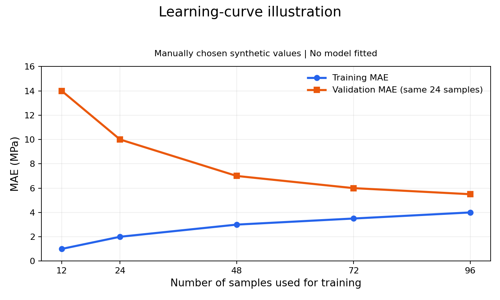
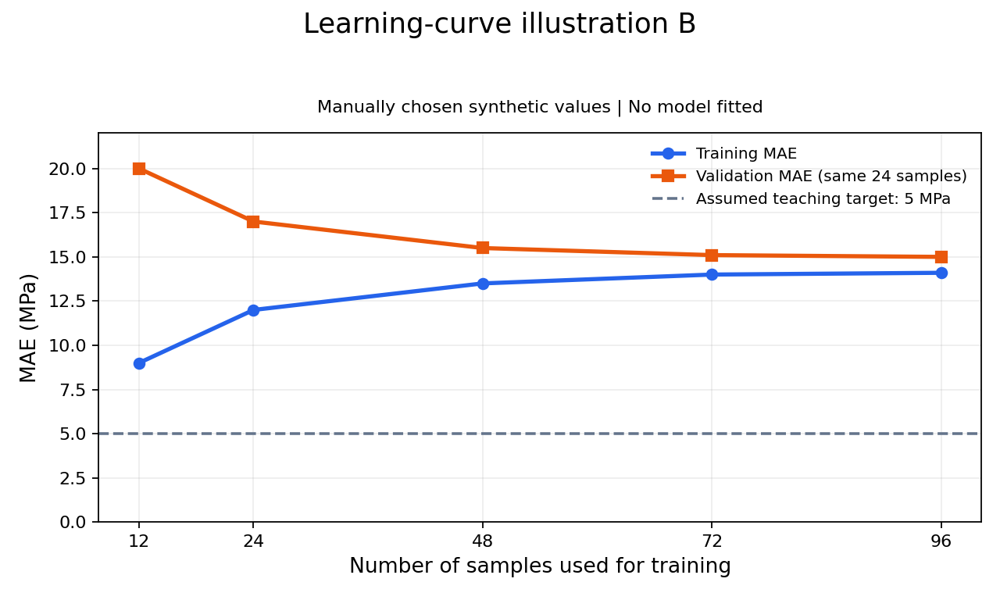
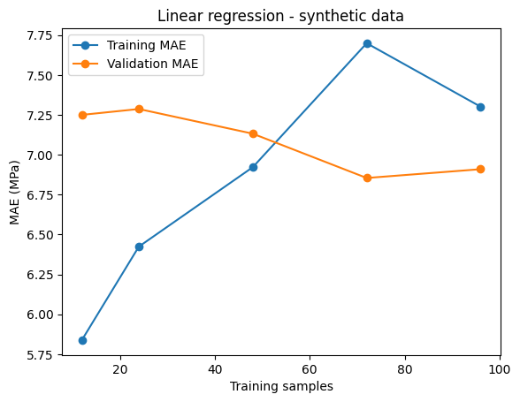
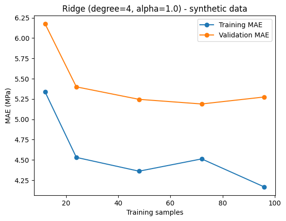

# 单元09：学习曲线与K折交叉验证——理解笔记

状态：学习中。Q27—Q29分步判断首次核心正确，实践17开发输入已运行保存；当前实践18创建KFold规则对象待代码。没有实际K折评分，正式8题未开始。

## 最新检查点：折内标准化与开发集输入准备（2026-11-02）

Q27学生首次答“每条有1轮属于验证组，4轮属于数据组”，按上下文将后者理解为训练组，两个计数首次正确，不为用词笔误立错。Q28首次答“从96条样本中学习，不应该把验证数据fit”，正确给出当折训练统计量来源与验证不参与fit的边界理由。Q29首次答“ttransform，fit会计算均值和标准差”，按语境理解为transform，选择和理由首次正确；不是实际运行的拼写异常。

教师进一步说明：以StandardScaler→LinearRegression方案为例，标准化器在当折96条训练样本fit，验证24条沿用相同变换；即使回归器只fit96，若标准化器用全部120，验证B的特征信息仍进入预处理。不宣称泄漏一定改变分数或使其必然变好。这段完整机制是教师补充，不冒称学生逐字独立说出。四次特征→StandardScaler→Ridge方案中的标准化实际还作用于各展开列；同样只能在当折训练数据拟合，不因先前单列题设歧义追罚学生。

实践17首次代码正确，并由学生实际运行保存：从df09_dev选ZrB2_wt_pct得到X09_dev、选UTS_MPa得到y09_dev，双括号保留单列DataFrame，stdout为(120, 1) (120, 1)。原96训练池与24固定验证都属于开发集，K折回到全部120条开发样本轮换；30条独立测试未加入。此步只是准备原始输入/目标，不是已经执行K折或得到新MAE。

原首错、局部示范和提示后修复层级保持，Q27—29不自动升级旧题独立复查或完整CV编程掌握。正式8题尚未开始。

### 当前实践18：创建KFold分组规则对象（待首次代码）

先示范新API的导入：

```python
from sklearn.model_selection import KFold
```

本步只用配置参数创建名为kf09的对象。三个参数：n_splits=5表示五折；shuffle=True表示打乱样本行号后确定折分组；random_state=20261032是实验前固定的复现种子，不为追求分数更换。请学生按“变量名 = 类名(参数名=值, ...)”的通用构造格式，自己写创建kf09的一行并先提交检查。未提供完整cross_validate代码，也未执行新对象/折分。

输入是三个设置值，输出是KFold规则对象，不是数据数组，因此没有样本表的shape或性能分数。后续将用于现有120条synthetic开发数据；30条holdout保持封存。实际折索引、Pipeline逐折训练与评分留到后续小步，不在此时预填。

参考：[scikit-learn 1.7.2 KFold官方文档](https://scikit-learn.org/1.7/modules/generated/sklearn.model_selection.KFold.html)。

## 上一检查点：从实际学习曲线进入K折（2026-11-02）

Q21首次独立读取Ridge真实图的两段变化正确：12→48先大幅后小幅下降，48→96先小幅下降后小幅上升。只证明本图观察，不代表已证明变化原因、噪声下限或继续增加数据必然有效。

Q22在相同96条训练、相同24条验证上，学生首次判断第二个完整方案更好，依据验证MAE更低。沿用已归档的学生synthetic data真实运行输出（仅显示三位小数）：StandardScaler→LinearRegression为6.909 MPa；PolynomialFeatures(degree=4, include_bias=False)→StandardScaler→Ridge(alpha=1.0)为5.275 MPa。没有新增运行。比较同时改变特征展开和回归方案，不能把差异单独归因于Ridge正则化；当前固定验证比较不等于最终方案冻结。

Q23首次指出同数量的划分可能包含不同样本，因此MAE不一定相同。教师规范为“可能不同”，而非保证不同划分必有不同分数；属于措辞精确，不新增错误。Q24首次正确给出第一折BCDE训练、共96条。Q25首次正确判断A可由第一折验证转为第二折训练；“跟上一轮区分开”理由方向合理，但当时尚未明确每折怎样重新拟合。Q26随后首次明确：不能不重新拟合便拿第一折模型给第二折B作有效验证，因为B已参与第一折训练。完整原答与提示层级见测验档；这些不是正式8题或原错误的延迟独立复查。

### K=5轮换的原理示意（未运行K折）

把120条synthetic开发数据分为A—E五组、各24条。每一折让一组验证，其余四组训练；同一完整方案在每折只用当折96条训练样本重新fit，不直接沿用上一折学到的参数。以下组字母只作轮换示意，不是假称新生成的ID文件或真实CV输出。

| 折数 | 用于训练的组（96条） | 用于验证的组（24条） |
| --- | --- | --- |
| 1 | B、C、D、E | A |
| 2 | A、C、D、E | B |
| 3 | A、B、D、E | C |
| 4 | A、B、C、E | D |
| 5 | A、B、C、D | E |

原30条独立测试数据继续封存，不参与这五组。预测训练样本本身可用于计算训练误差；问题是把见过的训练样本误差当作未见样本的验证误差。完整Pipeline折内拟合的实施与标准化原因尚待互动教学和代码检查，不能因口头判断正确而记为已完成实践。

### 当时教学检查Q27（历史题面，现已答）

> 对一个固定方案完成表中这轮五折后，每条开发样本分别有几轮属于验证组、几轮属于训练组？

当时题前没有给计数答案；现已收到首次正确答复，见最新入口。正式8题仍未开始。

## 已核对的前置证据

本地ML_LEARNING_HANDOFF.md最新入口、GitHub的AGENTS.md、STUDY_ROADMAP.md、learning/progress.md、单元08四类档案及Notebook均已核对，远程基线为1f49dda9c9e1608854bb5194b2e68beb0ff7d22a。

单元08本轮已完成：正式8题通过8/8，其中无追加内容提示5题，提示后3题；学习曲线横轴和用途曾首次回答正确，但没有实际学习曲线代码或图形证据。保留全部历史帮助层级，不重新教学Bias/Variance或Ridge整章，也不把单元08测试集恢复成独立新数据。

## 初期知识点与学生理解（历史）

Q0“学习曲线的每个点如何得到”已提示后纠正，首错与提示保留；Q1“当前点的训练MAE在哪些样本上计算”首次正确，Q2求助后已补“公平比较”的直觉，Q2a完成讲解后因素识别；Q3横轴含义已首次回答正确，Q4两线差距观察已首次正确，Q5少点/多点拟合直觉首次选B错误，Q8已首次提出合理可能原因，Q9同类数据与直线表达能力核心首次正确，Q10/Q11已首次正确观察图B误差水平与趋平，Q12已首次正确指出图A少样本端的过拟合常见表现，当前进入实际代码准备；原首错和教师帮助均保留。

> 模型的多项式次数和Ridge的alpha都保持固定。要画训练样本数分别为12、24、48时的误差点：你会分别用对应数量的训练样本重新fit，还是先用全部训练样本fit一次，再换不同数量的样本计算误差？请说明理由。

学生首次原答（2026-10-29）：“第二种吧，原因不会”。选择第二种不符合训练样本量学习曲线的目标；理由未说明，不推断误解的具体来源。

教师提示（不是学生自述）：如果先用96条synthetic训练样本fit，再取其中12条计算误差，模型的系数仍是从96条数据学来的；只减少评分样本没有减少训练时的信息。横轴写“训练样本数12”时，应代表模型实际用多少条学习？请据此重新选一次并说明理由。

提示后学生原答：“横轴标为“12条训练样本”的那个点，模型实际应该用12条数据来 fit，选第一种，第二种的模型系数是从96条数据学来的，不会因为只对训练样本数为12、24、48时的误差点评分，就忘记其他点”。

评价：选择第一种及因果解释正确；固定的是模型设置，各样本量需分别拟合。记为提示后纠正，不改写首次选择错误，也不把本次答复当作不同情境独立复查。学生措辞中的“误差点评分”不另立错误。

独立复查：尚未进行。

当前只观察到一次选择错误，未记为重复错误；本题不计入正式8题。

## 本单元范围与来源

- 课程markdown/week6.md第10.3—10.6节及code/ex5-bias vs variance/。
- 学习曲线的坐标、训练/验证误差、Bias/Variance典型形态及诊断限制，逐步实现并由学生先读图。
- 固定一次划分的波动、K=5轮换、折内Pipeline、KFold/cross_validate、负MAE、每折MAE及均值/标准差。
- GroupKFold仅认识炉次与文献来源独立性原理，不进入完整分组实践。
- 仍使用已学一次线性回归与一个预设多项式Ridge方案。

教师备课修正：课程10.3的“交叉验证集”主要指固定验证集，不是K折；其测试公式存在cv下标笔误。Ex5历史代码分别用各组自身统计量标准化，并以测试误差选lambda，这些步骤不照搬。原课程不改。

## 材料迁移与科学边界

新数据来自synthetic data数学教学设定，非7085Al实验。CV均值不等于真实材料性能，不保证新炉次、域外成分或不同文献来源可靠。上述是教师设定与待学边界，尚未记为学生通过。

## 学习产出

- [Notebook](../exercises/unit09-learning-curves-kfold-cross-validation.ipynb)
- [练习与实验预设](../exercises/unit09-learning-curves-kfold-cross-validation.md)
- [错误与复查](../mistakes/unit09-learning-curves-kfold-cross-validation.md)
- [测验记录](../quizzes/unit09-learning-curves-kfold-cross-validation.md)

## Q1：训练误差的计算范围（首次回答正确）

教师题面：仍是synthetic data的计划情境，尚未运行：训练池共96条，当前模型只取其中12条fit，另有固定24条验证数据。这个横坐标为12的点，它的训练MAE应该在参与fit的12条样本上计算，还是在整个96条训练池上计算？为什么？

学生首次原答：“在参与拟合的这12条上计算，其他的训练样本未参与fit”。

评价：计算组别及原因均正确，本题首次作答正确。它回答了训练误差评分范围，不将此升级为Q0已完成独立复查；Q0仍保留提示后纠正层级。无代码或运行，Q1不计正式8题。

## Q2：固定划分版学习曲线的验证误差（求助后补讲，Q2a辅助确认）

教师讲解：同一个已用12条样本fit的模型，还会对固定24条验证样本作预测，再比较这些预测与对应的synthetic目标，得到该点的验证MAE；这个评分过程不在验证数据上重新fit。这里是固定划分版学习曲线，之后K折各折的验证组按另一规则轮换。

教师题面：在固定划分版学习曲线中，训练样本量依次为12、24、48，每次都重新fit。为什么我们用同一组24条验证样本比较这些模型的验证MAE，而不是每次重新抽一组验证样本？

学生原文反馈：“不会，感觉这章节有点跳跃，不太理解”。这是求助和节奏反馈，尚无实质理由，不新增错误或通过，不推断此前Q0/Q1从未理解。

教师调整：承认先前未充分讲清“同一模型两个评分”和“不同训练量的公平比较”的联系，暂停逐项推进，用控制变量类比补足。

教师补讲（非学生自述）：先用材料实验的控制变量作类比：假设同时改变颗粒含量和时效制度，就不能把UTS变化只归因于颗粒含量。学习曲线想比较训练样本量变化；若同时更换验证样本，误差变化还掺入评价样本变化。固定同一批验证样本，让各训练量的模型接受同样的评价；这不保证误差一定下降，也不等于对全部未知材料的保证。这里只补比较逻辑，不推进代码或K折。

当前低负担检查Q2a：如果训练样本增加的同时，也换了一批验证样本，验证MAE下降了：除了训练数据更多，还有哪一种变化也可能让误差下降？

学生Q2a原答：“了一批更容易或更难预测的样本”。

评价：讲解后识别了验证样本变化这一因素，属于辅助理解确认，不回写Q2首次独立解释、不当成不同情境独立复查。学生识别了验证样本本身变化这一额外因素。针对题设的MAE下降，教师补充一种可能是换到更容易预测的样本；更难样本可能导致误差上升。这一方向说明是教师补充，不将学生的概括答复另记错误，也不冒称其已独立完整解释。

## Q3：用安排表连接两条曲线与坐标（首次回答正确）

教师整理（非学生自述）：

以下为synthetic data教学安排，尚未执行；表中数字是样本数量，不是MAE值。每行都重新fit一个模型，次数/alpha等设置固定；同一行的两个MAE来自该行同一个模型。

| 实际用于fit的样本数 | 训练MAE在哪些样本上算 | 验证MAE在哪些样本上算 |
| ---: | --- | --- |
| 12 | 这12条训练样本 | 固定的24条验证样本 |
| 24 | 这24条训练样本 | 同一组24条验证样本 |
| 48 | 这48条训练样本 | 同一组24条验证样本 |

每行产生两个待计算误差值。真正画图时纵轴放MAE（MPa），训练MAE与验证MAE分别连接成两条线；现在没有实际误差值或图像，不预先判断趋势。

当前问题：验证样本始终是24条，那么验证误差曲线的横轴，为什么仍然是12、24、48，而不是一直为24？

学生Q3首次原答：“横轴数字是训练样本数量”。回答了核心区别，正确，不因理由简短追加门槛。记本题首次回答正确，不等于Q0/Q2首次独立或延迟复查；尚无独立绘图/曲线诊断证据。

教师补充：训练和验证两条曲线共用训练样本量横轴。验证线表示相应训练样本量拟合出的模型在固定验证组上的误差，横坐标不是验证样本数。

## Q4：教师示意图的曲线差距（首次读图回答正确）

教师手工指定读图练习数列：训练样本数[12,24,48,72,96]；训练MAE[1.0,2.0,3.0,3.5,4.0]；验证MAE[14.0,10.0,7.0,6.0,5.5]（MPa）。全部是人为设定的synthetic教学示意值，不来自真实材料、单元09预设数据或任何模型拟合/评分。教师仅用Matplotlib将这些数列渲染为1280×768 PNG，不代表实际学习曲线必然如此，也不提供Ridge/线性方案的性能证据。



当前只问：随着训练样本从12条增加到96条，蓝色训练MAE曲线与橙色验证MAE曲线之间的差距怎样变化？

学生Q4首次原答：“差距越来越小”。对于本张教师示意图的两线差距观察正确，记本题首次读图回答正确；仅证明这一观察，不推断已经独立解释原因、识别Bias/Variance或完成绘图，也不升级其他题帮助层级。

## Q5：训练误差上升的拟合直觉（首错保留，几何子步讲解后正确）

教师将注意力转到示意图蓝线：本图的训练MAE随训练样本数增加而上升。这个趋势由教师指出，不能冒充学生已独立描述。接着用同一一次线性模型的少点/多点类比让学生先解释可能原因，不直接给原因或Bias/Variance结论，不声称真实MAE必然单调上升。

当前问题：先用一次线性回归作概念类比（synthetic示意情境，不是图中MAE数值的计算来源）：同样用一条直线，拟合两个横坐标不同的点，和拟合许多不完全共线的点，哪一种更容易让每个训练点的误差都很小？

学生Q5首次原答：“情况B”。选择不符合题设；没有说明理由，不推断其是否把泛化或数据量可靠性与训练误差混淆，也不宣称重复了Q0同一错误。

教师几何提示：这里先只看训练点上的误差。请先看情况A的两个横坐标不同的点：能不能画出一条直线，同时穿过这两个点？如果能，这两个点的预测值与目标值之间的差是多少？先回答这一步，再回到原来的A/B比较。

学生对几何提示的原答：“能，差不知道”。其中“能”正确；“差不知道”是求助，未给错误数值，不新增计算错误。该次局部记录此前仅在本地交接，现补齐。

教师解释：直线穿过训练点，代表在该输入处预测值等于目标纵坐标，预测值减目标值为0。synthetic手算例的目标UTS500MPa、预测500MPa，差为0MPa；两训练点都被穿过时两误差均0、训练MAE也0。这是教师说明，不是学生自主算出的数值，也不是模型运行或原PNG的计算来源。

教师随后题面：加入第三个点，而且三个点不共线；允许重新调整直线的斜率和截距，还能用一条直线同时穿过这三个点吗？

学生原答：“不能，两点确定一条直线”。在此前几何提示及零误差讲解之后，正确判断不共线三点不能被同一直线同时穿过，理由正确，记提示/讲解后的几何子步正确，不计原A/B首次独立正确或延迟独立复查。

教师归纳：原A/B比较中，A的两个不同横坐标点可由一条直线同时穿过，训练误差可为0；B许多不完全共线点无法全部同时穿过，直线需要折中。因此同一模型形式在样本很少时可能把训练点拟合得非常好，加入更多有散布的样本后训练MAE可能上升。这里只说明一种可能原因，不保证实际MAE严格单调，也不由训练误差上升直接判定未知样本预测变差。原A/B的选A和这段曲线解释由教师总结，不冒充学生已独立改选或说出完整原因。

## Q6：橙色验证误差线的趋势（首次回答正确）

继续使用同一张手工设定synthetic MAE示意PNG，无模型运行。学生先观察，不提前给趋势答案或高Bias/Variance解释。

当前只问：回到原来的教师示意图：橙色验证MAE随着训练样本数从12条增加到96条，是上升、下降，还是基本不变？

学生Q6首次原答：“下降”。正确识别橙线趋势，记本题首次读图正确；此前只告知图例，没有给趋势答案。该记录此前仅本地交接，现补齐。不能外推为已独立解释趋势原因、实际模型表现或掌握整章。

## Q7：两条线一起判断固定验证组表现（首次回答正确）

Q7题面：在这张示意图表达的情境中，虽然训练MAE上升，模型在固定的24条验证样本上的预测表现是变好还是变差？你依据哪条曲线判断？

学生首次原答：“变好，依据橙色验证曲线判断”。判断及依据均正确，记本题首次回答正确；题面已限定这24条固定验证样本，不能因学生未额外主动列全部泛化边界而降级或追加门槛。教师补充的准确范围：仅在教师synthetic示意图设定和这组验证样本上误差更小，不能替代实际运行、真实材料实验或全部未知材料保证。

## Q8：验证误差下降的可能原因（首次提出合理解释）

当前只问：模型形式和验证集都没变，为什么增加训练样本，可能让模型对验证样本预测得更准？请先提出一种可能解释，不需要公式。

学生Q8首次原答：“增加的训练样本中可能有偶然的样本对预测验证样本更加有利”。

评价：这是合理的可能解释：新增训练样本的具体组成可能恰好让拟合关系更适合当前固定验证组。本题只要求提出一种可能原因，学生已满足，不因未说出教师预设的噪声/Variance机制而判错或追加通过门槛。不能把‘可能’写成已证实的实际原因，也不能据此推断学生主动用验证集筛选训练点或发生数据泄漏；原答没有这样的操作。 记为首次提出合理可能解释，不等于独立说明了所有可能机制或通过正式评估。

教师再补充一种常见可能机制：训练样本很少时，个别偏高/偏低的样本可能较明显地影响拟合关系；新增有代表性、质量相近的数据后，模型可能更受共同趋势约束，对个别偶然波动不那么敏感，从而改善验证误差。该机制有前提，不保证数据越多验证MAE必降，也不是从手工示意图证实的因果结论；这是教师解释，不冒充学生自述。

来源：[课程10.6](https://github.com/Euan-Hsu/Coursera-ML-AndrewNg-Notes/blob/master/markdown/week6.md#L163)、[scikit-learn学习曲线说明](https://scikit-learn.org/stable/modules/learning_curve.html)。

## Q9：数据量与模型表达能力（首次回答正确）

当前只问：在一个新的synthetic概念情境中，数据总体趋势明显弯曲，模型却始终只用一条直线。只增加同类训练样本、不改模型形式，能让这条直线自动获得描述弯曲趋势的能力吗？

学生Q9首次原答：“不能，线性弯曲趋势的能力和模型形式有关”。

评价：学生正确判断不能，并将描述弯曲趋势的能力关联模型形式，核心解释正确，记本题首次回答正确；不为‘线性弯曲趋势’的表达另立错误或要求机械重答。题设限定原始单一特征的一次直线模型，不将结论扩大成所有对参数线性的模型都不能拟合曲线；多项式回归仍可对参数线性。该限定是教师精确说明，不冒充学生本轮主动说过。

这是synthetic概念判断，不是实际材料关系或程序运行；未要求学生先说Bias术语。

## Q10：两线接近与误差水平（示意图B，首次读图正确）

教师手工指定图B数列：训练样本数[12,24,48,72,96]；训练MAE[9.0,12.0,13.5,14.0,14.1]；验证MAE[20.0,17.0,15.5,15.1,15.0]（MPa）。虚线5MPa表示人为假设的教学目标MAE≤5MPa，不是7085Al工程标准、实验要求或已知不可约噪声基准。全部为synthetic教学示意值，教师只用Matplotlib渲染，没有拟合模型或生成预设150条材料数据，也不把图B归属为本单元线性/Ridge候选的真实分数。



当前只问：看示意图B右侧（训练样本较多时）：两条MAE虽然接近，但相对虚线标出的教学目标，它们的误差水平如何？

学生首次原答（2026-10-30）：“误差没有达到目标要求”。正确观察两条MAE均高于假设教学目标，记首次读图正确；不要求学生补具体数值或术语才通过。教师随后确认两线均高于假设目标，并转向观察验证曲线后半段。

## Q11：图B验证曲线的后半段（首次读图正确，2026-10-30）

> 当训练样本从48条增加到96条时，橙色验证误差还在明显下降，还是已经趋于平缓？

学生首次原答：“趋于平缓”。观察正确，记首次读图正确；不是模型真实运行或原Q0/Q5独立复查。

教师连接（非学生自述）：结合前面“用直线描述弯曲趋势”的模型限制设定，图B可用来示意高Bias（欠拟合）的一种表现：模型连训练数据的主要规律也未描述充分，继续增加同类样本的改善可能有限。这是有背景条件的synthetic概念说明，不是已运行模型的诊断；不能仅凭两线接近、任意5 MPa教学目标或曲线趋平就排除噪声等其他原因。

依据：[课程第10.6节](https://github.com/Euan-Hsu/Coursera-ML-AndrewNg-Notes/blob/master/markdown/week6.md)、[scikit-learn学习曲线说明](https://scikit-learn.org/stable/modules/learning_curve.html)。

## Q12：回看图A的少样本端（首次回答正确，2026-10-30）

继续使用[图A](../exercises/figures/unit09-learning-curve-illustration.png)，全部为教师手工指定的synthetic示意值，无新数据或模型运行。

> 只看图A最左侧12条训练样本的那个位置：这更像高Bias（欠拟合）还是高Variance（过拟合）的常见表现？请依据训练误差和验证误差说明。

学生首次原答：“左侧12条，模型训练误差显著低于验证误差，为过拟合”。

本题问常见表现，学生正确判断过拟合并给出训练误差显著低于验证误差的依据，记首次回答正确；不因未主动补充题外限制而降为提示后。教师将其联系到高Variance（方差大）常见信号，但不把单点差距当成真实模型原因的确定证明。

不计结课正式8题，不回写原Q0/Q5首错或提示层级，也不是它们的独立复查。

## 实践入口：新数据与先封存测试集（2026-10-30）

2026-10-30教师按生成前冻结的NumPy default_rng(20261029)配方生成150条新synthetic data：先Uniform(0,2)输入，再Normal(0,6)噪声，目标465+60*x-24*x**2+noise。CSV三列sample_id、ZrB2_wt_pct、UTS_MPa；ID为U09-001至U09-150，仅追溯行身份，不作模型特征。以17位有效数字保存浮点数并核验往返数值一致，SHA256为1486c2ffd5758f68fdd79b4d1cd3743e6e7aa6363d5e2dfcc43fbb67a468f165，Git blob为3b5d51dce533d7fcfd25f4e4db1630a96d7c45e4。不是实验结果，不含材料机制或真实UTS性能依据。

本步原任务（历史）：在单元09 Notebook的已有代码格中，导入pandas和train_test_split；读取data/unit09-learning-curves-synthetic.csv为df09；保持原CSV行顺序，用test_size=0.2、random_state=20261030一次划分为df09_dev和df09_holdout；只打印两者shape，先发代码检查，不运行或展示目标。

输入CSV为150×3；现已保存实际df09_dev.shape=(120,3)、df09_holdout.shape=(30,3)输出，详见下方实践记录。尚未拟合或评价，分组ID文件待保存。

## 实践第1步：整表划分与返回值数量（提示后修正，2026-10-30）

学生首稿已实际运行并保存为代码格[6]，报ValueError: too many values to unpack (expected 2)，没有shape输出。教师解释train_test_split对每个输入返回两份，两输入X/y会返回四份，提示本步整表划分以保留sample_id。学生随后原答“df09”，属提示后的对象识别；教师再明确提示以df09替换X09,y09，尚未给完整修正代码。学生修正版已运行为[7]，截图与本地保存版一致，stdout为(120, 3) (30, 3)。记提示后修正并成功运行，不记首次独立完成或延迟独立复查；不能由执行计数6/7推断未见的其他尝试。

理解要点（教师说明）：X/y共同划分本身有效，只需四个接收变量；本步按整张df09划分便于保留样本编号。提前选取X/y列本身不是数据泄漏，不能误记成此类错误。每个输入拆成两份，左侧变量个数须与返回对象数匹配。

这是150条新synthetic教学数据的实际读取/划分证据，不是模型评价或材料实验性能。test_size=0.2、random_state=20261030与原CSV行序保持；df09_dev为120×3，df09_holdout为30×3，三列sample_id/ZrB2_wt_pct/UTS_MPa同行保留。保留测试目前仅展示shape，未见目标预览、统计或模型使用。分组ID尚未导出，不宣称身份清单已经封存到文件；后续曲线/CV仅用开发数据。无模型fit/predict/评分、96/24内部划分或K折运行，正式8题未开始。

当时下一步（历史）：新建代码格，从df09_dev和df09_holdout各选sample_id一列，分别保存为data/unit09-dev-ids.csv和data/unit09-holdout-ids.csv。使用.to_csv(..., index=False)；index=False是不额外写入pandas行索引，sample_id列仍保留。输入为120×3和30×3，选列后为120×1和30×1，输出是对应数量的一列CSV。先发两行代码检查，暂不运行；不重新划分、不打印/保存UTS目标到这两个ID文件。

## 实践第2步：ID导出完成与封存边界（2026-10-30）

学生在两轮语法提示后提交正确保存代码截图，两个ID文件已实际生成。第一次只读时磁盘Notebook仍为[11]错误版；教师请求Ctrl+S，学生明确回复“已保存”，随后只读核验为[12]正确源码、stdout为(120, 3) (30, 3)、无error输出。记提示后修正并成功运行，不记首次独立完成、独立复查或教师批准后才运行；教师未提供本任务完整两行代写答案。

理解要点（教师说明）：.to_csv的调用对象是待保存表格，括号中的带引号路径是输出文件名；不是把调用结果赋给文件路径。df09_dev与df09.dev不同，前者为本任务实际变量。sample_id只标识样本身份，不是模型输入；index=False仅省略额外的pandas行索引，不删除sample_id列。原[9]/[11]两稿真实语法错误与逐轮提示完整保留在练习档和mistakes第4项，不因当前无error而抹去。

两个CSV均只含sample_id列：开发120行、保留测试30行，组内唯一、组间互斥，并集与原CSV150个ID完全一致。教师仅在原始ID序列上用预设RandomState(20261030)重建排列以核对文件顺序，两组顺序均精确匹配；未使用UTS目标列分析、拟合模型或评分，不把元数据核验冒充学生模型实验。

当时下一步（历史）：新建代码格，用train_test_split只划分df09_dev，依次接收为df09_train_pool和df09_val；test_size=0.2、random_state=20261031；打印两表shape，先发代码检查，暂不运行。

输入是已封存测试后留下的120×3开发表，预期得到96×3训练样本池和24×3固定验证表。训练池供后续12/24/48/72/96各训练量取样，每个点重新拟合完整Pipeline；同一24条验证样本评价所有这些点。此处test_size参数名只表示分给第二组的比例，第二组在本步骤的角色是验证集。30条holdout继续封存，不参与曲线、CV或模型选择。96/24尚未实际执行，不能提前记作运行输出。

## 实践3/4：固定训练池、验证组及模型数据（首次代码正确，2026-10-30）

实践3学生首次提交的开发内部划分代码正确，先前截图及保存版[14]真实输出(96, 3) (24, 3)。实践4学生首次提交四个X/y变量代码也正确，来源表/列/二维shape均符合题目，未追加调试提示。当前保存版第二代码格[6]合并内部划分与四变量，stdout为两行：(96, 3) (24, 3)；(96, 1) (96, 1) (24, 1) (24, 1)。首次代码正确是本步评价，题面已给映射，不扩大为全部独立编程、原错题独立复查或长期熟练。

96×3和24×3原始表中的sample_id只作追溯；X只保留ZrB2_wt_pct，y只保留synthetic UTS_MPa。因此训练池输入/目标各为96×1、固定验证输入/目标各为24×1，输入与目标都保持二维表。源数据、120/30分组和所有seed未改，没有标准化fit、模型fit/predict/MAE或CV。

## Q13：同一训练点的输入/目标行配对（相关概括与教师具体说明）

下一步准备横轴m=12的第一个训练点。教师介绍.iloc按行位置选数据，.iloc[:12]取当前顺序前12行，即位置0到11；输入为96×1训练池输入/目标，计划输出X09_12与y09_12均为12×1。固定验证X09_val/y09_val完整保留24×1，30条holdout继续封存。先请学生解释配对原因，再写切片代码；尚未给出本任务两行完整答案或配对原因。

> 为什么X09_pool与y09_pool必须取相同位置的12行，而不能各自随意取12行？

学生原答：“需要有完整的数据样本”。教师具体说明：“这里的“完整样本”具体指：同一样本的ZrB2含量，要配上它自己的synthetic UTS目标，所以X和y要取相同位置的行。” 这是对相关概括的具体说明，不新增错误或要求机械复述；教师给出的完整配对解释与学生原文分开保留。不计正式8题，无不同情境独立复查。

参考：[pandas 2.3.3的.iloc说明](https://pandas.pydata.org/pandas-docs/version/2.3/reference/api/pandas.DataFrame.iloc.html)。

## 实践5：前12行配对样本（首次代码正确，2026-10-31）

Q13学生首次原答“需要有完整的数据样本”为相关概括，教师随后把“完整”具体说明为同一样本输入与其自身目标配对。不因概括简短新增错误，也不把教师的具体解释回写成学生已自主完整说出。学生随后首次提交的.iloc切片代码正确，未追加代码调试提示；当前保存版第二代码格[3]真实stdout包含(12, 1) (12, 1)，截图与文件一致。方法与取样目标在题面已给定，不扩大为全部独立实现或独立复查。

.iloc[:12]已从固定96条训练池的当前行顺序成对取出12条，列仍各一列；24条固定验证保持完整，源CSV和分组ID清单不变。这是实际数据准备输出，不是模型性能或实验结果。

## 实践6：首个m=12线性训练点（首次代码正确并已拟合）

新建代码格，导入并复用已学的Pipeline（或make_pipeline）、StandardScaler和LinearRegression；创建新管道pipe09_linear12，顺序为StandardScaler→LinearRegression，再让完整管道只用原始X09_12、y09_12调用fit。先发导入、构造与fit代码检查，暂不运行；不提供本任务完整代码。

输入是同一批12条synthetic训练样本的X09_12/y09_12，均为(12,1)。标准化器仅在这12条输入中学习统计量，回归也只在这12条上拟合。fit返回训练后的Pipeline对象本身；此步尚未生成预测数组或误差。固定24条验证和30条保留测试均不参与fit，96条训练池只提供本次前12条。现已核验[4]实际fit完成；predict/MAE/K折仍未执行，最新证据见下文。

参考：[Pipeline.fit说明](https://scikit-learn.org/1.7/modules/generated/sklearn.pipeline.Pipeline.html#sklearn.pipeline.Pipeline.fit)。

### 实际运行证据（2026-10-31）

学生首次提交的截图代码正确：新建StandardScaler/LinearRegression对象，以scale、reg两步构成pipe09_linear12，并对完整管道调用fit(X09_12,y09_12)。截图[4]显示返回Pipeline结构。首次读磁盘时仍为引用单元08变量的未执行旧草稿，教师请求保存；随后读到与截图一致的正确[4]源码和execute_result，学生也明确回复“已保存”。这是保存版本一致性处理，不把旧草稿算作本次提交首错或实际异常；本步首次代码正确并实际拟合，无追加代码调试提示。

当前三个代码格计数为[2]/[3]/[4]，无error。X09_12/y09_12已实际为(12,1)，完整管道的fit源码只传入这两表；标准化器与回归均在对应12条训练样本中拟合。24条固定验证、30条holdout未参与fit。Pipeline图和text/plain输出是fit返回对象的结构展示，不是预测数组或误差分数；没有借此宣称性能好或材料实验成功。

这是在synthetic教学数据上实际执行的拟合，不是真实材料实验性能。源数据、分组和所有seed均未改。

## 实践7：同一个模型的两份预测（首次代码正确并运行）

新建代码格，统一使用已训练pipe09_linear12的predict，分别以原始X09_12和原始X09_val为输入，保存为y09_12_pred、y09_val_pred，再打印两者shape。先发两次预测与shape打印代码检查，暂不运行，不提供完整代码代写。

同一个12样本模型产生两份synthetic UTS预测，分别用于后续该学习曲线点的训练/验证MAE。输入shape依次(12,1)、(24,1)，当前二维目标下预测预期也为(12,1)、(24,1)，单位MPa。Pipeline在预测时沿用训练12条时学到的标准化统计量来转换原始输入；本步只调用predict，不新增fit或独立重拟合验证标准化。此处为当时任务边界；现已核验预测shape和m12两组MAE，尚无多训练量曲线、K折或保留测试评分。

参考：[Pipeline.predict说明](https://scikit-learn.org/1.7/modules/generated/sklearn.pipeline.Pipeline.html#sklearn.pipeline.Pipeline.predict)。

## 实践7/8：首组真实MAE（2026-10-31）

实践7两次predict首次代码正确，历史保存格[5]实际输出(12, 1) (24, 1)，此记录此前仅本地，现补齐。实践8两组MAE配对与计算首稿均正确，先前截图已显示5.837957055417992和7.249570499130854但没有单位标签；该截图未显示计数，不推断其为[6]或[7]。学生问“如何标注MPa”，教师提供两句print标签/单位字符串的完整格式示例，未代写MAE计算。当前保存格[8]显示相同两个数并正确带MPa。计算首次正确；单位显示有教师直接示范，不写成全部代码完全独立或新的机器学习错误。

实际训练MAE=5.837957055417992 MPa（12条），固定验证MAE=7.249570499130854 MPa（24条）。两者由同一个用12条训练的StandardScaler→LinearRegression管道产生，构成横坐标12处的两个误差点。这是新synthetic数据上的程序运行结果，不是手工示意图A/B数列、独立保留测试分数或真实材料实验性能。只有这一组点，尚无训练量变化的实际曲线，不据此直接诊断Bias/Variance或保证未知材料性能。

学生实际代码使用y09_12/y09_12_pred以及y09_val/y09_val_pred，两组各自配对；MAE为一个标量，打印单位字符串没有改变数值变量，后续可用于绘图。没有对MAE调用.shape的新错误，不因Unit08历史错误预设其当前会重犯。

## Q14：从横坐标12到24（方向正确，教师补充完整fit）

> 刚才得到了横坐标为12的点。现在要得到横坐标为24的点，你会怎样处理刚才的管道和训练数据？为什么？先解释，不写代码。

学生首次原答（2026-10-31）：“写 .iloc[:24] 函数，管道和训练数据改成24；如何保留三位小数”。

取训练池前24行、将训练数据量改为24的方向正确；未明确说出完整管道重新fit及其理由，不据简短表述推定错误信念，也不记为已完整独立解释。教师补充：管道仍采用StandardScaler→LinearRegression结构，应让完整管道用对应24条配对输入/目标重新fit；只改变量名不能改变实际训练量。可以重新fit同一完整管道，也可以新建同结构管道，不把新建对象当作必需条件。固定验证组仍为原24条。

本次记为应用复查已尝试、方向正确并获教师关键步骤补充，尚未记为独立复查通过；不要求机械复述。原Q0首次错误及提示后纠正保持，正式8题仍未开始。

### 三位小数显示（教师局部代码示范）

学生询问“如何保留三位小数”，教师提供以下打印格式，未代写新的模型训练或MAE计算：

```python
print(f"训练MAE: {mae09_train12:.3f} MPa")
print(f"验证MAE: {mae09_val12:.3f} MPa")
```

f字符串将花括号内的标量MAE插入文本；:.3f按小数点后三位显示，保留MPa单位，仅改变显示，原变量的完整数值不变。输入为先前学生实际计算的两个标量，不是数组；输出为两行文本。示例沿用同一synthetic数据m12结果，不是新增运行证据；当时尚无采用证据；本轮保存格[11]已采用，见下方最新检查点。

### 当时任务：24条配对切片与完整管道fit（历史，本轮已完成）

请从同一synthetic训练池X09_pool与y09_pool各取前24行，分别命名X09_24和y09_24；两者预期shape均为(24,1)，分别表示24条ZrB2含量与其配对的模拟UTS。让完整线性管道使用它们fit，先提交代码检查，暂不预测或计算新MAE。教师未提供本练习完整代码，未执行模型；当时没有m24拟合/分数证据，最新运行见下。后续仍按预设12/24/48/72/96嵌套前缀，固定验证24、独立保留测试30封存。

## 实践9：24样本完整管道已拟合（2026-10-31）

实践9首次提交的24样本切片、新建StandardScaler/LinearRegression、完整Pipeline及fit代码正确；教师只确认与要求运行，没有追加代码调试提示。2026-10-31的截图与保存Notebook代码格[11]一致，实际打印(24, 1) (24, 1)，末尾execute_result为Pipeline(steps=[('scale', StandardScaler()), ('reg', LinearRegression())])。这证明本次完整24样本管道拟合已运行，不是预测数组或误差分数。任务中的24样本、变量与完整重新fit规则此前已给，不扩大为完全独立设计，也不升级Q14独立原因复查通过；原Q0首次错误/提示后纠正保持。

学生已采用教师示范的f字符串:.3f格式，保存[11]真实stdout显示训练5.838 MPa、验证7.250 MPa；这两项仍是同格先执行的m12结果，不是m24的分数。格式采用有真实执行证据，格式写法来源仍为教师示范。当前格同样重新构造并fit了原12条模型，随后才fit24；相同固定协议重运行不是验证fit、换seed或新错误。

仍使用本单元新的synthetic data。m24的输入与目标分别是训练池固定顺序前24条ZrB2含量与配对的模拟UTS，各(24,1)。StandardScaler和LinearRegression只在这24条内fit；固定验证24与独立封存测试30未参与fit。当前未有m24预测/MAE、完整实际学习曲线、Ridge拟合、K折或保留测试评分，不能据Pipeline结构判断模型性能或材料规律。

### 当时任务：补齐横坐标24的训练/验证MAE（历史，本轮已完成）

复用已经学过的predict与mean_absolute_error，两次预测统一使用pipe09_linear24：训练X09_24→y09_24_pred，与y09_24比较，保存mae09_train24；固定验证X09_val→y09_val24_pred，与y09_val比较，保存mae09_val24。两个预测数组预期均(24,1)，但对应不同组；每项MAE为一个标量，单位MPa。打印三位小数和单位，先提交预测、计算及打印代码检查，暂不运行。教师不提供此任务完整答案，不预填数值、变化方向或诊断；先完成同一学习曲线点，后续才进入其他固定样本量与曲线。

## 实践10：m24预测与MAE已运行（2026-11-01）

实践10：本次首次提交截图中，两次predict都使用pipe09_linear24，输入分别是X09_24和原固定X09_val；y09_24_pred与y09_val24_pred分别与y09_24、y09_val配对计算MAE，打印变量也正确。保存[7]源码/输出与截图一致，预测shape均(24,1)，训练MAE显示6.424 MPa，固定验证MAE显示7.286 MPa。在已给管道、变量与配对映射的任务下首次提交代码正确，没有追加预测/计算调试提示；不扩大为整套完全独立设计。三位小数格式沿用教师示范，Q14先前教师补充及尚未独立原因复查通过的状态保留。

本单元新synthetic data的学生实际运行结果；单位MPa，显示值四舍五入至三位小数，不是手工示意或真实材料实验性能。

| 实际训练样本数 | 训练MAE（MPa） | 固定验证MAE（MPa） |
| ---: | ---: | ---: |
| 12 | 5.838 | 7.250 |
| 24 | 6.424 | 7.286 |

完整StandardScaler→LinearRegression只在训练池固定前24条fit，训练MAE在这24条计算，验证MAE在原固定24条计算；保留测试30条继续封存。数据、分组、seed与候选不变，全部为synthetic教学数据。同格[7]也重跑原m12固定流程，不是换seed或验证fit。目前仅有m12/m24两组实际MAE，无m48/72/96、完整曲线、Ridge、本单元K折或测试评分，不提前诊断整条曲线或保证未知材料性能。

归档前初次读到的是较早磁盘保存版：[5]含NameError输出，源中m24训练MAE打印仍引用mae09_train12，与当前正确截图不同。该旧源与旧输出是否同一次执行、具体异常变量及触发上下文未核实，不补推原因或把旧稿当作本次首次提交错误。教师只请求Ctrl+S同步；学生回复“已保存”，最新[7]与截图一致、无error。保存提示不是计算调试提示，也不据最终无error声称历史上从未报错。

### 教学检查Q15：两组实际结果比较（首次回答正确）

> 训练样本从12增加到24后，这一次固定验证组上的表现变好了还是变差了？请用表中的数值说明。

学生Q15首次原答：“变差了，验证MAE增加”。本次固定验证MAE由7.250到7.286 MPa，方向及依据正确，记本题首次回答正确，不因没有复述已给数值而降级。教师随后补充有限样本验证MAE不保证每增加一批训练数据就下降，需补齐预设训练量观察整体；此规律与原因边界是教师说明，不写成学生已独立完整解释。Q15不计正式8题，原Q0/Q5首错及Q14帮助保持。

## 实践11：五个预设训练量的线性循环已运行（2026-11-01）

实践11：学生在教师给出的for结构和前m行切片任务上，主动把既有StandardScaler→LinearRegression构造、完整fit、两次predict和MAE计算也放进循环。首次提交代码正确：每轮X/y取同位置前m行，新建本轮标准化器/回归器/完整Pipeline，只fit本轮m条；训练预测/目标同为m条，验证始终预测原固定24条并与其目标比较。保存[9]与截图一致，五轮m=12/24/48/72/96均有真实shape及MAE输出，无error。教师没有提供完整ML循环或追加调试提示；for示范和既有任务映射帮助保留，不扩大为全套无支架独立设计。学生扩展运行属于既定学习实验，不记成技术错误或泄漏。

下表为新synthetic教学数据的学生实际运行输出，单位MPa、仅三位小数显示，不是手工示意或真实材料实验性能。

| 训练样本数m | 训练MAE（MPa） | 固定验证MAE（MPa） |
| ---: | ---: | ---: |
| 12 | 5.838 | 7.250 |
| 24 | 6.424 | 7.286 |
| 48 | 6.922 | 7.132 |
| 72 | 7.699 | 6.854 |
| 96 | 7.301 | 6.909 |

入门线性学习曲线的五组数值已齐，但尚无实际曲线图或学生对该图的独立解读。当前不提前讲这组曲线的趋势、Bias/Variance诊断、材料含义或选模结论。仍为固定数据/顺序/seed/候选，仅开发数据内训练与验证；保留测试30条封存。相同固定实验重跑不是新的独立泛化验证。预设degree4 Ridge、本单元K折/GroupKFold原理、正式8题均未完成。

### 当时任务：为绘图累积每轮MAE（历史，示范后已完成）

现有循环技术实现正确；尚未建立累计列表是绘图准备的后续任务，不新增错题。教师解释：同名MAE变量每轮重新赋值，循环结束后该变量仅保留最后一轮值；五轮打印仍保留在输出中。画五个点需把五轮原始数值按顺序收集。

教师只给通用列表语法示例：

```python
numbers = []
numbers.append(12)
```

这是Python列表语法示例，12沿用预设训练量的整数，不是模拟性能或新MAE结果；示例后列表为[12]。空列表用[]建立，append把一个数值放到末尾，示例不拟合模型。

请学生仅补充并标明位置：循环前建立train_mae09与val_mae09两个空列表；循环内各MAE计算后，将本轮原始MAE变量追加到对应列表；循环后打印两个列表。每个列表应有5个数，依次对应12/24/48/72/96，用完整数值绘图，三位小数仅用于显示。先发新增行及位置/缩进检查，暂不运行；不提供本练习完整代码，不预先作图或解释趋势。

## 实践12：两份MAE列表已保存（2026-11-01）

实践12的实际帮助：教师先提供通用numbers=[]/numbers.append(12)列表示例及位置要求；学生问“空列表怎么建立”，教师给出完整两行train_mae09=[]、val_mae09=[]及循环前顶格初始化说明。学生再说“循环内也不会”，教师给出完整两行train_mae09.append(mae09_train_m)、val_mae09.append(mae09_val_m)，说明在两项MAE计算后、循环内同级缩进。学生随后提交“已保存”。这属于两次求助后的局部代码直接示范，没有学生错误源码/实际异常，不登记成首错后纠正，也不算完全独立实现列表收集。

保存Notebook[15]实际实现正确：两个空列表在for前初始化；每轮算出两项MAE后，在循环内部按同样缩进append原始数值；print(train_mae09, val_mae09)位于循环外顶格。一次print同时打印两列表与分两行等效，不额外设格式门槛。初始化/append按教师示范正确整合，循环外打印位置本次首份代码正确；输出两列表各5个数，顺序与m=12/24/48/72/96对应，无error。

本次由学生实际保存的stdout首次取得两份完整精度数列（新synthetic data上的模型MAE，MPa，未由教师重算）：

```text
train_mae09 = [5.837957055417992, 6.423736953125652, 6.92152464505865, 7.698675774111984, 7.300741952810969]
val_mae09 = [7.249570499130854, 7.286411941140258, 7.131759288817125, 6.854012479402068, 6.909135340166323]
```

这不是前次三位小数显示值的补算；原三位显示与列表相符，原值未先格式化成字符串。

只在固定开发分组中重跑既定一次线性实验收集数值；每轮完整Pipeline在相应m条训练部分fit，固定验证24、封存测试30及全部四seed不变。源CSV/ID/manifest四hash不变。尚无实际曲线图或学生独立读图，当前不解释实际曲线趋势或提前诊断。预设Ridge、本单元K折与正式8题均未完成；本结果不属于材料实验性能或新的独立泛化证据。

### 当时任务：补充两条实际plot调用（历史，首稿已提交但报错）

每个训练量与两个MAE列表相同位置的数值配成一个点；三份列表长度均5。教师示范通用plt.plot(x, y, marker="o", label="曲线名称")写法：两个等长一维数值序列作为输入，创建一条带圆点的折线；尚未执行或生成图。不给两条实际数据配对调用的完整答案，由学生分别使用train_mae09和val_mae09补全。

教师提供固定显示框架，使第一张图就有坐标、单位、模型/synthetic标题及图例；核心两条plot调用留学生：

```python
import matplotlib.pyplot as plt
train_sizes09 = [12, 24, 48, 72, 96]

# 在这里补充两行 plt.plot(...)

plt.xlabel("Training samples")
plt.ylabel("MAE (MPa)")
plt.title("Linear regression - synthetic data")
plt.legend()
plt.show()
```

训练曲线图例用Training MAE，验证用Validation MAE；先提交补全代码检查，暂不运行。随后由学生运行、保存实际图，再独立判断趋势与可能原因；教师不预告实际图结论或先画一张代替学生实现。

## 实践13：首次绘图错误与append理解补讲（2026-11-01）

学生本次原话：“里面不知道填什么，还有上一问的append也没理解”。此前[15]列表实现和输出确实正确，依赖教师直接初始化/append示范；新反馈表明append概念尚未理解，不能把运行正确扩大为概念已掌握。保留之前正确操作证据与全部真实帮助，不回退其他已经掌握的内容。

学生首次绘图源码：

```python
plt.plot(train_mae09,mae09_train_m , marker="o", label="Training MAE")
plt.plot(val_mae09,mae09_val_m , marker="o", label="Validation MAE")
```

实践13首次绘图代码把五值MAE列表作为横坐标、最后一轮的单个MAE作为纵坐标。保存[18]与截图一致，第一条plot在格内第92行实际抛出ValueError: x and y must have same first dimension, but have shapes (5,) and (1,)。第二条plot有相同的输入选择问题，但在首条异常后未执行，不登记第二次实际报错。报错(1,)是Matplotlib处理单个MAE绘图输入的形状，不代表原Python MAE标量自带.shape；不混作单元08旧标量.shape错误，也不推断其已重复相同误解。

模型、数据、分组、四seed和候选保持不变。绘图异常在MAE列表打印之后，前置五组模型/预测/MAE实际stdout仍成立；不因绘图失败否认前置结果，也不将display_data当作两条有效学习曲线成功证据。当前没有成功图或学生独立读图；固定验证24、保留测试30封存。预设Ridge、本单元K折及正式8题仍未完成。

### 教学检查Q16：append怎样保留多轮结果（讲解后首次回答正确）

教师先指出5个数与1个数不能逐点配对，暂不直接提供两条完整正确plot调用。优先补append：它把已经算出的本轮MAE数值放到累计列表末尾，列表保留已存旧数，本轮MAE变量在下一轮重新赋值。下面仅手工跟踪学生此前synthetic真实结果，不执行新代码，表中显示三位小数，实际列表保存原始精度。

```python
train_mae09.append(mae09_train_m)
```

| 当前轮训练量 | 本轮mae09_train_m | 执行append后的train_mae09 |
| ---: | ---: | --- |
| 12 | 5.838 | [5.838] |
| 24 | 6.424 | [5.838, 6.424] |

> 第三轮m=48时，训练MAE约为6.922 MPa。执行这一轮append之后，train_mae09里应该有哪些数？先回答列表，不写绘图代码。

Q16学生首次原答：“[5.838, 6.424, 6.922]”。在教师展示前两轮append追踪表后，正确保留原两项并追加第三项；记讲解后的本题首次回答正确，不扩大为未讲解的独立复查、整个append长期掌握或已会绘图。不计正式8题，原求助与直接语法示范保持。

## 实践13纠正与真实曲线保存（2026-11-01）

Q16学生首次原答：“[5.838, 6.424, 6.922]”。在教师展示前两轮append追踪表后，正确保留原两项并追加第三项；记讲解后的本题首次回答正确，不扩大为未讲解的独立复查、整个append长期掌握或已会绘图。不计正式8题，原求助与直接语法示范保持。

教师随后给出训练线参数含义提示：第一个参数train_sizes09是5个训练样本数，第二个参数train_mae09是对应5个MAE，末轮mae09_train_m只是单值；只要求先改训练线，未给完整实际plot调用。学生同次在聊天正确提交训练线和验证线两条调用。首次读取保存文件仍有验证行plt.plot(trainval_mae09, ...)且保留旧[18]输出，与正确聊天不同；教师只要求同步成学生已写对的版本、运行并保存。这个过渡保存差异不替代聊天正确答案，也不编造实际NameError或另立错误。学生再次“已保存”后，最新[19]两条plot源码、输出和图一致。

学生修正并实际运行的两条调用：

```python
plt.plot(train_sizes09, train_mae09, marker="o", label="Training MAE")
plt.plot(train_sizes09, val_mae09, marker="o", label="Validation MAE")
```

实践13第5项现已提示后修正并实际出图。保存代码格[19]先按既定五训练量运行线性Pipeline/评分/累计列表，再正确以train_sizes09分别配train_mae09、val_mae09，输出1张带模型/synthetic标题、样本数横轴、MAE(MPa)纵轴与Training MAE/Validation MAE图例的实际学习曲线，无error。图形质量已检查，标签/图例/五个训练量的数据点可读；目前仅确认实现与图像有效，不代替学生描述趋势或诊断。

学习曲线PNG直接从学生保存Notebook[19]的image/png输出逐字节解码提取，路径learning/exercises/figures/unit09-linear-learning-curve.png；588×455，33248字节，SHA256 2c29b3a9fe24e8cb3a54ae1233edf07d44bbcec51d4dd4789d858ec9202567ba，Git blob 874ab0233207bae8199b8462f35cd5c844b4fbcb。它来自学生在新synthetic数据上的实际程序输出，不是教师手工示意图A/B或教师重新拟合的结果。

源CSV、开发ID、保留ID、manifest四hash与此前一致，嵌套训练量/顺序、每个训练子集内的完整Pipeline拟合、固定验证24和封存测试30、四seed及两预设候选都保持。当前只完成一次线性学习曲线的运行与绘图纠错，尚无本张图的学生独立解读、预设Ridge、本单元K折或正式8题；不把真实synthetic运行图描述成材料实验性能或未知材料预测保证。



### 教学检查Q17：首次读取自己的实际验证曲线（已答，首次分段观察正确）

> 只看橙色验证曲线，从12条训练样本到96条，它整体怎样变化？中途每一段都沿着同一方向变化吗？

Q17首次原答：“验证曲线从12到96先增加再下降又增加，再约70的时候最低，不是沿同一方向”。各段变化及非同向判断正确；约70对应实际72条最低，近似读图合理，不新增错误或强制改写。学生未明确首尾净变化，教师补充验证MAE约7.250→6.909 MPa、整体下降且有波动；此净变化概括属教师补充，不冒称学生独立明确说出。不计正式8题或整章掌握。

## 真实曲线读图与平均数澄清（2026-11-02）

Q17首次原答：“验证曲线从12到96先增加再下降又增加，再约70的时候最低，不是沿同一方向”。各段变化及非同向判断正确；约70对应实际72条最低，近似读图合理，不新增错误或强制改写。学生未明确首尾净变化，教师补充验证MAE约7.250→6.909 MPa、整体下降且有波动；此净变化概括属教师补充，不冒称学生独立明确说出。不计正式8题或整章掌握。

Q18首次原答：“训练曲线先大幅增加后下降，训练样本很少时，可能数据恰好和模型拟合，训练样本增加后，导致MAE增加，样本数量更多后，平均了MAE，又导致下降”。蓝线分段观察正确，少量样本可能偶然容易拟合是合理可能解释，不要求从一张有限图证明精确因果。后半句“平均了MAE”尚不具体，可能指低误差样本稀释均值，也可能只是表述含糊；不虚构其已明确相信“样本越多分母越大就必降”，不新增第6项错误或把整题判错。

教师中性澄清：MAE每个点本来就已是平均值，样本增加时绝对误差总和与数量都可能变化，仅靠数量不足以解释下降。真实学习曲线每个m都重新fit，旧样本的预测与误差也可能变化；新增样本的误差组成与重新拟合都可影响均值。将这些作为合理可能机制说明，不把任何一个机制写成本图已经证实的唯一原因，也不倒写为学生首次完整解释。

Q19为synthetic手算示例，只研究平均数：原两项绝对误差2、4 MPa，教师给原MAE=3 MPa；再加入9 MPa，问新MAE及变化方向。学生首次原答：“为5MPa，高”，计算及比较正确，(2+4+9)/3=5 MPa。不把原3记成学生独立计算，不把此讲解后算例当真实运行/材料实验或旧题无提示独立复查，不由此追认Q18为原先犯过明确错误。

尚未实际构造或运行本单元Ridge，也未开展K折/独立测试或正式8题。原第5项首错与提示后出图、append直接语法示范等帮助继续保留。

### 当时任务：公平比较说明与预设Ridge构造（历史，已答并已实际fit）

为避免额外拆一轮抽象问答，作为一个连贯任务：学生先用一句话说明公平比较两个方案时，每个m的训练子集和验证样本应怎样安排，再写构造预设管道的代码。固定方案为PolynomialFeatures(degree=4, include_bias=False)→StandardScaler→Ridge(alpha=1.0)，命名pipe09_ridge；只构造，不fit/predict/评分。PolynomialFeatures与Ridge已在单元08学过，不重新整章教学，不引入新模型或调参。

构造代码未接收数据，输出是未训练Pipeline对象；后续原始输入仍是单列ZrB2含量，每个训练子集(m,1)，四次无常数展开后(m,4)，目标仍为synthetic UTS。数据映射/管道参数及顺序为预设任务约束，教师未提供整段Python构造答案；说明与代码均待学生，不提前记独立复查或运行。先在聊天提交一句说明及构造代码，暂不运行。

## Q20/实践14：公平比较说明与Ridge首次拟合（2026-11-02）

Q20学生首次原答：“两个方案训练子集和验证样本的数量相等且为同一批”。按题意理解为两个方案的对应训练子集相同、对应验证组相同，数据安排核心首次正确。教师具体化为：在同一m下，两方案都用训练池相同前m条，并共享原固定24条验证样本；不是把训练组和验证组合成同一组。不因没有额外解释未明确要求的理由而判错，不自动升级为旧Q2完整独立复查通过。

实践14首次提交并保存的管道参数/顺序正确：PolynomialFeatures(degree=4, include_bias=False)→StandardScaler→Ridge(alpha=1.0)。学生实际命名pipe09_2，_2可表示第二个方案，不要求仅因变量名不同重做；后续保持引用一致。source注释“创建二次模型”应写为“四次特征展开”，但实际degree=4和执行正确，未据注释推定二次概念误解或新增错误。

学生主动增加pipe09_2.fit(X09_pool, y09_pool)，保存代码格[9]与截图一致，execute_result返回三步Pipeline结构。只使用固定训练池96条synthetic样本，原始X/y各(96,1)，内部四次无常数展开后特征(96,4)，StandardScaler和Ridge随完整Pipeline在该96条内fit；原验证24与保留测试30未参与fit。虽然超出当时只构造的窄任务，但仍属已授权固定实验，不记为算法错误、泄漏或新候选。图示是已fit对象结构，不是预测/误差；目前Ridge仅有96条拟合证据，尚无其任何MAE或完整学习曲线点。

### 当时任务：完整预设Ridge学习曲线循环（历史，首稿已提交并报错）

无需再拆一轮96条预测练习。沿用已跑通的一次线性循环，采用相同m=[12,24,48,72,96]、相同前缀训练样本与原固定24条验证。用新列表ridge_train_mae09、ridge_val_mae09保留此方案结果。每轮对本轮m条完整fit预设三步管道，再预测本轮训练样本与固定验证样本，正确配对计算两项MAE并append原始值，最后在循环外打印两个五值列表。

核心约束是每个m都完整重新fit；可以在循环内新建三步管道，也可对同一完整Pipeline重新fit，不把分配新Python对象当额外评分门槛。输入仍是synthetic原始单特征表与配对UTS，训练数量m、验证数量24；Ridge预测的实际一维/二维形状待输出核验，不机械套用OLS二维预期，MAE依样本对应关系检查。两个MAE列表预期各5个数。先提交Ridge循环代码检查、暂不运行；教师不代写整段循环，不预告Ridge分数/曲线趋势，也不开展调参。

## 实践15：Ridge循环首稿与问题定位（2026-11-02）

实践15首次Ridge循环稿的机器学习流程安排正确：五个预设m、同位置前m行X/y、每轮拟合完整四次特征→标准化→Ridge(alpha1)、同一固定验证24、预测/目标MAE配对及append位置正确。但有步骤列表分隔符遗漏与结果容器未在源码初始化两个实现问题，不能记为完整循环首次正确。

保存索引9代码格[10]与本次聊天代码一致。第一轮已打印12及(12,1) (12,1)，随后因("poly", poly09_m)行末漏逗号，Python把后面的括号作为对前一元组的调用，出现SyntaxWarning: 'tuple' object is not callable; perhaps you missed a comma?，并实际抛出TypeError: 'tuple' object is not callable。不是SyntaxError。警告重复输出不当作多次独立错误；一次实际TypeError发生在Pipeline参数列表构造处，本轮尚未到完整fit、predict、MAE或append。

全保存Notebook源码里，ridge_train_mae09和ridge_val_mae09只出现于append/print，未找到赋值初始化。需要在for之前顶格建立两个空列表，让每次完整运行从空容器收集五轮值。隐藏内核是否已有同名变量未核实；当前执行已在前面中止，未实际触发NameError，不编造该异常或声称append已经失败。此处是静态问题，与实际逗号错误分开记录，不否认此前线性列表已示范后正确整合及Q16跟踪答对。

教师仅指出第一项("poly", poly09_m)与第二项之间缺逗号，解释Pipeline步骤是列表的各个元素、彼此用逗号分隔；提示参照先前空列表方法，在for之前初始化两个新的Ridge结果列表。没有代写修正后的完整循环或预填MAE；尚无学生修正答案、成功Ridge循环运行或独立复查。

现有独立96条Ridge fit[9]仍为有效证据，错误[10]只说明这次五量循环首轮未fit，不能写成从未拟合Ridge，也不能写已新增m12模型/预测/误差点。参数、数据、四seed、固定验证24和封存测试30不变，暂无Ridge分数/曲线、K折或正式8题。

### 当时任务：实践15局部修正（历史，提示后已修正并运行）

先只修两处：Pipeline第一项与下一项之间的分隔符；for之前两份新结果列表初始化。请学生提交“循环前的初始化”与“循环内修正后的Pipeline构造”两小段，并保留正确缩进，暂不运行、不需重贴整个循环。教师未提供完整正确循环，当前未答，不提前记提示后修正或运行成功。

## 实践15纠正与实践16实际Ridge曲线（2026-11-02）

实践15第6项已在教师定位/提示后修正。此前保存[11]在for前顶格加入ridge_train_mae09=[]/ridge_val_mae09=[]，Pipeline第一项后逗号已补，五轮拟合/预测/MAE正常运行；本次[12]保留相同正确实现并追加绘图后重跑。不是首次独立完整写对循环；[10]首稿的实际SyntaxWarning/TypeError和初始化静态问题仍保持，也不倒写曾有实际NameError。

Ridge五量MAE是学生在既定新synthetic数据上的实际程序输出，MPa，教师未重算。预测实际为(m,)/(24,)的一维单目标数组，与对应单列目标计算MAE合法，不强制reshape。

```text
ridge_train_mae09 = [5.338252179889854, 4.530140714271188, 4.360514606139826, 4.511729679592049, 4.166076753395134]
ridge_val_mae09 = [6.176422413996963, 5.399185828826887, 5.245536559794537, 5.188417647559322, 5.27467737077765]
```

两列表各5值，对应12/24/48/72/96；三位打印只改变显示，列表保留原始精度。

实践16按给定数据映射/标签要求，首次提交的Ridge绘图代码正确，未追加本轮plot调试提示：横轴train_sizes09，纵轴分别ridge_train_mae09/ridge_val_mae09，图例区分训练/验证，坐标为Training samples与MAE(MPa)，标题Ridge (degree=4, alpha=1.0) - synthetic data。学生将绘图追加在原循环代码格，但语句缩进位于for外，等效实现不另立错误；没有覆盖原线性图及结果。实际[12]输出1张可读Ridge PNG、无error。输入为三份等长5的一维列表，输出两条五点曲线；目前只确认实现/显示，不代替学生解释趋势或两模型优劣。

Ridge PNG从学生Notebook索引9[12]的image/png原字节导出，文件learning/exercises/figures/unit09-ridge-learning-curve.png，588×455、31325字节，SHA256 f313a684d90f4b7b89b2b84e0926acb469d868fcbc6ed04504f9e5336197e079，Git blob ad3a665bb61ab455f8e16b8202f3b21bd0db99f2。已直接查看原图检查可读性，没有教师重新拟合/重绘。原线性PNG SHA256仍2c29b3a9fe24e8cb3a54ae1233edf07d44bbcec51d4dd4789d858ec9202567ba；两张均为synthetic真实运行图，与手工示意A/B分开。

数据源、四seed、前缀训练子集/顺序、degree4/include_biasFalse/alpha1均保持固定，每m完整Pipeline只fit该m条，固定验证24只预测/评分，保留测试30封存。四CSV/ID/manifest hash与此前相同。相同开发实验重跑不是新的独立泛化证据，图不作材料实验性能或所有未知材料预测保证。K折、GroupKFold原理和正式8题仍未开始。



### 当时教学检查Q21（历史题面，已答；见最新入口）

> 只看Ridge图的橙色验证曲线：比较12→48条和48→96条这两段，MAE的变化幅度有什么不同？请根据图或数值说明。

当时题前没有提供趋势或原因答案；现已收到首次正确的分段观察，详见最新入口。保留此题面作为历史，不继续列为待答，不计正式8题。
