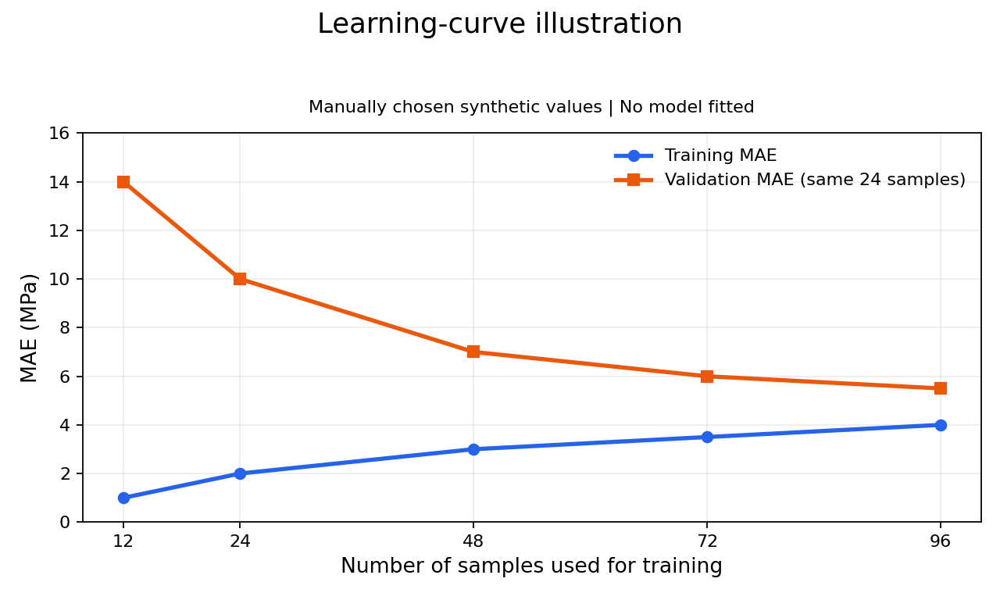

# 单元09：学习曲线与K折交叉验证——理解笔记

状态：学习中；2026-10-29启动。概念入口Q0已提示后纠正，Q1训练MAE计算范围首次回答正确，Q2求助后已用控制变量类比补讲，Q2a已识别验证样本变化，Q3首次正确指出横轴为训练样本数，Q4首次正确指出两线差距缩小，Q5几何子步已讲解后正确，原A/B与训练误差原因由教师归纳，当前Q6验证线趋势待答；尚无不同情境独立复查或代码运行证据。

## 已核对的前置证据

本地ML_LEARNING_HANDOFF.md最新入口、GitHub的AGENTS.md、STUDY_ROADMAP.md、learning/progress.md、单元08四类档案及Notebook均已核对，远程基线为1f49dda9c9e1608854bb5194b2e68beb0ff7d22a。

单元08本轮已完成：正式8题通过8/8，其中无追加内容提示5题，提示后3题；学习曲线横轴和用途曾首次回答正确，但没有实际学习曲线代码或图形证据。保留全部历史帮助层级，不重新教学Bias/Variance或Ridge整章，也不把单元08测试集恢复成独立新数据。

## 当前知识点与学生理解

Q0“学习曲线的每个点如何得到”已提示后纠正，首错与提示保留；Q1“当前点的训练MAE在哪些样本上计算”首次正确，Q2求助后已补“公平比较”的直觉，Q2a完成讲解后因素识别；Q3横轴含义已首次回答正确，Q4两线差距观察已首次正确，Q5少点/多点拟合直觉首次选B错误，当前通过几何引导后转到Q6验证曲线趋势；原首错和教师帮助均保留。

> 模型的多项式次数和Ridge的alpha都保持固定。要画训练样本数分别为12、24、48时的误差点：你会分别用对应数量的训练样本重新fit，还是先用全部训练样本fit一次，再换不同数量的样本计算误差？请说明理由。

学生首次原答（2026-10-29）：“第二种吧，原因不会”。选择第二种不符合训练样本量学习曲线的目标；理由未说明，不推断误解的具体来源。

教师提示（不是学生自述）：如果先用96条synthetic训练样本fit，再取其中12条计算误差，模型的系数仍是从96条数据学来的；只减少评分样本没有减少训练时的信息。横轴写“训练样本数12”时，应代表模型实际用多少条学习？请据此重新选一次并说明理由。

提示后学生原答：“横轴标为“12条训练样本”的那个点，模型实际应该用12条数据来 fit，选第一种，第二种的模型系数是从96条数据学来的，不会因为只对训练样本数为12、24、48时的误差点评分，就忘记其他点”。

评价：选择第一种及因果解释正确；固定的是模型设置，各样本量需分别拟合。记为提示后纠正，不改写首次选择错误，也不把本次答复当作不同情境独立复查。学生措辞中的“误差点评分”不另立错误。

独立复查：尚未进行。

当前只观察到一次选择错误，未记为重复错误；本题不计入正式8题。

## 本单元范围与来源

- 课程markdown/week6.md第10.3—10.6节及code/ex5-bias vs variance/。
- 学习曲线的坐标、训练/验证误差、Bias/Variance典型形态及诊断限制，逐步实现并由学生先读图。
- 固定一次划分的波动、K=5轮换、折内Pipeline、KFold/cross_validate、负MAE、每折MAE及均值/标准差。
- GroupKFold仅认识炉次与文献来源独立性原理，不进入完整分组实践。
- 仍使用已学一次线性回归与一个预设多项式Ridge方案。

教师备课修正：课程10.3的“交叉验证集”主要指固定验证集，不是K折；其测试公式存在cv下标笔误。Ex5历史代码分别用各组自身统计量标准化，并以测试误差选lambda，这些步骤不照搬。原课程不改。

## 材料迁移与科学边界

新数据来自synthetic data数学教学设定，非7085Al实验。CV均值不等于真实材料性能，不保证新炉次、域外成分或不同文献来源可靠。上述是教师设定与待学边界，尚未记为学生通过。

## 学习产出

- [Notebook](../exercises/unit09-learning-curves-kfold-cross-validation.ipynb)
- [练习与实验预设](../exercises/unit09-learning-curves-kfold-cross-validation.md)
- [错误与复查](../mistakes/unit09-learning-curves-kfold-cross-validation.md)
- [测验记录](../quizzes/unit09-learning-curves-kfold-cross-validation.md)

## Q1：训练误差的计算范围（首次回答正确）

教师题面：仍是synthetic data的计划情境，尚未运行：训练池共96条，当前模型只取其中12条fit，另有固定24条验证数据。这个横坐标为12的点，它的训练MAE应该在参与fit的12条样本上计算，还是在整个96条训练池上计算？为什么？

学生首次原答：“在参与拟合的这12条上计算，其他的训练样本未参与fit”。

评价：计算组别及原因均正确，本题首次作答正确。它回答了训练误差评分范围，不将此升级为Q0已完成独立复查；Q0仍保留提示后纠正层级。无代码或运行，Q1不计正式8题。

## Q2：固定划分版学习曲线的验证误差（求助后补讲，Q2a辅助确认）

教师讲解：同一个已用12条样本fit的模型，还会对固定24条验证样本作预测，再比较这些预测与对应的synthetic目标，得到该点的验证MAE；这个评分过程不在验证数据上重新fit。这里是固定划分版学习曲线，之后K折各折的验证组按另一规则轮换。

教师题面：在固定划分版学习曲线中，训练样本量依次为12、24、48，每次都重新fit。为什么我们用同一组24条验证样本比较这些模型的验证MAE，而不是每次重新抽一组验证样本？

学生原文反馈：“不会，感觉这章节有点跳跃，不太理解”。这是求助和节奏反馈，尚无实质理由，不新增错误或通过，不推断此前Q0/Q1从未理解。

教师调整：承认先前未充分讲清“同一模型两个评分”和“不同训练量的公平比较”的联系，暂停逐项推进，用控制变量类比补足。

教师补讲（非学生自述）：先用材料实验的控制变量作类比：假设同时改变颗粒含量和时效制度，就不能把UTS变化只归因于颗粒含量。学习曲线想比较训练样本量变化；若同时更换验证样本，误差变化还掺入评价样本变化。固定同一批验证样本，让各训练量的模型接受同样的评价；这不保证误差一定下降，也不等于对全部未知材料的保证。这里只补比较逻辑，不推进代码或K折。

当前低负担检查Q2a：如果训练样本增加的同时，也换了一批验证样本，验证MAE下降了：除了训练数据更多，还有哪一种变化也可能让误差下降？

学生Q2a原答：“了一批更容易或更难预测的样本”。

评价：讲解后识别了验证样本变化这一因素，属于辅助理解确认，不回写Q2首次独立解释、不当成不同情境独立复查。学生识别了验证样本本身变化这一额外因素。针对题设的MAE下降，教师补充一种可能是换到更容易预测的样本；更难样本可能导致误差上升。这一方向说明是教师补充，不将学生的概括答复另记错误，也不冒称其已独立完整解释。

## Q3：用安排表连接两条曲线与坐标（首次回答正确）

教师整理（非学生自述）：

以下为synthetic data教学安排，尚未执行；表中数字是样本数量，不是MAE值。每行都重新fit一个模型，次数/alpha等设置固定；同一行的两个MAE来自该行同一个模型。

| 实际用于fit的样本数 | 训练MAE在哪些样本上算 | 验证MAE在哪些样本上算 |
| ---: | --- | --- |
| 12 | 这12条训练样本 | 固定的24条验证样本 |
| 24 | 这24条训练样本 | 同一组24条验证样本 |
| 48 | 这48条训练样本 | 同一组24条验证样本 |

每行产生两个待计算误差值。真正画图时纵轴放MAE（MPa），训练MAE与验证MAE分别连接成两条线；现在没有实际误差值或图像，不预先判断趋势。

当前问题：验证样本始终是24条，那么验证误差曲线的横轴，为什么仍然是12、24、48，而不是一直为24？

学生Q3首次原答：“横轴数字是训练样本数量”。回答了核心区别，正确，不因理由简短追加门槛。记本题首次回答正确，不等于Q0/Q2首次独立或延迟复查；尚无独立绘图/曲线诊断证据。

教师补充：训练和验证两条曲线共用训练样本量横轴。验证线表示相应训练样本量拟合出的模型在固定验证组上的误差，横坐标不是验证样本数。

## Q4：教师示意图的曲线差距（首次读图回答正确）

教师手工指定读图练习数列：训练样本数[12,24,48,72,96]；训练MAE[1.0,2.0,3.0,3.5,4.0]；验证MAE[14.0,10.0,7.0,6.0,5.5]（MPa）。全部是人为设定的synthetic教学示意值，不来自真实材料、单元09预设数据或任何模型拟合/评分。教师仅用Matplotlib将这些数列渲染为1280×768 PNG，不代表实际学习曲线必然如此，也不提供Ridge/线性方案的性能证据。

当前只问：随着训练样本从12条增加到96条，蓝色训练MAE曲线与橙色验证MAE曲线之间的差距怎样变化？

学生Q4首次原答：“差距越来越小”。对于本张教师示意图的两线差距观察正确，记本题首次读图回答正确；仅证明这一观察，不推断已经独立解释原因、识别Bias/Variance或完成绘图，也不升级其他题帮助层级。

## Q5：训练误差上升的拟合直觉（首错保留，几何子步讲解后正确）

教师将注意力转到示意图蓝线：本图的训练MAE随训练样本数增加而上升。这个趋势由教师指出，不能冒充学生已独立描述。接着用同一一次线性模型的少点/多点类比让学生先解释可能原因，不直接给原因或Bias/Variance结论，不声称真实MAE必然单调上升。

当前问题：先用一次线性回归作概念类比（synthetic示意情境，不是图中MAE数值的计算来源）：同样用一条直线，拟合两个横坐标不同的点，和拟合许多不完全共线的点，哪一种更容易让每个训练点的误差都很小？

学生Q5首次原答：“情况B”。选择不符合题设；没有说明理由，不推断其是否把泛化或数据量可靠性与训练误差混淆，也不宣称重复了Q0同一错误。

教师几何提示：这里先只看训练点上的误差。请先看情况A的两个横坐标不同的点：能不能画出一条直线，同时穿过这两个点？如果能，这两个点的预测值与目标值之间的差是多少？先回答这一步，再回到原来的A/B比较。

学生对几何提示的原答：“能，差不知道”。其中“能”正确；“差不知道”是求助，未给错误数值，不新增计算错误。该次局部记录此前仅在本地交接，现补齐。

教师解释：直线穿过训练点，代表在该输入处预测值等于目标纵坐标，预测值减目标值为0。synthetic手算例的目标UTS500MPa、预测500MPa，差为0MPa；两训练点都被穿过时两误差均0、训练MAE也0。这是教师说明，不是学生自主算出的数值，也不是模型运行或原PNG的计算来源。

教师随后题面：加入第三个点，而且三个点不共线；允许重新调整直线的斜率和截距，还能用一条直线同时穿过这三个点吗？

学生原答：“不能，两点确定一条直线”。在此前几何提示及零误差讲解之后，正确判断不共线三点不能被同一直线同时穿过，理由正确，记提示/讲解后的几何子步正确，不计原A/B首次独立正确或延迟独立复查。

教师归纳：原A/B比较中，A的两个不同横坐标点可由一条直线同时穿过，训练误差可为0；B许多不完全共线点无法全部同时穿过，直线需要折中。因此同一模型形式在样本很少时可能把训练点拟合得非常好，加入更多有散布的样本后训练MAE可能上升。这里只说明一种可能原因，不保证实际MAE严格单调，也不由训练误差上升直接判定未知样本预测变差。原A/B的选A和这段曲线解释由教师总结，不冒充学生已独立改选或说出完整原因。

## Q6：橙色验证误差线的趋势（待答）

继续使用同一张手工设定synthetic MAE示意PNG，无模型运行。学生先观察，不提前给趋势答案或高Bias/Variance解释。

当前只问：回到原来的教师示意图：橙色验证MAE随着训练样本数从12条增加到96条，是上升、下降，还是基本不变？

学生首次原答尚未收到。Q5数学/几何子步的正确不能外推为已经独立解释验证曲线或掌握整章。
