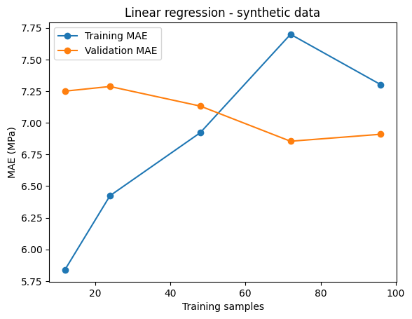
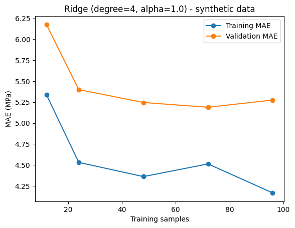

# 单元09：学习曲线与K折交叉验证——问答与评估

状态：学习中。实践24字典取值提示后成功，实际Ridge负MAE已核验；实践25待实现，正式8题未开始。

## 最新检查点：Ridge五折负MAE已读取（2026-11-10）

错误9原首次代码`cv09_ridge[["test_score"]]`及真实`TypeError: unhashable type: 'list'`已保存在历史提交[d9b042c](https://github.com/Euan-Hsu/Coursera-ML-AndrewNg-Notes/commit/d9b042ca6125cf0ed5f82bdb170674b047b96967)。教师先指出字典与DataFrame取值的区别、提示检查方括号层数，未直接给目标修正整行。当前记“提示后修正并运行成功”，不覆盖首次错误，不记独立复查通过。当前学生在原格保留整段调用并修正，不因没有另开提取格而追罚，也不冒称本次只运行过取值、未重跑CV；固定协议不变。

实践24提示后修正已核验：截图与本地保存末格[11]一致，取值改为`neg_mae09_ridge = cv09_ridge["test_score"]`，打印得到：

```text
[-4.72239494 -4.17395022 -5.2594136  -5.07739623 -3.55240514] (5,)
```

这是本单元synthetic开发数据、预设完整四次特征展开→标准化→Ridge(alpha=1.0)、同一folds09的真实运行输出，不是教师代算或手工教学数列，更不是材料实验性能。cross_validate输入X09_dev/y09_dev各(120,1)，每折完整管道在96条训练样本上拟合、24条验证；输出字典中test_score的数组含5个折负MAE，shape(5,)，不涉及封存30条测试。保留打印精度，不伪造更多小数。

下一实践25（待首次代码/实际输出）：参照已完成的一次线性方案，对neg_mae09_ridge整体取反，保存mae09_ridge_folds；用原数组求mean_mae09_ridge与std_mae09_ridge（ddof=0）；打印五折MAE及其shape、平均值和标准差（汇总三位小数并标MPa）。这是已学操作的迁移，不代写整段代码或预填数值。输入是已有5个负评分(5,)，输出是5个非负MAE(5,)及两个MPa标量，不需重新训练。得到实际结果后再由学生比较两预设方案，尚未最终选模。

一次线性已有平均MAE7.391 MPa/std0.599 MPa（ddof=0）；当前尚无Ridge均值/std运行证据。正式8题未开始，原1—8项层级保持，错误9独立复查待；30封存测试继续不用于选择，GroupKFold完整分组实践留后续。

以下为历史检查点；待修复等状态以本节为准。

## 上一检查点：Ridge结果字典取值错误待修复（2026-11-09）

Q33学生首次原答：“不能吧，有的数据可能整体平均但有个别极端样本”。判断及理由核心正确：平均值不能约束每条误差；折间标准差的具体对象由教师进一步补充，不冒称学生已独立完整解释置信区间或材料分布变化。

Q34学生答“不知道”，记求助，不新增错误。教师讲解estimator是完整管道，X/y/cv保留，提供仅estimator一个空的cross_validate框架且明确既有管道名pipe09_2。学生填写estimator=pipe09_2首次正确，属于明确支架后完成，不升级为独立编写完整CV。

实践24首次结果提取错误（新编号9）：学生截图与本地保存末格[12]一致：

```python
cv09_ridge = cross_validate(
    estimator=pipe09_2,
    X=X09_dev,
    y=y09_dev,
    cv=folds09,
    scoring="neg_mean_absolute_error",
)

neg_mae09_ridge = cv09_ridge[["test_score"]]
print(neg_mae09_ridge, neg_mae09_ridge.shape)
```

实际异常：`TypeError: unhashable type: 'list'`，定位第9行取值，打印未执行。cross_validate调用已返回，不能把此异常归因于Ridge训练失败；但没有打印出Ridge的逐折数值，不补造分数、均值或std。

错误原因：cv09_ridge是字典；内层["test_score"]创建列表，外层取值试图把该列表当字典键，列表不能作为键。与pandas中DataFrame[["列名"]]保留二维表的语境区分；不推断学生已口头解释过混淆原因。教师提示对照此前线性结果的成功取值，检查方括号层数，不直接代写目标修正整行。

当前任务：在新代码格只写修正后的结果提取及原print，运行、Ctrl+S并发输出；不必重跑cross_validate。输入为已返回的cv09_ridge字典，目标输出为test_score的五个负MAE数组，shape (5,)，这是折内验证而非封存测试。暂不追加取反、均值/std等任务。修复尚未收到，独立复查未进行。

120条synthetic开发/30条封存测试、同一folds09、四种子和两个预设方案保持；不引入新模型/调参/测试选择。正式8题未开始，原1—8项首错/提示后修复/独立复查层级保持。

以下为历史检查点；当前状态以上文为准。

## 上一检查点：标准差已运行，进入报告解释（2026-11-07）

Q32首次原答：“乙的五折MAE更分散，其数字分布不均”。首次核心判断正确，日常解释方向正确；教师补充甲全为7、乙范围3—11，不冒称学生独立说出了补充细节，也不把“分布不均”按正式均匀分布术语追罚。这两组是手工构造、未运行模型的synthetic教学数列，不能与实际CV结果混写。

实践23：教师此前讲解“偏差→平方→求平均→开方”，只给通用API 数组.std(ddof=0)，没有代写具体赋值/打印或代算真实标准差。学生首次具体代码与实际输出正确：

```python
std_mae09_linear = mae09_linear_folds.std(ddof=0)
print(f"标准差：{std_mae09_linear:.3f} MPa")
```

保存stdout：`标准差：0.599 MPa`。输入为本单元synthetic开发数据实际CV产生的五折MAE数组mae09_linear_folds，shape (5,)；输出是一个标准差标量，单位MPa。本次ddof=0，分母为5，描述这五折MAE的散布，不作为置信区间、单条误差上限或未知材料性能保证。不是教师重新运行模型得到的参考分数。

实践22格式提醒已修复并核验：均值格[9]保存stdout为`五折平均MAE:  7.391  MPa`。当前可报告一次线性方案五折平均MAE 7.391 MPa、折间标准差0.599 MPa（ddof=0）；仅保留三位显示，不伪造更高精度。
下一教学检查Q33（待首次回答，不计正式8题）：当前报告为五折平均MAE 7.391 MPa、折间标准差0.599 MPa（ddof=0）。这能否保证每一个未知材料样本的预测误差都不超过“平均MAE＋标准差”？为什么？

正式8题未开始；Ridge CV、最终选模、GroupKFold原理认识仍待推进。保持120条synthetic开发数据、30条封存测试、四个随机种子和两个预设方案，不重筛种子/大规模调参，测试集未用于选择。

以下为历史检查点，待答/待补等状态以本节为准。

## 上一Q31与实践22记录（2026-11-03，不计正式8题）

Q31原题为只报五折最小MAE能否充分概括整体、为什么；学生原答：“不知道”。Q31学生原答“不知道”，记求助、没有独立理由，不新增错误。教师没有继续拆诱导小问或追问整题，而用真实synthetic第2折6.422/第3折8.280 MPa（三位显示）解释只报最小值未反映其他折，再讲五折平均MAE=五个MAE之和/5及通用数组.mean()。这是教师讲解，不能记学生已独立解释Q31；对汇总意义的自主理解稍后检查。

随后布置实践22，在已有五折非负MAE数组上求.mean()、存mean_mae09_linear并三位MPa打印。首次代码：

```python
# 计算五折平均MAE：数组.mean() 可以求平均值
mean_mae09_linear = mae09_linear_folds.mean()
print(f"五折平均MAE:  {mean_mae09_linear:.3f} ")
```

实际输出：

```text
五折平均MAE:  7.391 
```

实践22截图与保存索引12[9]一致：mean_mae09_linear = mae09_linear_folds.mean()，以f-string的:.3f打印，实际显示“五折平均MAE:  7.391”。基于原始五折数组求均值及三位小数格式首次代码正确，已运行；输入(5,)来自本单元synthetic开发集实际CV，输出是一个平均值标量，物理单位仍MPa，未重新训练。

原print字符串末尾没有MPa。教师提示在输出文字末尾补单位，计算本身正确，不将标签遗漏判算法错误/新增第9项，也不推断学生认为它无量纲；单位补注尚未收到新保存核验，无需为小标签修改单独多轮确认，不阻塞下一概念。只获得三位显示值7.391，不补造更长均值精度；后续计算继续用原数组/变量。

未收到对Q31的独立解释，不改为首次独立通过；均值API通用提示后首次计算正确，报告标签还需补注，帮助层级分开。正式8题未开始。

### 当前教学检查Q32：相同均值、不同散布（待答，不计正式8题）

以下是人为构造、未运行模型的synthetic五折MAE教学数列，不是实际一次线性/Ridge分数，也不是材料实验结果：

| 教学数列 | 五折MAE（MPa） | 平均MAE（MPa） |
| --- | --- | ---: |
| 甲 | 7、7、7、7、7 | 7 |
| 乙 | 3、5、7、9、11 | 7 |

题面：两组平均MAE相同，哪组五折MAE更分散？请用这些数字说明。先由学生比较，尚无回答，不预填组别或原因，不要求标准差公式/精确数值。此步只建立折间波动直觉，随后再定义/计算描述性std，不同时加入Ridge或独立测试评价。

## 上一实践21：首次代码正确与实际非负MAE输出（2026-11-03，不计正式8题）

任务：将五个负评分整体取相反数存入mae09_linear_folds，打印数组和shape。教师给通用“数组前加负号逐元素取反”提示，没有给实际赋值/打印整行，允许写后直接运行。

学生首次源稿及截图/保存版一致：

```python
# 在数组名前加 -，会逐元素取相反数
mae09_linear_folds = -neg_mae09_linear
print(mae09_linear_folds, mae09_linear_folds.shape)
```

实际输出：

```text
[7.25421522 6.42174577 8.2799882  7.61102202 7.38939505] (5,)
```

实践21截图与本地保存格[8]一致：mae09_linear_folds = -neg_mae09_linear，随后正确打印数组与shape。在教师给通用逐元素取反提示后，学生首次具体赋值/打印代码正确并实际运行，无本步错误或纠错；不扩大为整套CV完全独立实现或旧错误独立复查通过。

数组输入与输出均(5,)，输出单位MPa。不是新训练/新独立验证数据，不按当前正确改写此前代码错误。正式8题未开始，尚未进行平均MAE/std的解释验收或计算。

### 当时教学检查Q31（历史题面，求助后已讲解）

题面：如果只报告这五折中最小的MAE，能否充分概括这次交叉验证的整体表现？为什么？先让学生解释汇总动机，暂不写代码。

学生后来答“不知道”，已由教师讲解，见最新入口；未记独立回答通过，不要求提前掌握统计术语。随后再逐点介绍五折平均MAE与折间描述性标准差的含义/代码，先不代算汇总，也不执行Ridge/独立测试。

## 上一Q30及实践20记录（2026-11-03，不计正式8题）

### Q30：负MAE手算换算首次正确

题面先讲负评分约定，以明确synthetic、非Notebook结果的-4.2为例，问换回MAE用MPa报告。学生首次原答：“4.2”。数值正确，单位由题目给定，教师确认4.2 MPa不降低其首次判断；不当真实跑分或独立复查。

### 实践20：从求助到教师支架后完成

学生原答“不会”，未交错误代码，记主动求助。教师缩小任务，给完整两步Pipeline与已填estimator/scoring的调用骨架，让学生填3变量；学生填X09_dev、y09_dev、folds09均首次正确。另加的提前fit多余但不是CV泄漏，教师解释cross_validate克隆重新fit并建议删除。字典取值示范由教师给出，学生补print(neg_mae09_linear, neg_mae09_linear.shape)首次正确；删除多余fit后实际[7]执行成功。

实践20一次线性完整Pipeline交叉验证已由学生实际运行成功，保存格[7]正确采用StandardScaler→LinearRegression、原始X09_dev/y09_dev和同一folds09，scoring="neg_mean_absolute_error"。多余的提前fit已删除；每折完整管道重新拟合，没有独立全开发数据预标准化。cv09_linear["test_score"]按键取值和打印均成功，实际shape(5,)，全文件无error。这里test_score是五个验证折，未使用30条封存独立测试。

真实负评分（仅保存输出显示精度）：

```text
[-7.25421522 -6.42174577 -8.2799882  -7.61102202 -7.38939505] (5,)
```

不升级成完全独立编程或旧题复查通过；原第8项真实NameError仍保留。正式8题尚未开始，当前无正MAE数组/均值/std的新运行结果。

### 当时实践21：将负评分转换成MAE（历史任务，现已完成）

不再重复Q30标量换算。请在新代码格对现有neg_mae09_linear整体取相反数，保存为mae09_linear_folds，打印数组及shape。给通用提示：负号放在数组名前，会逐个元素取相反数；不代写实际赋值和print两行。

输入是本次synthetic开发数据真实CV运行产生的五值负评分数组(5,)，输出预期是五折非负MAE数组(5,)，单位MPa。只转换已有评分，不需要重新训练；写好后允许直接运行该格、Ctrl+S保存并提交输出，不为这一步另加代码审批。该任务现已完成，源码/实际输出见最新入口；此处保留当时任务，均值/std和Ridge仍待后续。

## 上一实践19：提示后完成与输出核验（2026-11-03，不计正式8题）

学生“已保存”后，保存格补上：

```python
folds09 = list(kf09.split(X09_dev))
```

放在kf09构造后、folds09[0]前，先前print已含len(folds09)。实践19已提示后补齐并运行成功：在正确kf09构造后、读取folds09[0]前加入folds09 = list(kf09.split(X09_dev))。实际输出列表长度5，第一折训练位置96个、验证位置24个，shape分别(96,)和(24,)；保留初始解包/shape正确、len漏输出提示后补齐及随后第8项实际NameError的完整阶段，不改为整步首次独立完成。

教师只解析学生已保存stdout，确认第一折两组位置各自唯一、不重叠，合并覆盖当前开发表0—119全部120个位置；不是独立运行KFold生成参考分组，没有拟合模型。位置编号代表当前开发表行位置，不是ZrB2特征值、sample_id或原DataFrame索引标签。只有第一折行号被打印；五折列表长度已实际输出，不冒称其他四折全部逐一展示。

首次聊天局部正确/漏打印折数、教师局部提示、补len后真实NameError、再次提示生成列表、当前修复运行四阶段均保留。新API最早由教师示范，不能改成无支架完整实现；独立复查未进行，正式8题仍未开始。

最终保存格[6]无error，读取中曾见[27]；不凭连续执行编号追认重启/Run All或新独立泛化证据。没有真实CV模型分数。

### 当时教学检查Q30：负MAE换算（历史题面，现已答）

准备进入cross_validate前，只讲评分约定：scikit-learn的scorer按“返回值越大越好”比较；MAE本身按“越小越好”，所以scoring="neg_mean_absolute_error"返回-MAE。负号属于评分接口，实际MAE仍非负。对应[scikit-learn 1.7.2官方评分说明](https://scikit-learn.org/1.7/modules/model_evaluation.html#scoring-string-names)。

单一口头题：某折返回-4.2，这是明确的synthetic手算教学示例，不是当前Notebook运行分数。若换回MAE并用MPa报告，应写多少？当时尚未回答；现已首次答对，见最新入口。该题未同时加入均值、标准差或完整CV代码。讲解后的首次应用不当作旧错独立复查或正式8题。

后续直接进入完整Pipeline配合现有folds09的cross_validate，不重复已学的手动切片/单折训练整套流程；独立测试集区别稍后单独确认。原30条holdout继续封存，本单元尚无任何真实CV模型评分。

## 上一实践19：部分正确、输出漏项补齐后出现真实NameError（2026-11-02，不计正式8题）

首次聊天源码：

```python
train_idx09, val_idx09 = folds09[0]  # folds09[0]:取第一折，其中包含两组编号，可以用两个变量接收; len(folds09)：查看列表里有几份安排
print(train_idx09, val_idx09, train_idx09.shape, val_idx09.shape)
```

实践19首份聊天代码的双变量接收和两数组shape查询正确，额外打印两组行号可接受；但总折数len(folds09)只在注释中出现，尚未打印。教师只提示把len(folds09)加入现有print，允许补后直接运行保存，不代写整行。该漏输出当时不登记算法错误，也没有当时的运行异常证据。

随后保存的print为print(len(folds09),train_idx09, val_idx09, train_idx09.shape, val_idx09.shape)，漏项源码已按提示补齐；不等于该print已运行成功。

学生随后“已保存，报错”。只读保存Notebook索引10[25]，实际源码已把len(folds09)加入print，但在上一行train_idx09, val_idx09 = folds09[0]抛出NameError: name 'folds09' is not defined。此前只打印开发输入(120, 1) (120, 1)，末尾含len/数组/shape的print尚未执行，没有实际五折列表长度、首折行号或shape结果。

保存源码已正确创建kf09规则，却没有生成并赋值folds09。规则对象不会自动创建名为folds09的结果列表；本次缺列表生成步骤与实际NameError登记为第8项。不能倒写为此前已经观察报错，不能把它解释成KFold参数错误或把已正确的解包/len/shape判错，也不猜测学生遗漏的动机。

当前最小提示：回看前一条“用split产生、list收集五折安排并赋给folds09”的示范句，把它放在创建kf09之后、读取folds09[0]之前。只补这一步，补后可直接运行当前格、Ctrl+S保存并提交实际输出；未重贴完整修正版/整套CV代码，没有新修正答案或成功折分证据。

核心解包与shape小项首次代码正确，完整检查任务尚未完成；len漏项提示后补齐、缺列表生成的第8项待纠正，分别保留。没有完整五折检查首次独立完成或新情境独立复查证据，正式8题尚未开始。完整失败格和真实traceback见练习档及Notebook。

## 上一实践18：提示后修正并运行保存（2026-11-02，不计正式8题）

学生“已保存”并附截图，构造行为：

```python
from sklearn.model_selection import KFold
kf09 = KFold(n_splits = 5, shuffle = True, random_state = 20261032)
```

实践18已在教师局部提示后修正，并保存实际执行证据。截图中True和无中文分号均正确；复读本地Notebook索引10[17]，源码为kf09 = KFold(n_splits = 5, shuffle = True, random_state = 20261032)，stdout仍为开发输入两个(120,1)，全文件无error。KFold赋值本来不额外打印对象，结合该格正确源码/执行输出确认构造成功，不把旧shape输出当作五折训练结果。

第一遍只读曾遇到尚未同步的旧ture源码，短暂复读后正确版本已写入；这是保存时点差异，不新增错误，也不冒称曾观察到旧稿SyntaxError/NameError。原聊天首稿、中文分号是否在Notebook中的条件说明、种子非日期的释疑与提示层级保留。此步记“提示后修正并实际构造成功”，不是首次完整构造正确或独立复查通过。

先前第7项的首稿和实际两条提示均保留。独立复查未进行，不因后来正确而抹去第一次ture/中文标点静态检查或把API导入示范改为学生完全独立编写。正式8题尚未开始。

### 当时实践19：观察折分内容（历史任务，首稿及报错已收到）

新API用法示范：

```python
folds09 = list(kf09.split(X09_dev))
```

输入是既定kf09规则和现有X09_dev(120,1)，来源为同一份synthetic开发数据；split按规则给出每折两组行位置编号，list将五份安排收集成列表。位置从0开始，针对当前开发表的行顺序，不是sample_id或原DataFrame索引标签。这里只生成分组信息，不拟合模型或计算MAE；30条holdout不参与。

folds09[0]取列表第一份安排，其中先训练行号、后验证行号。说明可以用两个变量接收这两个结果，沿用此前多变量接收写法，不引入next/enumerate或双层索引。请学生补代码：用train_idx09、val_idx09接收第一折，然后打印列表长度及两数组shape；len(列表)返回元素个数。预期长度5、首折行号数组shape为(96,)和(24,)，这些只是待核验的预期，不是当前已运行输出。暂不取实际样本或写模型训练循环。

先在聊天提交补充代码检查，不代写完整KFold/Pipeline/cross_validate全流程；首次新API示范属于教师提供，不计整套独立实现。参考：[scikit-learn 1.7.2 KFold.split官方文档](https://scikit-learn.org/1.7/modules/generated/sklearn.model_selection.KFold.html#sklearn.model_selection.KFold.split)。

## 上一实践18首次代码检查（2026-11-02，不计正式8题）

学生首次原稿：

```python
# 创建KFold分组规则对象
from sklearn.model_selection import KFold
kf09 = KFold(n_splits = 5, shuffle = ture, random_state = 20261032)；#2026年10月没有32号哦
```

静态检查：导入、对象赋值结构、n_splits=5与random_state=20261032均正确；shuffle=ture没有写成题目要求的布尔常量True，ture会按变量名解释；按聊天原样作为Python代码时，行末中文全角分号“；”不符合语法；如果它也写入Notebook，请删除，若只是聊天标点则不据此判Notebook有错。本轮只有聊天源码，尚无实际运行输出或新保存确认；未核验磁盘，也不编造实际SyntaxError/NameError。

评价：两个局部实现问题待纠正，不能记完整构造首次正确；其余正确设置与结构保留，不否定已经答对的K折概念。只有聊天首稿，没有实际异常/成功对象或评分证据。

随机种子释疑：20261032是实验前固定的整数设置，不是日期，不要求存在“2026年10月32日”。它用于控制随机过程复现；继续保留该预设，不因为外观像日期而更换。学生的注释是提问/疑问，不登记为实际换seed、筛选分数或模型划分错误。

教师提示：对照上一步参数表中的True，检查ture的字母顺序和大小写；如果行末中文全角分号“；”也在Notebook源码中，将其删除；这一行赋值不需要它，注释直接用#。只让学生修改这两处并提交修正后的kf09构造行，未提供整行完整修正版，也未继续split/cross_validate。

提示后纠正尚无原答，独立复查尚未进行，正式8题未开始。当前仅等待修正后的kf09那一行，不预填提示后完成或实际构造成功。正式8题仍未开始，无新的K折索引、fit、预测或MAE。

## 上一教学检查Q27—Q29与实践17（2026-11-02，不计正式8题）

### Q27：五折角色次数（首次正确）

题面：对一个固定方案完成表中这轮五折后，每条开发样本分别有几轮属于验证组、几轮属于训练组？题前给出了五轮角色表，没有给两个计数答案。

学生首次原答：“每条有1轮属于验证组，4轮属于数据组”。语境中后者指训练组，两个计数首次正确；不为笔误立错或机械重答，不扩大为K折代码已会。

### Q28：当折标准化器统计量来源（首次核心正确）

题面：第二折ACDE共96条训练，B24条验证；ZrB2含量的均值与标准差应从这96条训练样本学习，还是从全部120条开发样本学习？为什么？先提示fit会学习统计量，不给来源选择答案。

学生首次原答：“从96条样本中学习，不应该把验证数据fit”。来源选择与验证不参与fit的规则理由首次核心正确。完整预处理泄漏机制由教师补充：若scaler提前fit全部120，B的特征信息已进入预处理，回归器随后只fit96不能消除这一使用。不要求额外术语/公式才通过，也不宣称泄漏一定使分数变化或更好。后续明确单列统计量题以一次线性方案为例；Ridge在多项式展开后逐列标准化，消除教师题设歧义不降级学生答案。

### Q29：验证组使用哪种转换（首次正确）

题面：以一次线性方案为例，StandardScaler已在ACDE上fit；处理B组24条验证输入应调用fit_transform还是transform？为什么？

学生首次原答：“ttransform，fit会计算均值和标准差”。按语境理解为transform，API选择及fit重新学习统计量的理由首次正确。教师确认沿用当折训练统计量，不把该补充当成学生原答全部独立阐明，不编造笔误运行异常。

### 实践17：完整120条开发输入准备（首次代码正确且已运行）

给定任务：用既有df09_dev创建X09_dev和y09_dev，分别只取ZrB2_wt_pct及UTS_MPa，沿用单列DataFrame模式并打印shape；预期各(120,1)，sample_id不作特征。教师没有提供三行完整赋值/打印答案。

学生首次代码：

```python
# k折交叉验证
X09_dev = df09_dev[["ZrB2_wt_pct"]]
y09_dev = df09_dev[["UTS_MPa"]]
print(X09_dev.shape, y09_dev.shape)
```

来源/列名/双括号/shape查询均正确；先静态确认，学生“已保存”后只读核验索引10[15]实际stdout为(120, 1) (120, 1)，无error。既有120条synthetic开发数据的输入准备，不是模型训练或CV评分。没有本题纠错提示，不扩大为整个CV实现完全独立或旧错延迟复查通过。

正式8题仍未开始，0/8表示尚未作答而非成绩。此前首错、局部示范、提示后修复与独立复查层级全部保留。

### 当时实践18：创建KFold对象（历史任务，首稿现已提交）

先示范新API的导入：

```python
from sklearn.model_selection import KFold
```

本步只用配置参数创建名为kf09的对象。三个参数：n_splits=5表示五折；shuffle=True表示打乱样本行号后确定折分组；random_state=20261032是实验前固定的复现种子，不为追求分数更换。请学生按“变量名 = 类名(参数名=值, ...)”的通用构造格式，自己写创建kf09的一行并先提交检查。未提供完整cross_validate代码，也未执行新对象/折分。

输入是三个设置值，输出是KFold规则对象，不是数据数组，因此没有样本表的shape或性能分数。后续将用于现有120条synthetic开发数据；30条holdout保持封存。实际折索引、Pipeline逐折训练与评分留到后续小步，不在此时预填。

参考：[scikit-learn 1.7.2 KFold官方文档](https://scikit-learn.org/1.7/modules/generated/sklearn.model_selection.KFold.html)。

## 上一教学检查Q21—Q26（2026-11-02，不计正式8题）

### Q21：Ridge真实验证曲线两段变化

题面：只看Ridge图的橙色验证曲线，比较12→48条和48→96条这两段，MAE变化幅度有什么不同？请根据图或数值说明。

学生首次原答：“橙色验证曲线MAE从12→48条先大幅下降后小幅下降，48→96条先小幅下降后小幅上升”。首次分段观察和幅度比较正确，题前未给趋势答案；不要求额外百分比、噪声下限或因果证明，不扩大为全章掌握。

### Q22：同一固定验证组比较两个完整方案

题面给出同96条训练/同24条验证上的既有synthetic实际运行结果：StandardScaler→LinearRegression验证MAE6.909 MPa；PolynomialFeatures(degree=4, include_bias=False)→StandardScaler→Ridge(alpha=1.0)验证MAE5.275 MPa。只根据这次固定验证组，哪个完整方案表现更好？依据是什么？

学生首次原答：“第二个方案更好，验证MAE更低”。方案判断与评价依据首次正确。只限这次固定验证，未冻结最终候选，不把差异单独归因于Ridge正则化，也不是材料实验性能。

### Q23：单次划分的可能波动

题面：仍用这120条synthetic开发数据，管道结构和预设设置不变。假设换一种96条训练、24条验证的分组，并用新训练组重新拟合，验证MAE一定与原来相同吗？请说一个可能原因。纯口头假设，不实际换种子或分组。

学生首次原答：“不一定，虽然分组数量相等，但两组不是相同样本，MAE会不同”。不保证相同的判断与样本组成理由首次核心正确；原题只要求一种原因，不强求同时说明训练参数和验证难度两方面。教师确认时精确为“MAE可能变化”，不宣称不同分组必然不同分数，不另立错误，也不要求机械重答。

### Q24：第一折的训练组与数量

先给背景：120条synthetic开发数据分A—E五组、各24条，一组验证、其余训练；30条holdout封存。题面：第一折若A组验证，哪些组训练，训练一共多少条？

学生首次原答：“BCDE用于训练，96条”。组别与计数首次正确；不推断已会完整K折实现。

### Q25：A组能否换角色

题面：第二轮改用B组做验证，A组能回到第二轮的训练组吗？为什么？

学生首次原答：“能回吧，跟上一轮区分开应该不会数据泄露”。允许A换角色的判断首次正确，理由方向合理；尚未明确每折怎样重新拟合，不回写为已掌握全部折内预处理。没有提示后纠错事件，不新增错误。

### Q26：不能直接使用上一折的拟合结果

题面：第一轮模型用BCDE训练，第二轮改用B验证。若不重新拟合，直接用第一轮训练好的模型预测B并计算MAE，能把它作为第二轮验证误差吗？为什么？明确不重新fit，避免与同一Python对象重新fit混淆。

学生首次原答：“不能，第一轮训练的模型含B,预测B相当于数据泄露”。在题设有效验证误差语境下，判断和理由首次正确；题前没有代答。教师精确说明：对训练样本预测可用于训练误差，问题是将见过的训练样本当未见样本评价；不另立错误。

本组口头题不当作旧Q0/Q2等原题的延迟独立复查，也不将此前提示后修复的代码改成首次独立完成。正式结课8题仍未开始，0/8表示尚未作答而非成绩。

### 当时教学检查Q27：角色次数（历史题面，现已答）

教师将五轮连接为下表；它是原理示意，不是新的K折运行结果。每行同一预设完整方案在当轮训练组重新fit；30条holdout不参与。

| 折数 | 用于训练的组（96条） | 用于验证的组（24条） |
| --- | --- | --- |
| 1 | B、C、D、E | A |
| 2 | A、C、D、E | B |
| 3 | A、B、D、E | C |
| 4 | A、B、C、E | D |
| 5 | A、B、C、D | E |

> 对一个固定方案完成表中这轮五折后，每条开发样本分别有几轮属于验证组、几轮属于训练组？

本题现已首次回答正确，见最新入口；保留此处原题面，不继续列为待答。

## 教学入口Q0（不计入结课8题）

教学设计使用新synthetic data，非实际模型运行结果。

> 模型的多项式次数和Ridge的alpha都保持固定。要画训练样本数分别为12、24、48时的误差点：你会分别用对应数量的训练样本重新fit，还是先用全部训练样本fit一次，再换不同数量的样本计算误差？请说明理由。

- 学生首次原答（2026-10-29）：“第二种吧，原因不会”。
- 首次评价：选择第二种不符合题目目标；原因未说明，不推断误解来源。没有代码或运行结果。
- 教师内容提示：如果先用96条synthetic训练样本fit，再取其中12条计算误差，模型的系数仍是从96条数据学来的；只减少评分样本没有减少训练时的信息。横轴写“训练样本数12”时，应代表模型实际用多少条学习？请据此重新选一次并说明理由。
- 提示后纠正原答：“横轴标为“12条训练样本”的那个点，模型实际应该用12条数据来 fit，选第一种，第二种的模型系数是从96条数据学来的，不会因为只对训练样本数为12、24、48时的误差点评分，就忘记其他点”。
- 纠正评价：选择第一种、12条拟合对应12条点及全96条训练信息不会因减少评分数消失，核心均正确；记提示后纠正，保留首次错误，不能升级为首次独立正确。
- 应用复查：Q14已尝试，取前24条与增大训练量方向正确；完整fit及理由由教师补充，尚未记独立复查通过。具体原答见Q14；原Q0首错与提示后纠正保留。
- 本题只计教学过程，不计正式8题；正式评估仍未开始。

## 教学检查Q1：当前点的训练MAE（首次回答正确）

> 仍是synthetic data的计划情境，尚未运行：训练池共96条，当前模型只取其中12条fit，另有固定24条验证数据。这个横坐标为12的点，它的训练MAE应该在参与fit的12条样本上计算，还是在整个96条训练池上计算？为什么？

- 学生首次原答：“在参与拟合的这12条上计算，其他的训练样本未参与fit”。
- 首次评价：组别与理由均正确，记本题首次作答正确。
- 本题内容提示：答题前未给出；不因前题Q0有提示而把所有后续回答一律降为提示后，也不将Q1升级为Q0独立复查。
- 提示后纠正：本题不适用；独立复查尚未进行。
- 本题不计结课8题，正式评估仍未开始；没有代码或运行证据。

## 教学检查Q2：固定验证组的理由（求助后补讲，Q2a辅助确认）

答题前教师讲解：同一个已用12条样本fit的模型，还会对固定24条验证样本作预测，再比较这些预测与对应的synthetic目标，得到该点的验证MAE；这个评分过程不在验证数据上重新fit。这里是固定划分版学习曲线，之后K折各折的验证组按另一规则轮换。

> 在固定划分版学习曲线中，训练样本量依次为12、24、48，每次都重新fit。为什么我们用同一组24条验证样本比较这些模型的验证MAE，而不是每次重新抽一组验证样本？

- 学生原文反馈：“不会，感觉这章节有点跳跃，不太理解”。
- 评价：求助和教学节奏反馈，无实质理由，既不新增错误也不记通过。
- 教师补讲：先用材料实验的控制变量作类比：假设同时改变颗粒含量和时效制度，就不能把UTS变化只归因于颗粒含量。学习曲线想比较训练样本量变化；若同时更换验证样本，误差变化还掺入评价样本变化。固定同一批验证样本，让各训练量的模型接受同样的评价；这不保证误差一定下降，也不等于对全部未知材料的保证。这里只补比较逻辑，不推进代码或K折。
- Q2a（讲解后的低负担检查）：如果训练样本增加的同时，也换了一批验证样本，验证MAE下降了：除了训练数据更多，还有哪一种变化也可能让误差下降？
- Q2a学生原答：“了一批更容易或更难预测的样本”。
- Q2a评价：识别验证样本变化的因素，记讲解后辅助理解确认；不能回写成Q2首次独立理由，尚无不同情境独立复查。
- 教师补充：学生识别了验证样本本身变化这一额外因素。针对题设的MAE下降，教师补充一种可能是换到更容易预测的样本；更难样本可能导致误差上升。这一方向说明是教师补充，不将学生的概括答复另记错误，也不冒称其已独立完整解释。
- 本题是教学过程，不计结课8题；上述数量为synthetic data计划，尚未运行。

## 教学检查Q3：验证曲线横坐标（首次回答正确）

答题前教师给出训练量12/24/48、训练评分用对应子集、验证评分固定同一24条的安排表；每行重新fit，两个误差来自同一行模型。表格为synthetic data计划，没有实际MAE数值或图像。

> 验证样本始终是24条，那么验证误差曲线的横轴，为什么仍然是12、24、48，而不是一直为24？

学生Q3首次原答：“横轴数字是训练样本数量”。核心判断正确，记本题首次作答正确，不因未重复完整句追加门槛；本题只检查图与表对应，不计正式8题，也不升级Q0/Q2的帮助层级。没有延迟独立复查或实际绘图证据。

## 教学检查Q4：教师示意图的两线差距（首次回答正确）

题图：[synthetic手工示意值](../exercises/figures/unit09-learning-curve-illustration.png)。教师告知蓝线为训练MAE、橙线为验证MAE；未提前解释变化趋势或套用Bias/Variance标签。

教师手工指定读图练习数列：训练样本数[12,24,48,72,96]；训练MAE[1.0,2.0,3.0,3.5,4.0]；验证MAE[14.0,10.0,7.0,6.0,5.5]（MPa）。全部是人为设定的synthetic教学示意值，不来自真实材料、单元09预设数据或任何模型拟合/评分。教师仅用Matplotlib将这些数列渲染为1280×768 PNG，不代表实际学习曲线必然如此，也不提供Ridge/线性方案的性能证据。

> 随着训练样本从12条增加到96条，蓝色训练MAE曲线与橙色验证MAE曲线之间的差距怎样变化？

学生Q4首次原答：“差距越来越小”。两线差距观察正确，记本题首次读图回答正确；此前没有给趋势答案。没有独立原因解释、Bias/Variance诊断或学生绘图证据；本题不计正式8题，不冒充真实运行模型结果。

## 教学检查Q5：直线拟合少点与多点（首错保留，几何子步讲解后正确）

答题前教师指明本示意图蓝线的训练MAE上升，不将这一观察冒充学生自述；暂不解释原因。

> 先用一次线性回归作概念类比（synthetic示意情境，不是图中MAE数值的计算来源）：同样用一条直线，拟合两个横坐标不同的点，和拟合许多不完全共线的点，哪一种更容易让每个训练点的误差都很小？

- 学生Q5首次原答：“情况B”。
- 首次评价：选择不符合题设，未说明原因，不编造误解来源。
- 教师几何提示：这里先只看训练点上的误差。请先看情况A的两个横坐标不同的点：能不能画出一条直线，同时穿过这两个点？如果能，这两个点的预测值与目标值之间的差是多少？先回答这一步，再回到原来的A/B比较。
- 几何提示后学生原答：“能，差不知道”。两点能穿过正确；差值求助，不新增错误数值。
- 教师零误差说明：教师解释：直线穿过训练点，代表在该输入处预测值等于目标纵坐标，预测值减目标值为0。synthetic手算例的目标UTS500MPa、预测500MPa，差为0MPa；两训练点都被穿过时两误差均0、训练MAE也0。这是教师说明，不是学生自主算出的数值，也不是模型运行或原PNG的计算来源。
- 教师几何子题Q5b：加入第三个点，而且三个点不共线；允许重新调整直线的斜率和截距，还能用一条直线同时穿过这三个点吗？
- 学生Q5b原答：“不能，两点确定一条直线”。判断及理由正确，记提示/讲解后几何子步正确；原A/B未由学生另行明确自主改选，零误差数值和完整原因不能计学生独立给出。
- 教师归纳：教师归纳：原A/B比较中，A的两个不同横坐标点可由一条直线同时穿过，训练误差可为0；B许多不完全共线点无法全部同时穿过，直线需要折中。因此同一模型形式在样本很少时可能把训练点拟合得非常好，加入更多有散布的样本后训练MAE可能上升。这里只说明一种可能原因，不保证实际MAE严格单调，也不由训练误差上升直接判定未知样本预测变差。原A/B的选A和这段曲线解释由教师总结，不冒充学生已独立改选或说出完整原因。
- 原首错与帮助层级保留，未进行不同情境独立复查。
- 本题为慢节奏概念衔接，同一模型形式，不计正式8题，不执行模型。

## 教学检查Q6：验证误差趋势（首次回答正确）

继续使用同一张教师手工synthetic示意PNG，未产生模型分数。仅告知橙线为验证MAE，未给趋势答案或原因。

> 回到原来的教师示意图：橙色验证MAE随着训练样本数从12条增加到96条，是上升、下降，还是基本不变？

学生Q6首次原答：“下降”。趋势正确，记本题首次读图正确；此前没有给出趋势答案。前一轮仅本地记录现已补齐，无独立原因解释或程序运行证据。本题不计正式8题。

## 教学检查Q7：固定验证样本上的表现（首次回答正确）

教师先并列已知的蓝线训练MAE上升、橙线验证MAE下降，再给题，不提前告诉“变好/变差”的判断。

Q7题面：在这张示意图表达的情境中，虽然训练MAE上升，模型在固定的24条验证样本上的预测表现是变好还是变差？你依据哪条曲线判断？

学生首次原答：“变好，依据橙色验证曲线判断”。判断及依据均正确，记本题首次回答正确；题面已限定这24条固定验证样本，不能因学生未额外主动列全部泛化边界而降级或追加门槛。教师补充的准确范围：仅在教师synthetic示意图设定和这组验证样本上误差更小，不能替代实际运行、真实材料实验或全部未知材料保证。

本题不计结课正式8题，无独立模型运行或长期保持证据。

## 教学检查Q8：验证误差下降的可能原因（首次提出合理解释）

> 模型形式和验证集都没变，为什么增加训练样本，可能让模型对验证样本预测得更准？请先提出一种可能解释，不需要公式。

学生Q8首次原答：“增加的训练样本中可能有偶然的样本对预测验证样本更加有利”。

首次评价：这是合理的可能解释：新增训练样本的具体组成可能恰好让拟合关系更适合当前固定验证组。本题只要求提出一种可能原因，学生已满足，不因未说出教师预设的噪声/Variance机制而判错或追加通过门槛。不能把‘可能’写成已证实的实际原因，也不能据此推断学生主动用验证集筛选训练点或发生数据泄漏；原答没有这样的操作。

教师补充：教师再补充一种常见可能机制：训练样本很少时，个别偏高/偏低的样本可能较明显地影响拟合关系；新增有代表性、质量相近的数据后，模型可能更受共同趋势约束，对个别偶然波动不那么敏感，从而改善验证误差。该机制有前提，不保证数据越多验证MAE必降，也不是从手工示意图证实的因果结论；这是教师解释，不冒充学生自述。

这是学生首次提出的合理可能解释，教师之后的噪声敏感性机制单独标注；不合并回写为学生说过。本题是教学Q8，不是结课第8题；正式评估仍未开始。

## 教学检查Q9：数据量与直线模型能力（首次回答正确）

> 在一个新的synthetic概念情境中，数据总体趋势明显弯曲，模型却始终只用一条直线。只增加同类训练样本、不改模型形式，能让这条直线自动获得描述弯曲趋势的能力吗？

学生Q9首次原答：“不能，线性弯曲趋势的能力和模型形式有关”。

首次评价：学生正确判断不能，并将描述弯曲趋势的能力关联模型形式，核心解释正确，记本题首次回答正确；不为‘线性弯曲趋势’的表达另立错误或要求机械重答。题设限定原始单一特征的一次直线模型，不将结论扩大成所有对参数线性的模型都不能拟合曲线；多项式回归仍可对参数线性。该限定是教师精确说明，不冒充学生本轮主动说过。

不要求先说Bias标签，不计正式8题，不冒充真实材料关系、独立延迟复查或程序运行。

## 教学检查Q10：图B误差水平与教学目标（首次读图正确）

题图：[教师synthetic示意图B](../exercises/figures/unit09-learning-curve-illustration-b.png)。只说明蓝线训练MAE、橙线验证MAE、虚线为假设教学目标，不把Bias/Variance写入图题或先给诊断。

教师手工指定图B数列：训练样本数[12,24,48,72,96]；训练MAE[9.0,12.0,13.5,14.0,14.1]；验证MAE[20.0,17.0,15.5,15.1,15.0]（MPa）。虚线5MPa表示人为假设的教学目标MAE≤5MPa，不是7085Al工程标准、实验要求或已知不可约噪声基准。全部为synthetic教学示意值，教师只用Matplotlib渲染，没有拟合模型或生成预设150条材料数据，也不把图B归属为本单元线性/Ridge候选的真实分数。

> 看示意图B右侧（训练样本较多时）：两条MAE虽然接近，但相对虚线标出的教学目标，它们的误差水平如何？

学生首次原答（2026-10-30）：“误差没有达到目标要求”。判断正确，记首次读图正确；没有提示后纠正或独立复查，不计结课8题。此记录由上轮本地交接补齐。教师确认高于假设目标后，布置Q11观察后半段变化。

## 教学检查Q11：图B验证曲线是否趋平（首次读图正确，2026-10-30）

> 当训练样本从48条增加到96条时，橙色验证误差还在明显下降，还是已经趋于平缓？

学生首次原答：“趋于平缓”。观察正确，记首次读图正确；不升级成已独立解释全部原因或旧题延迟复查。未发生新的答题提示或纠错。

教师连接（非学生自述）：结合前面“用直线描述弯曲趋势”的模型限制设定，图B可用来示意高Bias（欠拟合）的一种表现：模型连训练数据的主要规律也未描述充分，继续增加同类样本的改善可能有限。这是有背景条件的synthetic概念说明，不是已运行模型的诊断；不能仅凭两线接近、任意5 MPa教学目标或曲线趋平就排除噪声等其他原因。

## 教学检查Q12：图A少样本端（首次回答正确，2026-10-30）

题图仍为既有[synthetic教师示意图A](../exercises/figures/unit09-learning-curve-illustration.png)，不是模型结果；不提前给两种误差高低或诊断答案。

> 只看图A最左侧12条训练样本的那个位置：这更像高Bias（欠拟合）还是高Variance（过拟合）的常见表现？请依据训练误差和验证误差说明。

学生首次原答：“左侧12条，模型训练误差显著低于验证误差，为过拟合”。

本题问常见表现，学生正确判断过拟合并给出训练误差显著低于验证误差的依据，记首次回答正确；不因未主动补充题外限制而降为提示后。教师将其联系到高Variance（方差大）常见信号，但不把单点差距当成真实模型原因的确定证明。

本题没有提示后纠正，不是原Q0/Q5的独立复查，不计结课8题。下一步仅为教学实践第1步：在单元09 Notebook的已有代码格中，导入pandas和train_test_split；读取data/unit09-learning-curves-synthetic.csv为df09；保持原CSV行顺序，用test_size=0.2、random_state=20261030一次划分为df09_dev和df09_holdout；只打印两者shape，先发代码检查，不运行或展示目标。 尚未提交代码，不预填通过或运行结果。

## 实践检查1：读取与整表划分（提示后修正，非正式8题）

学生首稿已实际运行并保存为代码格[6]，报ValueError: too many values to unpack (expected 2)，没有shape输出。教师解释train_test_split对每个输入返回两份，两输入X/y会返回四份，提示本步整表划分以保留sample_id。学生随后原答“df09”，属提示后的对象识别；教师再明确提示以df09替换X09,y09，尚未给完整修正代码。学生修正版已运行为[7]，截图与本地保存版一致，stdout为(120, 3) (30, 3)。记提示后修正并成功运行，不记首次独立完成或延迟独立复查；不能由执行计数6/7推断未见的其他尝试。

首稿完整代码与实际错误见[练习档](../exercises/unit09-learning-curves-kfold-cross-validation.md)和[错题第3项](../mistakes/unit09-learning-curves-kfold-cross-validation.md)。提示后学生“df09”只证明对象识别，随后教师替换提示和[7]源码/输出才构成修正运行证据；不回写成首次完整代码正确。教师未运行，未发生独立复查。

这是150条新synthetic教学数据的实际读取/划分证据，不是模型评价或材料实验性能。test_size=0.2、random_state=20261030与原CSV行序保持；df09_dev为120×3，df09_holdout为30×3，三列sample_id/ZrB2_wt_pct/UTS_MPa同行保留。保留测试目前仅展示shape，未见目标预览、统计或模型使用。分组ID尚未导出，不宣称身份清单已经封存到文件；后续曲线/CV仅用开发数据。无模型fit/predict/评分、96/24内部划分或K折运行，正式8题未开始。

当前只布置：新建代码格，从df09_dev和df09_holdout各选sample_id一列，分别保存为data/unit09-dev-ids.csv和data/unit09-holdout-ids.csv。使用.to_csv(..., index=False)；index=False是不额外写入pandas行索引，sample_id列仍保留。输入为120×3和30×3，选列后为120×1和30×1，输出是对应数量的一列CSV。先发两行代码检查，暂不运行；不重新划分、不打印/保存UTS目标到这两个ID文件。 尚无该新代码或文件，不能提前验收。

## 实践检查2：导出分组ID（提示后修正，非正式8题）

学生首稿将未加引号路径置于赋值左侧，并混淆完整变量与属性访问，实际[9]语法错误；在通用调用模板提示后，第二稿已改对两组来源与选列，仍缺路径引号和首行逗号，实际[11]语法错误。教师再提示具体路径字符串片段与逗号后，学生第三稿正确，截图、[12]保存版及两个实际CSV一致。完整两稿和异常见练习档/mistakes第4项。

学生在两轮语法提示后提交正确保存代码截图，两个ID文件已实际生成。第一次只读时磁盘Notebook仍为[11]错误版；教师请求Ctrl+S，学生明确回复“已保存”，随后只读核验为[12]正确源码、stdout为(120, 3) (30, 3)、无error输出。记提示后修正并成功运行，不记首次独立完成、独立复查或教师批准后才运行；教师未提供本任务完整两行代写答案。

两个CSV均只含sample_id列：开发120行、保留测试30行，组内唯一、组间互斥，并集与原CSV150个ID完全一致。教师仅在原始ID序列上用预设RandomState(20261030)重建排列以核对文件顺序，两组顺序均精确匹配；未使用UTS目标列分析、拟合模型或评分，不把元数据核验冒充学生模型实验。

未提供完整实际两行答案，通用模板/对象提示/引号片段均计教师帮助，不改写为首次独立。未做独立复查，不计结课正式8题。

## 实践检查3：开发内部训练池/验证划分（首次代码正确，2026-10-30）

新建代码格，用train_test_split只划分df09_dev，依次接收为df09_train_pool和df09_val；test_size=0.2、random_state=20261031；打印两表shape，先发代码检查，暂不运行。

输入是已封存测试后留下的120×3开发表，预期得到96×3训练样本池和24×3固定验证表。训练池供后续12/24/48/72/96各训练量取样，每个点重新拟合完整Pipeline；同一24条验证样本评价所有这些点。此处test_size参数名只表示分给第二组的比例，第二组在本步骤的角色是验证集。30条holdout继续封存，不参与曲线、CV或模型选择。96/24尚未实际执行，不能提前记作运行输出。

本步实际首次代码和[14]保存输出已正确，源代码与当前合并保存证据见后文和练习档；无追加调试提示，不扩大为整单元独立掌握。

## 实践检查4：四个输入/目标表（首次代码正确，2026-10-30）

题目给定来源表、列名和预期shape，学生首次四行赋值及打印均正确；未追加调试提示。

实践3学生首次提交的开发内部划分代码正确，先前截图及保存版[14]真实输出(96, 3) (24, 3)。实践4学生首次提交四个X/y变量代码也正确，来源表/列/二维shape均符合题目，未追加调试提示。当前保存版第二代码格[6]合并内部划分与四变量，stdout为两行：(96, 3) (24, 3)；(96, 1) (96, 1) (24, 1) (24, 1)。首次代码正确是本步评价，题面已给映射，不扩大为全部独立编程、原错题独立复查或长期熟练。

没有提供完整四行代写，学生自己完成。不是原第3/4错题的独立复查，不计正式8题。

## 教学检查Q13：m=12时行配对（相关概括后教师具体说明）

下一步准备横轴m=12的第一个训练点。教师介绍.iloc按行位置选数据，.iloc[:12]取当前顺序前12行，即位置0到11；输入为96×1训练池输入/目标，计划输出X09_12与y09_12均为12×1。固定验证X09_val/y09_val完整保留24×1，30条holdout继续封存。先请学生解释配对原因，再写切片代码；尚未给出本任务两行完整答案或配对原因。

> 为什么X09_pool与y09_pool必须取相同位置的12行，而不能各自随意取12行？

学生原答：“需要有完整的数据样本”。教师随后具体说明：“这里的“完整样本”具体指：同一样本的ZrB2含量，要配上它自己的synthetic UTS目标，所以X和y要取相同位置的行。” 不新增错误，保留概括与教师解释的区别；没有要求学生机械复述，不把教师完整措辞归为学生已自主明确说过。本题不计正式8题。

## 实践检查5：前12行配对切片（首次代码正确，2026-10-31）

题面给出.iloc[:12]方法、源表和变量名，学生首次写出正确切片及shape打印，[3]真实输出`(12, 1) (12, 1)`。没有追加代码调试提示，方法由教师介绍，不扩大为自行发现API或整套流程完全独立。完整源码/输出见练习档；不计正式8题或原错题独立复查。

## 实践检查6：12条样本的线性管道（首次代码正确并已拟合）

新建代码格，导入并复用已学的Pipeline（或make_pipeline）、StandardScaler和LinearRegression；创建新管道pipe09_linear12，顺序为StandardScaler→LinearRegression，再让完整管道只用原始X09_12、y09_12调用fit。先发导入、构造与fit代码检查，暂不运行；不提供本任务完整代码。

输入是同一批12条synthetic训练样本的X09_12/y09_12，均为(12,1)。标准化器仅在这12条输入中学习统计量，回归也只在这12条上拟合。fit返回训练后的Pipeline对象本身；此步尚未生成预测数组或误差。固定24条验证和30条保留测试均不参与fit，96条训练池只提供本次前12条。此处是原任务的边界说明；最新[4]已核验fit成功，predict/MAE/K折仍未执行，见后文实际证据。

学生首次提交的截图代码正确：新建StandardScaler/LinearRegression对象，以scale、reg两步构成pipe09_linear12，并对完整管道调用fit(X09_12,y09_12)。截图[4]显示返回Pipeline结构。首次读磁盘时仍为引用单元08变量的未执行旧草稿，教师请求保存；随后读到与截图一致的正确[4]源码和execute_result，学生也明确回复“已保存”。这是保存版本一致性处理，不把旧草稿算作本次提交首错或实际异常；本步首次代码正确并实际拟合，无追加代码调试提示。

当前三个代码格计数为[2]/[3]/[4]，无error。X09_12/y09_12已实际为(12,1)，完整管道的fit源码只传入这两表；标准化器与回归均在对应12条训练样本中拟合。24条固定验证、30条holdout未参与fit。Pipeline图和text/plain输出是fit返回对象的结构展示，不是预测数组或误差分数；没有借此宣称性能好或材料实验成功。

题目给定流程/输入，学生自行写导入、构造与fit，首次正确；没有给实际完整构造代码或追加调试提示。未做独立复查，不计正式8题。

## 实践检查7：训练/验证两份预测（首次代码正确并已运行）

新建代码格，统一使用已训练pipe09_linear12的predict，分别以原始X09_12和原始X09_val为输入，保存为y09_12_pred、y09_val_pred，再打印两者shape。先发两次预测与shape打印代码检查，暂不运行，不提供完整代码代写。

同一个12样本模型产生两份synthetic UTS预测，分别用于后续该学习曲线点的训练/验证MAE。输入shape依次(12,1)、(24,1)，当前二维目标下预测预期也为(12,1)、(24,1)，单位MPa。Pipeline在预测时沿用训练12条时学到的标准化统计量来转换原始输入；本步只调用predict，不新增fit或独立重拟合验证标准化。此为原任务发布时的状态；现已完成预测与m12两组MAE，完整多训练量曲线、K折和保留测试评分仍未执行。

两次predict首次代码正确，历史[5]实际shape为(12,1)/(24,1)，现已归档；未追加代码调试提示。后续MAE结果见实践8。

## 实践检查8：m12两组MAE（计算首次正确，单位格式有示范）

实践7两次predict首次代码正确，历史保存格[5]实际输出(12, 1) (24, 1)，此记录此前仅本地，现补齐。实践8两组MAE配对与计算首稿均正确，先前截图已显示5.837957055417992和7.249570499130854但没有单位标签；该截图未显示计数，不推断其为[6]或[7]。学生问“如何标注MPa”，教师提供两句print标签/单位字符串的完整格式示例，未代写MAE计算。当前保存格[8]显示相同两个数并正确带MPa。计算首次正确；单位显示有教师直接示范，不写成全部代码完全独立或新的机器学习错误。

实际训练MAE=5.837957055417992 MPa（12条），固定验证MAE=7.249570499130854 MPa（24条）。两者由同一个用12条训练的StandardScaler→LinearRegression管道产生，构成横坐标12处的两个误差点。这是新synthetic数据上的程序运行结果，不是手工示意图A/B数列、独立保留测试分数或真实材料实验性能。只有这一组点，尚无训练量变化的实际曲线，不据此直接诊断Bias/Variance或保证未知材料性能。

本题不计结课正式8题，完整源码/输出见练习档；原首次/帮助层级不变。

## 教学检查Q14：增加横坐标的应用复查（已答，尚未记独立通过）

> 刚才得到了横坐标为12的点。现在要得到横坐标为24的点，你会怎样处理刚才的管道和训练数据？为什么？先解释，不写代码。

学生首次原答（2026-10-31）：“写 .iloc[:24] 函数，管道和训练数据改成24；如何保留三位小数”。

取训练池前24行、将训练数据量改为24的方向正确；未明确说出完整管道重新fit及其理由，不据简短表述推定错误信念，也不记为已完整独立解释。教师补充：管道仍采用StandardScaler→LinearRegression结构，应让完整管道用对应24条配对输入/目标重新fit；只改变量名不能改变实际训练量。可以重新fit同一完整管道，也可以新建同结构管道，不把新建对象当作必需条件。固定验证组仍为原24条。

本次记为应用复查已尝试、方向正确并获教师关键步骤补充，尚未记为独立复查通过；不要求机械复述。原Q0首次错误及提示后纠正保持，正式8题仍未开始。

尚无首次原答、提示、纠正或复查通过证据。

## 结课评估安排

完成教学、学生代码和实际曲线解释之后，再逐题发布正式题目，不预填答案或分数。

| 编号 | 类型 | 计划覆盖 | 状态 |
| --- | --- | --- | --- |
| C1 | 概念1 | 学习曲线坐标、两种误差与诊断边界 | 待教学后发布 |
| C2 | 概念2 | K=5完整轮换与单次划分波动 | 待教学后发布 |
| C3 | 概念3 | 每折标准化、CV与独立保留测试 | 待教学后发布 |
| M1 | 数学1 | 训练样本量与每折训练/验证数量 | 待教学后发布 |
| M2 | 数学2 | 负MAE、每折MAE、均值与描述性标准差 | 待教学后发布 |
| P1 | Python1 | 完整Pipeline生成学习曲线并独立读图 | 待教学后发布 |
| P2 | Python2 | KFold/cross_validate与正确汇总 | 待教学后发布 |
| T1 | 材料迁移 | 炉次/文献来源独立性、GroupKFold原理与泛化限制 | 待教学后发布 |

每题分别保存首次原答、提示内容、提示后答案、独立复查、源码与实际运行归属。不用教师讲解替代学生答案；不把0/8未开始写成失败，也不因文件齐全就宣布结课。

三位小数格式的两句f字符串打印由教师直接示范，只改变显示。当时尚无采用后运行证据；本轮[11]已确认采用，格式来源仍为教师示范。24条配对切片及完整管道fit现已完成，不继续要求机械复述；正式8题仍0/8作答，0不代表成绩。

## 实践9代码检查与运行（不计正式8题）

实践9首次提交的24样本切片、新建StandardScaler/LinearRegression、完整Pipeline及fit代码正确；教师只确认与要求运行，没有追加代码调试提示。2026-10-31的截图与保存Notebook代码格[11]一致，实际打印(24, 1) (24, 1)，末尾execute_result为Pipeline(steps=[('scale', StandardScaler()), ('reg', LinearRegression())])。这证明本次完整24样本管道拟合已运行，不是预测数组或误差分数。任务中的24样本、变量与完整重新fit规则此前已给，不扩大为完全独立设计，也不升级Q14独立原因复查通过；原Q0首次错误/提示后纠正保持。

学生已采用教师示范的f字符串:.3f格式，保存[11]真实stdout显示训练5.838 MPa、验证7.250 MPa；这两项仍是同格先执行的m12结果，不是m24的分数。格式采用有真实执行证据，格式写法来源仍为教师示范。当前格同样重新构造并fit了原12条模型，随后才fit24；相同固定协议重运行不是验证fit、换seed或新错误。

完整学生源码与输出见练习档。m24拟合首次代码正确且真实运行，既有Q14部分理解及教师补充不变；没有新的独立原因解释或完整曲线评估证据。正式8题仍未开始，已答0/8不是成绩。

### 当时任务：补齐横坐标24的训练/验证MAE（历史，本轮已完成）

复用已经学过的predict与mean_absolute_error，两次预测统一使用pipe09_linear24：训练X09_24→y09_24_pred，与y09_24比较，保存mae09_train24；固定验证X09_val→y09_val24_pred，与y09_val比较，保存mae09_val24。两个预测数组预期均(24,1)，但对应不同组；每项MAE为一个标量，单位MPa。打印三位小数和单位，先提交预测、计算及打印代码检查，暂不运行。教师不提供此任务完整答案，不预填数值、变化方向或诊断；先完成同一学习曲线点，后续才进入其他固定样本量与曲线。

## 实践10代码与运行检查（2026-11-01，不计正式8题）

实践10：本次首次提交截图中，两次predict都使用pipe09_linear24，输入分别是X09_24和原固定X09_val；y09_24_pred与y09_val24_pred分别与y09_24、y09_val配对计算MAE，打印变量也正确。保存[7]源码/输出与截图一致，预测shape均(24,1)，训练MAE显示6.424 MPa，固定验证MAE显示7.286 MPa。在已给管道、变量与配对映射的任务下首次提交代码正确，没有追加预测/计算调试提示；不扩大为整套完全独立设计。三位小数格式沿用教师示范，Q14先前教师补充及尚未独立原因复查通过的状态保留。

归档前初次读到的是较早磁盘保存版：[5]含NameError输出，源中m24训练MAE打印仍引用mae09_train12，与当前正确截图不同。该旧源与旧输出是否同一次执行、具体异常变量及触发上下文未核实，不补推原因或把旧稿当作本次首次提交错误。教师只请求Ctrl+S同步；学生回复“已保存”，最新[7]与截图一致、无error。保存提示不是计算调试提示，也不据最终无error声称历史上从未报错。

源码/真实stdout见练习档。正式8题仍0/8作答，0是未开始，不是成绩。

本单元新synthetic data的学生实际运行结果；单位MPa，显示值四舍五入至三位小数，不是手工示意或真实材料实验性能。

| 实际训练样本数 | 训练MAE（MPa） | 固定验证MAE（MPa） |
| ---: | ---: | ---: |
| 12 | 5.838 | 7.250 |
| 24 | 6.424 | 7.286 |

### 教学检查Q15：两组实际结果比较（首次回答正确）

> 训练样本从12增加到24后，这一次固定验证组上的表现变好了还是变差了？请用表中的数值说明。

学生Q15首次原答：“变差了，验证MAE增加”。本次固定验证MAE由7.250到7.286 MPa，方向及依据正确，记本题首次回答正确，不因没有复述已给数值而降级。教师随后补充有限样本验证MAE不保证每增加一批训练数据就下降，需补齐预设训练量观察整体；此规律与原因边界是教师说明，不写成学生已独立完整解释。Q15不计正式8题，原Q0/Q5首错及Q14帮助保持。

## 实践11循环检查（2026-11-01，不计正式8题）

实践11：学生在教师给出的for结构和前m行切片任务上，主动把既有StandardScaler→LinearRegression构造、完整fit、两次predict和MAE计算也放进循环。首次提交代码正确：每轮X/y取同位置前m行，新建本轮标准化器/回归器/完整Pipeline，只fit本轮m条；训练预测/目标同为m条，验证始终预测原固定24条并与其目标比较。保存[9]与截图一致，五轮m=12/24/48/72/96均有真实shape及MAE输出，无error。教师没有提供完整ML循环或追加调试提示；for示范和既有任务映射帮助保留，不扩大为全套无支架独立设计。学生扩展运行属于既定学习实验，不记成技术错误或泄漏。

下表为新synthetic教学数据的学生实际运行输出，单位MPa、仅三位小数显示，不是手工示意或真实材料实验性能。

| 训练样本数m | 训练MAE（MPa） | 固定验证MAE（MPa） |
| ---: | ---: | ---: |
| 12 | 5.838 | 7.250 |
| 24 | 6.424 | 7.286 |
| 48 | 6.922 | 7.132 |
| 72 | 7.699 | 6.854 |
| 96 | 7.301 | 6.909 |

入门线性学习曲线的五组数值已齐，但尚无实际曲线图或学生对该图的独立解读。当前不提前讲这组曲线的趋势、Bias/Variance诊断、材料含义或选模结论。仍为固定数据/顺序/seed/候选，仅开发数据内训练与验证；保留测试30条封存。相同固定实验重跑不是新的独立泛化验证。预设degree4 Ridge、本单元K折/GroupKFold原理、正式8题均未完成。

下一任务为学生新增两份列表、循环内append、循环后打印，通用空列表/append语法由教师示范，完整ML循环不是教师代写。尚无该新增代码或运行结果，不提前评分。正式8题仍0/8作答，0表示未开始而非成绩。

## 实践12学习帮助与运行验收（2026-11-01，不计正式8题）

实践12的实际帮助：教师先提供通用numbers=[]/numbers.append(12)列表示例及位置要求；学生问“空列表怎么建立”，教师给出完整两行train_mae09=[]、val_mae09=[]及循环前顶格初始化说明。学生再说“循环内也不会”，教师给出完整两行train_mae09.append(mae09_train_m)、val_mae09.append(mae09_val_m)，说明在两项MAE计算后、循环内同级缩进。学生随后提交“已保存”。这属于两次求助后的局部代码直接示范，没有学生错误源码/实际异常，不登记成首错后纠正，也不算完全独立实现列表收集。

保存Notebook[15]实际实现正确：两个空列表在for前初始化；每轮算出两项MAE后，在循环内部按同样缩进append原始数值；print(train_mae09, val_mae09)位于循环外顶格。一次print同时打印两列表与分两行等效，不额外设格式门槛。初始化/append按教师示范正确整合，循环外打印位置本次首份代码正确；输出两列表各5个数，顺序与m=12/24/48/72/96对应，无error。

本次由学生实际保存的stdout首次取得两份完整精度数列（新synthetic data上的模型MAE，MPa，未由教师重算）：

```text
train_mae09 = [5.837957055417992, 6.423736953125652, 6.92152464505865, 7.698675774111984, 7.300741952810969]
val_mae09 = [7.249570499130854, 7.286411941140258, 7.131759288817125, 6.854012479402068, 6.909135340166323]
```

这不是前次三位小数显示值的补算；原三位显示与列表相符，原值未先格式化成字符串。

下一任务是填两条实际plot数据配对，通用plot语法及完整显示框架由教师提供。尚无新增plot代码、实际图或独立读图证据，不能提前记绘图通过。正式8题仍未开始。

## 实践13首次绘图检查（2026-11-01，不计正式8题）

学生本次原话：“里面不知道填什么，还有上一问的append也没理解”。此前[15]列表实现和输出确实正确，依赖教师直接初始化/append示范；新反馈表明append概念尚未理解，不能把运行正确扩大为概念已掌握。保留之前正确操作证据与全部真实帮助，不回退其他已经掌握的内容。

```python
plt.plot(train_mae09,mae09_train_m , marker="o", label="Training MAE")
plt.plot(val_mae09,mae09_val_m , marker="o", label="Validation MAE")
```

实践13首次绘图代码把五值MAE列表作为横坐标、最后一轮的单个MAE作为纵坐标。保存[18]与截图一致，第一条plot在格内第92行实际抛出ValueError: x and y must have same first dimension, but have shapes (5,) and (1,)。第二条plot有相同的输入选择问题，但在首条异常后未执行，不登记第二次实际报错。报错(1,)是Matplotlib处理单个MAE绘图输入的形状，不代表原Python MAE标量自带.shape；不混作单元08旧标量.shape错误，也不推断其已重复相同误解。

尚无修正答案、实际有效图或独立读图证据。原先列表操作成功与本次理解求助分开评价，正式8题未开始。

### 教学检查Q16：append怎样保留多轮结果（讲解后首次回答正确）

教师先指出5个数与1个数不能逐点配对，暂不直接提供两条完整正确plot调用。优先补append：它把已经算出的本轮MAE数值放到累计列表末尾，列表保留已存旧数，本轮MAE变量在下一轮重新赋值。下面仅手工跟踪学生此前synthetic真实结果，不执行新代码，表中显示三位小数，实际列表保存原始精度。

```python
train_mae09.append(mae09_train_m)
```

| 当前轮训练量 | 本轮mae09_train_m | 执行append后的train_mae09 |
| ---: | ---: | --- |
| 12 | 5.838 | [5.838] |
| 24 | 6.424 | [5.838, 6.424] |

> 第三轮m=48时，训练MAE约为6.922 MPa。执行这一轮append之后，train_mae09里应该有哪些数？先回答列表，不写绘图代码。

Q16学生首次原答：“[5.838, 6.424, 6.922]”。在教师展示前两轮append追踪表后，正确保留原两项并追加第三项；记讲解后的本题首次回答正确，不扩大为未讲解的独立复查、整个append长期掌握或已会绘图。不计正式8题，原求助与直接语法示范保持。

## 实践13提示后绘图验收（2026-11-01，不计正式8题）

教师随后给出训练线参数含义提示：第一个参数train_sizes09是5个训练样本数，第二个参数train_mae09是对应5个MAE，末轮mae09_train_m只是单值；只要求先改训练线，未给完整实际plot调用。学生同次在聊天正确提交训练线和验证线两条调用。首次读取保存文件仍有验证行plt.plot(trainval_mae09, ...)且保留旧[18]输出，与正确聊天不同；教师只要求同步成学生已写对的版本、运行并保存。这个过渡保存差异不替代聊天正确答案，也不编造实际NameError或另立错误。学生再次“已保存”后，最新[19]两条plot源码、输出和图一致。

实践13第5项现已提示后修正并实际出图。保存代码格[19]先按既定五训练量运行线性Pipeline/评分/累计列表，再正确以train_sizes09分别配train_mae09、val_mae09，输出1张带模型/synthetic标题、样本数横轴、MAE(MPa)纵轴与Training MAE/Validation MAE图例的实际学习曲线，无error。图形质量已检查，标签/图例/五个训练量的数据点可读；目前仅确认实现与图像有效，不代替学生描述趋势或诊断。

原错误及帮助层级保持，绘图代码纠正与实际运行通过；尚无独立复查。学生原图见下；正式8题仍未开始。



### 教学检查Q17：首次读取自己的实际验证曲线（已答，首次分段观察正确）

> 只看橙色验证曲线，从12条训练样本到96条，它整体怎样变化？中途每一段都沿着同一方向变化吗？

Q17首次原答：“验证曲线从12到96先增加再下降又增加，再约70的时候最低，不是沿同一方向”。各段变化及非同向判断正确；约70对应实际72条最低，近似读图合理，不新增错误或强制改写。学生未明确首尾净变化，教师补充验证MAE约7.250→6.909 MPa、整体下降且有波动；此净变化概括属教师补充，不冒称学生独立明确说出。不计正式8题或整章掌握。

## 教学检查Q18：训练曲线观察与可能原因（首次分层记录）

> 再看蓝色训练误差曲线：从12条到96条，它整体怎样变化？你能提出一个可能解释吗？

Q18首次原答：“训练曲线先大幅增加后下降，训练样本很少时，可能数据恰好和模型拟合，训练样本增加后，导致MAE增加，样本数量更多后，平均了MAE，又导致下降”。蓝线分段观察正确，少量样本可能偶然容易拟合是合理可能解释，不要求从一张有限图证明精确因果。后半句“平均了MAE”尚不具体，可能指低误差样本稀释均值，也可能只是表述含糊；不虚构其已明确相信“样本越多分母越大就必降”，不新增第6项错误或把整题判错。

教师中性澄清：MAE每个点本来就已是平均值，样本增加时绝对误差总和与数量都可能变化，仅靠数量不足以解释下降。真实学习曲线每个m都重新fit，旧样本的预测与误差也可能变化；新增样本的误差组成与重新拟合都可影响均值。将这些作为合理可能机制说明，不把任何一个机制写成本图已经证实的唯一原因，也不倒写为学生首次完整解释。

## 教学检查Q19：synthetic平均数算例（首次回答正确）

Q19为synthetic手算示例，只研究平均数：原两项绝对误差2、4 MPa，教师给原MAE=3 MPa；再加入9 MPa，问新MAE及变化方向。学生首次原答：“为5MPa，高”，计算及比较正确，(2+4+9)/3=5 MPa。不把原3记成学生独立计算，不把此讲解后算例当真实运行/材料实验或旧题无提示独立复查，不由此追认Q18为原先犯过明确错误。

### 当时任务：公平比较说明与预设Ridge构造（历史，已答并已实际fit）

为避免额外拆一轮抽象问答，作为一个连贯任务：学生先用一句话说明公平比较两个方案时，每个m的训练子集和验证样本应怎样安排，再写构造预设管道的代码。固定方案为PolynomialFeatures(degree=4, include_bias=False)→StandardScaler→Ridge(alpha=1.0)，命名pipe09_ridge；只构造，不fit/predict/评分。PolynomialFeatures与Ridge已在单元08学过，不重新整章教学，不引入新模型或调参。

构造代码未接收数据，输出是未训练Pipeline对象；后续原始输入仍是单列ZrB2含量，每个训练子集(m,1)，四次无常数展开后(m,4)，目标仍为synthetic UTS。数据映射/管道参数及顺序为预设任务约束，教师未提供整段Python构造答案；说明与代码均待学生，不提前记独立复查或运行。先在聊天提交一句说明及构造代码，暂不运行。

正式8题仍0/8作答，0表示尚未开始，不是成绩。既有首次/提示后/独立复查差异保留。

## 教学检查Q20与实践14（首次数据安排/构造代码正确，不计正式8题）

Q20学生首次原答：“两个方案训练子集和验证样本的数量相等且为同一批”。按题意理解为两个方案的对应训练子集相同、对应验证组相同，数据安排核心首次正确。教师具体化为：在同一m下，两方案都用训练池相同前m条，并共享原固定24条验证样本；不是把训练组和验证组合成同一组。不因没有额外解释未明确要求的理由而判错，不自动升级为旧Q2完整独立复查通过。

实践14首次提交并保存的管道参数/顺序正确：PolynomialFeatures(degree=4, include_bias=False)→StandardScaler→Ridge(alpha=1.0)。学生实际命名pipe09_2，_2可表示第二个方案，不要求仅因变量名不同重做；后续保持引用一致。source注释“创建二次模型”应写为“四次特征展开”，但实际degree=4和执行正确，未据注释推定二次概念误解或新增错误。

学生主动增加pipe09_2.fit(X09_pool, y09_pool)，保存代码格[9]与截图一致，execute_result返回三步Pipeline结构。只使用固定训练池96条synthetic样本，原始X/y各(96,1)，内部四次无常数展开后特征(96,4)，StandardScaler和Ridge随完整Pipeline在该96条内fit；原验证24与保留测试30未参与fit。虽然超出当时只构造的窄任务，但仍属已授权固定实验，不记为算法错误、泄漏或新候选。图示是已fit对象结构，不是预测/误差；目前Ridge仅有96条拟合证据，尚无其任何MAE或完整学习曲线点。

### 当时任务：完整预设Ridge学习曲线循环（历史，首稿已提交并报错）

无需再拆一轮96条预测练习。沿用已跑通的一次线性循环，采用相同m=[12,24,48,72,96]、相同前缀训练样本与原固定24条验证。用新列表ridge_train_mae09、ridge_val_mae09保留此方案结果。每轮对本轮m条完整fit预设三步管道，再预测本轮训练样本与固定验证样本，正确配对计算两项MAE并append原始值，最后在循环外打印两个五值列表。

核心约束是每个m都完整重新fit；可以在循环内新建三步管道，也可对同一完整Pipeline重新fit，不把分配新Python对象当额外评分门槛。输入仍是synthetic原始单特征表与配对UTS，训练数量m、验证数量24；Ridge预测的实际一维/二维形状待输出核验，不机械套用OLS二维预期，MAE依样本对应关系检查。两个MAE列表预期各5个数。先提交Ridge循环代码检查、暂不运行；教师不代写整段循环，不预告Ridge分数/曲线趋势，也不开展调参。

正式8题尚未开始；本次不当作旧错误无提示独立复查或整个Ridge流程已完成。

## 实践15首次代码检查（2026-11-02，不计正式8题）

实践15首次Ridge循环稿的机器学习流程安排正确：五个预设m、同位置前m行X/y、每轮拟合完整四次特征→标准化→Ridge(alpha1)、同一固定验证24、预测/目标MAE配对及append位置正确。但有步骤列表分隔符遗漏与结果容器未在源码初始化两个实现问题，不能记为完整循环首次正确。

保存索引9代码格[10]与本次聊天代码一致。第一轮已打印12及(12,1) (12,1)，随后因("poly", poly09_m)行末漏逗号，Python把后面的括号作为对前一元组的调用，出现SyntaxWarning: 'tuple' object is not callable; perhaps you missed a comma?，并实际抛出TypeError: 'tuple' object is not callable。不是SyntaxError。警告重复输出不当作多次独立错误；一次实际TypeError发生在Pipeline参数列表构造处，本轮尚未到完整fit、predict、MAE或append。

全保存Notebook源码里，ridge_train_mae09和ridge_val_mae09只出现于append/print，未找到赋值初始化。需要在for之前顶格建立两个空列表，让每次完整运行从空容器收集五轮值。隐藏内核是否已有同名变量未核实；当前执行已在前面中止，未实际触发NameError，不编造该异常或声称append已经失败。此处是静态问题，与实际逗号错误分开记录，不否认此前线性列表已示范后正确整合及Q16跟踪答对。

教师仅指出第一项("poly", poly09_m)与第二项之间缺逗号，解释Pipeline步骤是列表的各个元素、彼此用逗号分隔；提示参照先前空列表方法，在for之前初始化两个新的Ridge结果列表。没有代写修正后的完整循环或预填MAE；尚无学生修正答案、成功Ridge循环运行或独立复查。

### 当时任务：实践15局部修正（历史，提示后已修正并运行）

先只修两处：Pipeline第一项与下一项之间的分隔符；for之前两份新结果列表初始化。请学生提交“循环前的初始化”与“循环内修正后的Pipeline构造”两小段，并保留正确缩进，暂不运行、不需重贴整个循环。教师未提供完整正确循环，当前未答，不提前记提示后修正或运行成功。

正式8题尚未开始；原初稿和真实异常保留，当前不预填修正成绩或Ridge误差。

## 实践15提示后修复与实践16绘图（2026-11-02，不计正式8题）

实践15第6项已在教师定位/提示后修正。此前保存[11]在for前顶格加入ridge_train_mae09=[]/ridge_val_mae09=[]，Pipeline第一项后逗号已补，五轮拟合/预测/MAE正常运行；本次[12]保留相同正确实现并追加绘图后重跑。不是首次独立完整写对循环；[10]首稿的实际SyntaxWarning/TypeError和初始化静态问题仍保持，也不倒写曾有实际NameError。

Ridge五量MAE是学生在既定新synthetic数据上的实际程序输出，MPa，教师未重算。预测实际为(m,)/(24,)的一维单目标数组，与对应单列目标计算MAE合法，不强制reshape。

```text
ridge_train_mae09 = [5.338252179889854, 4.530140714271188, 4.360514606139826, 4.511729679592049, 4.166076753395134]
ridge_val_mae09 = [6.176422413996963, 5.399185828826887, 5.245536559794537, 5.188417647559322, 5.27467737077765]
```

两列表各5值，对应12/24/48/72/96；三位打印只改变显示，列表保留原始精度。

实践16按给定数据映射/标签要求，首次提交的Ridge绘图代码正确，未追加本轮plot调试提示：横轴train_sizes09，纵轴分别ridge_train_mae09/ridge_val_mae09，图例区分训练/验证，坐标为Training samples与MAE(MPa)，标题Ridge (degree=4, alpha=1.0) - synthetic data。学生将绘图追加在原循环代码格，但语句缩进位于for外，等效实现不另立错误；没有覆盖原线性图及结果。实际[12]输出1张可读Ridge PNG、无error。输入为三份等长5的一维列表，输出两条五点曲线；目前只确认实现/显示，不代替学生解释趋势或两模型优劣。



### 当时教学检查Q21（历史题面，已答；见最新入口）

> 只看Ridge图的橙色验证曲线：比较12→48条和48→96条这两段，MAE的变化幅度有什么不同？请根据图或数值说明。

当时题前没有提供趋势或原因答案；现已收到首次正确的分段观察，详见最新入口。保留此题面作为历史，不继续列为待答，不计正式8题。

正式8题仍0/8作答，表示未开始而非成绩；原首答/提示后/独立复查层级保留。
